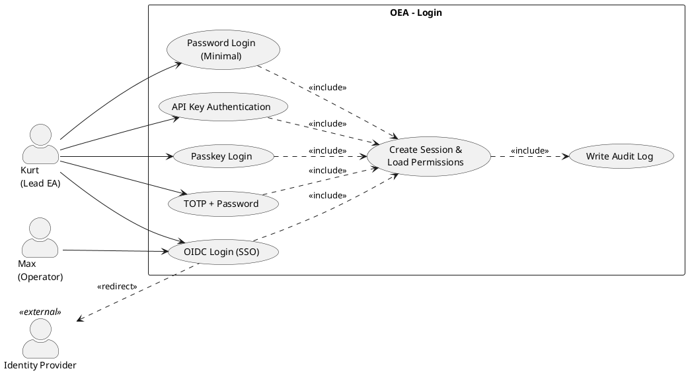

# UC-01: Login

## Diagram

## Goal in Context

Kurt manages the architecture repository via Git/Markdown, but also uses UI and API functions (see SH-03: CLI preferred, UI only for diagrams). Before he can perform any action in the repository, the system must know who he is and which role he fulfills – only then can his permissions (e.g., schema changes, plateau approvals) be assigned correctly. Login is the prerequisite for every further use case that goes beyond publicly readable content.

## Persona and Story

**Primary Actor**: [Kurt – Lead Enterprise Architect](../../business-analysis/stakeholders/SH-03-kurt-lead-enterprise-architect.md)
**Other Stakeholders**: [Max – Operator in an SME](../../business-analysis/stakeholders/SH-06-max-operator-sme.md) – Max operates the instance and decides which authentication mechanisms (SSO via OIDC vs. local authentication) are available for the organization

**Story**: As a person with a role stored in the repository, I want to log in to the system so that I can access the areas of the EA repository released for me according to my role.

## Trigger

- External cause: Kurt opens the OEA user interface or calls the API/CLI with a write or protected operation
- Timing: at the start of every work session, or when an existing session has expired
- Predecessor use case: none – login is the entry point

## Preconditions

- [ ] A [Person](../../business-objects/person.md) with a valid `email`/`externalReference` exists
- [ ] The person is assigned at least one active [Role](../../business-objects/role.md) (RoleAssignment with `validFrom <= today <= validTo`)
- [ ] At least one authentication mechanism is configured for the OEA instance (see concept §21.8): OIDC identity provider (incl. SSO), and/or local authentication (passkey, username/password optionally with TOTP)
- [ ] If the operator has enabled enforcement of a second factor during commissioning (see REQ-020): A5 (username/password without a second factor) is not usable for regular persons – this enforcement does not apply to the system admin account from UC-02
- [ ] If local authentication with passkey or TOTP is used: the person has previously registered the respective factor (enrollment, see "Out of Scope")

## Postconditions

### On Success

- A valid session/access token exists, bound to the person and their active roles
- Kurt sees the areas of the repository visible to his role(s) – the visible functional scope depends on the respective Role and is not limited to the role "Enterprise Architect" (e.g., schema management with the corresponding permission, read access for other roles)
- The audit log contains a login entry (person, timestamp, provider used)
- On the first successful login, the person's lifecycle status changes from `invited` to `active` (see [person.md](../../business-objects/person.md))

### On Failure

- No session is created
- No permissions are granted
- Kurt receives an understandable error message without revealing security-relevant details (no indication whether the email address exists)

## Basic Flow

1. **Kurt**: opens the OEA user interface or a protected API/CLI operation
2. **System**: detects a missing or expired session, redirects to the configured OIDC identity provider
3. **Kurt**: authenticates with the identity provider (e.g., with a corporate account)
4. **Identity provider**: confirms the identity, redirects back to OEA with an authorization code
5. **System**: redeems the authorization code with the identity provider, receives the identity token, and verifies its validity (by default local signature verification against the provider's JWKS; optionally additionally an online check with the IdP, e.g., token introspection, if configured for the instance)
6. **System**: matches the identity contained in the token with the [Person](../../business-objects/person.md) object in the repository and loads its active [Role](../../business-objects/role.md) assignments
7. **System**: creates a session with the corresponding permissions, confirms the successful login to Kurt and shows his role-based entry area

## Alternative Flows

**A1 – Existing valid session**: At step 2, if a valid session already exists, then:

1. System skips the redirect to the identity provider
2. System proceeds directly with the authorization check required for the operation

- Returns to step 7 (confirmation is omitted since no new login took place)

**A2 – API key authentication (machine-to-machine)**: At step 2, if the request uses an API key instead of a browser login (see concept §21.8):

1. System validates the API key directly, without redirect to the identity provider
2. System determines the person/service identity assigned to the API key and its roles

- Returns to step 6 of the basic flow

**A3 – Passkey login (local authentication, without external IdP)**: At step 2, if the OEA instance does not use an OIDC provider but local authentication with passkey (see concept §21.8):

1. System prompts Kurt for passkey authentication (WebAuthn challenge), **without prior entry of username or password** – provided the registered passkey is a discoverable credential (resident key), the authenticator itself identifies the person (FIDO2/WebAuthn standard)
2. Kurt confirms with the registered passkey (e.g., platform authenticator, security key)
3. System verifies the WebAuthn signature and determines the person via the user handle contained in the credential

- Returns to step 6 of the basic flow
- Non-discoverable credentials (non-resident keys) that require prior username entry remain possible as a fallback, but are not the recommended default case

**A4 – Username/password with TOTP (local authentication, second factor)**: At step 2, if the OEA instance uses local authentication with username/password and TOTP:

1. Kurt enters username and password
2. System checks the password hash; on success it requests the current TOTP code
3. Kurt enters the TOTP code from his authenticator app
4. System verifies the TOTP code against the person's registered secret

- Returns to step 6 of the basic flow

**A5 – Username/password without second factor (local authentication, minimal variant)**: At step 2, if the OEA instance uses local authentication without a second factor:

1. Kurt enters username and password
2. System checks the password hash

- Returns to step 6 of the basic flow
- This variant is deliberately riskier (no second factor) and is flagged accordingly in the audit log (see REQ-005)
- The operator can block this variant instance-wide for all regular persons by enabling enforcement of a second factor (see REQ-020); this block applies exclusively to regular persons, not to the system admin account from UC-02

## Exception Flows

**E1 – Identity provider rejects authentication**:

- Condition: Kurt enters wrong credentials or cancels the login at the provider
- Expected reaction: System shows a generic error message ("Login unsuccessful"), no session is created
- Resumption: Kurt can restart the login attempt (back to step 2)

**E2 – Person does not exist or is `offboarded` in the repository**:

- Condition: Identity token is valid, but no assigned active person exists in the repository
- Expected reaction: System refuses session creation, audit log records the rejected access attempt
- Resumption: Kurt must be enabled in the repository by a role with the appropriate authority (e.g., admin)

**E3 – Person has no active role assignment**:

- Condition: BR-01 from [person.md](../../business-objects/person.md) is violated (no `fillsRoles` assignment with a valid period)
- Expected reaction: Session is created, but without permissions beyond publicly readable content; Kurt receives a notice that no role is assigned
- Resumption: Kurt contacts a person with authorization to assign roles

**E4 – Identity provider unreachable**:

- Condition: Timeout or network error at steps 2–5
- Expected reaction: System shows a technical error message with a hint to retry, no session
- Resumption: Kurt retries as soon as the provider is reachable

## Data Flow

| Step | Data | Direction | Remark |
|---|---|---|---|
| 2 | Redirect URL with OIDC parameters | System → Kurt | state/nonce for CSRF protection |
| 3–4 | Credentials, authorization code | Kurt ↔ identity provider, provider → system | never in plain text through the OEA backend |
| 5 | Authorization code → identity token (access token, ID token) | System ↔ identity provider | server-to-server, TLS |
| 6 | Identity claims (e.g., email, subject ID) | System internal | matching with Person.externalReference |
| 6 | RoleAssignment query | System internal | only active assignments (validFrom/validTo) |
| 7 | Session confirmation | System → Kurt | contains no sensitive token content in the UI |

## Involved Business Objects

| Business Object | Operation | Note |
|---|---|---|
| [person](../../business-objects/person.md) | read, update | `update` if the lifecycle transition `invited → active` takes place on first login |
| [role](../../business-objects/role.md) | read | Active RoleAssignments are read to derive permissions |

## Acceptance Criteria

- [ ] Basic flow can be fully completed with a configured OIDC provider
- [ ] Preconditions (valid person, active role assignment) are checked before session creation
- [ ] Postconditions on success are met: session exists, audit log entry present, role-based entry area visible
- [ ] Alternative flows A1 (existing session) and A2 (API key) work
- [ ] If Kurt already has an active session with the configured OIDC identity provider (SSO), he is logged in without re-entering credentials
- [ ] Alternative flows A3 (passkey), A4 (username/password + TOTP) and A5 (username/password without second factor) work, provided the instance offers local authentication
- [ ] Exception flows E1–E4 are handled correctly without leaking security-relevant information (no user enumeration vector) – applies to all authentication mechanisms (OIDC, API key, passkey, local login)
- [ ] The audit log contains, for every login attempt (successful or not), at least: timestamp, mechanism used (incl. whether with/without second factor), result
- [ ] A person without an active role assignment can log in, but only gets access to publicly readable content (E3)

## Out of Scope

- Self-service registration of new persons in the identity provider (this is the task of the IdP/HR system, not of OEA)
- Management of roles and role assignments themselves (separate use case, e.g., "Manage role assignment")
- Property-level authorization on individual fields (see concept §21.8) – this concerns follow-up use cases after successful login
- Password reset for OIDC-managed accounts (lies with the identity provider)
- Enrollment/setup of passkeys, TOTP secrets or local passwords (separate use case, e.g., "Set up authentication method") – UC-01 assumes a completed registration
- Password reset for locally managed accounts (separate use case)

## Concept References

- [§21.8 Authentication/Authorization](../../concept/70-platform/21-api-architecture.md)
- [§8.2 Role](../../concept/20-entities/08-organization-roles-persons.md)
- [§8.3 Person](../../concept/20-entities/08-organization-roles-persons.md)

## Implementation Notes

- EntityTypes: `Person`, `Role`
- Relations: `RoleAssignment` (role, person, validFrom, validTo, assignmentType, percentage)
- Constraints: `person-minimum-role` (concept §8.8) – deliberately treated as a warning instead of a hard block in E3, so as not to block onboarding
- Performance notes: Login is a high-frequency, latency-critical path – role assignments should be cached, not re-resolved on every request
- Local authentication (A3–A5) requires additional data storage per person: WebAuthn public keys, TOTP secrets, password hashes – storage separate from the rest of the Person object is recommended (sensitive, not part of the business EA model)
- A5 (username/password without second factor) should be disableable/enableable instance-wide, not per person

## Realizing Components

- Requirements: [REQ-001](../req/REQ-001-oidc-login-session.md), [REQ-002](../req/REQ-002-api-key-authentication.md), [REQ-003](../req/REQ-003-access-without-role-assignment.md), [REQ-004](../req/REQ-004-reject-unknown-offboarded-person.md), [REQ-005](../req/REQ-005-audit-log-login.md), [REQ-006](../req/REQ-006-no-account-existence-disclosure.md), [REQ-007](../req/REQ-007-lifecycle-transition-invited-active.md), [REQ-008](../req/REQ-008-login-latency.md), [REQ-009](../req/REQ-009-passkey-login.md), [REQ-010](../req/REQ-010-username-password-totp.md), [REQ-011](../req/REQ-011-username-password-minimal.md), [REQ-012](../req/REQ-012-token-lifetime-local.md), [REQ-020](../req/REQ-020-enforce-second-factor.md)
- User Stories: [US-001](../user-stories/US-001-oidc-login.md), [US-002](../user-stories/US-002-api-key-auth.md), [US-003](../user-stories/US-003-access-without-role.md), [US-004](../user-stories/US-004-reject-unknown-person.md), [US-005](../user-stories/US-005-audit-log-login.md), [US-006](../user-stories/US-006-generic-error-message.md), [US-007](../user-stories/US-007-lifecycle-invited-active.md), [US-008](../user-stories/US-008-login-latency.md), [US-009](../user-stories/US-009-passkey-login.md), [US-010](../user-stories/US-010-totp-login.md), [US-011](../user-stories/US-011-password-minimal.md), [US-012](../user-stories/US-012-token-lifetime-configurable.md)
- ADRs: [ADR-006](../../adrs/ADR-006-auth-stack-choice.md) (Entra ID + Authentik mandatory, local auth optional)
- Test Cases: none yet
- Implementation: none yet

## Open Questions

- [x] Which concrete identity provider/auth stack is used? → decided in [ADR-006](../../adrs/ADR-006-auth-stack-choice.md): Entra ID + Authentik mandatory, local auth optional
- [ ] Which local authentication mechanism (passkey, TOTP, or only username/password) is implemented first for the walking skeleton, if not all at the same time?
- [x] Bootstrapping use case for the initial system admin access → see [UC-02: System Admin Bootstrapping](./UC-02-system-admin-bootstrapping.md)
- [x] How long is a session valid, and how is refresh handled? → with an external IdP, the IdP dictates the lifetime (REQ-001, AC4); with local authentication it is configurable instance-wide (REQ-012)
- [ ] Should the minimal variant A5 (username/password without second factor) be disabled by default and have to be deliberately enabled by a role with admin authority?
- [ ] Should the optional online token validation against the IdP (REQ-001) be configurable instance-wide, or per role/permission level (e.g., mandatory only for `admin` operations)?
- [ ] Which WebAuthn authenticator requirements are assumed for discoverable credentials (e.g., only platform authenticator, or also external security keys)?
- [ ] How is the fallback from passkey (A3) to TOTP (A4) or the minimal variant (A5) handled when a person does not use a WebAuthn-capable client?

## Notes

Login was deliberately formulated in a goal-oriented way ("gain access according to role"), not as a technical OIDC redirect flow, even though the basic flow describes the standard OIDC case. The primary actor is SH-03 (Kurt), because in the single-user SME scenario he is the toughest test case for self-hosting suitability without a dedicated IdP team.

Local authentication (passkey, TOTP, username/password) was added as an optional alternative to OIDC, because SH-06 (Max, SME operator) explicitly names own user management without SSO as a rejection reason – conversely, the tool must not necessarily require an external IdP either. Concept §21.8 was extended accordingly (see `concept/CHANGELOG.md` v0.16).

## Change History

| Version | Date | Author | Change |
|---|---|---|---|
| 0.1.0 | 2026-06-24 | Requirements Engineer | Initial draft |
| 0.2.0 | 2026-06-24 | Requirements Engineer | Added SSO acceptance criterion and SH-06 reference; added alternative flows A3 (passkey), A4 (username/password + TOTP), A5 (username/password without second factor) as optional local authentication |
| 0.3.0 | 2026-06-24 | Requirements Engineer | Refined A3 (passkey) with discoverable-credential/usernameless flow; added optional online token validation against the IdP (step 5) |
| 0.4.0 | 2026-06-24 | Requirements Engineer | Linked ADR-006 (auth stack choice: Entra ID + Authentik mandatory, local auth optional, system admin local/remote); clarified token lifetime (external: dictated by IdP, local: configurable, REQ-012) |
| 0.4.1 | 2026-06-24 | Requirements Engineer | Clarification in postconditions: login and visible functional scope concern all roles, not only "Enterprise Architect" |
| 0.5.0 | 2026-06-24 | Requirements Engineer | Added REQ-020: instance-wide enforcement of a second factor for regular persons, explicitly excluding the system admin account from UC-02 |
