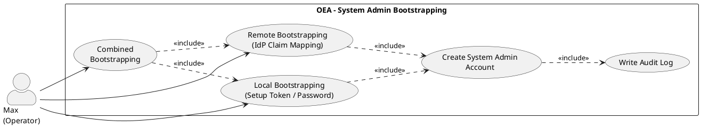

# UC-02: System Admin Bootstrapping

## Diagram

## Goal in Context

A freshly installed OEA instance contains neither persons nor roles nor an IdP configuration. UC-01 (Login) requires that a [Person](../../business-objects/person.md) with an active [Role](../../business-objects/role.md) already exists – by definition this is not the case at initial installation (chicken-and-egg problem). Max therefore needs to obtain a first privileged access before he can configure the instance for actual operation (IdP connection, first persons/roles).

## Persona and Story

**Primary Actor**: [Max – Operator in an SME](../../business-analysis/stakeholders/SH-06-max-operator-sme.md)
**Other Stakeholders**: [Kurt – Lead Enterprise Architect](../../business-analysis/stakeholders/SH-03-kurt-lead-enterprise-architect.md) – in the single-user SME scenario, Max is often Kurt himself

**Story**: As the operator of a freshly installed OEA instance, I want to obtain a first privileged access so that I can configure the instance without persons or roles having to exist in the repository already.

## Trigger

- External cause: Initial installation of an OEA instance (e.g., container start)
- Timing: once per instance, immediately after installation
- Predecessor use case: none – bootstrapping is the entry point before UC-01

## Preconditions

- [ ] The OEA instance is freshly installed
- [ ] No [System Admin Account](../../business-objects/system-admin-account.md) exists yet for this instance
- [ ] No [Person](../../business-objects/person.md)/[Role](../../business-objects/role.md) data exist yet through which a regular login (UC-01) would be possible

## Postconditions

### On Success

- A [System Admin Account](../../business-objects/system-admin-account.md) exists (local or remote-mapped, see [ADR-006](../../adrs/ADR-006-auth-stack-choice.md))
- Max can log in with this account and continue configuring the instance (set up IdP, create first Person/Role)
- The audit log contains an entry about the completed bootstrapping process
- A repeated bootstrapping process is no longer possible for this instance without explicitly resetting the existing system admin account (see E3)

### On Failure

- No system admin account is created
- The instance remains in the state "not administrable"
- Max receives an understandable error message

## Basic Flow

1. **Max**: starts the OEA instance for the first time
2. **System**: detects that no system admin account exists and initiates the bootstrapping process (e.g., setup wizard in the UI or CLI command)
3. **Max**: selects the bootstrapping mode **local** (default case without external IdP)
4. **System**: generates a one-time setup token or prompts Max to set an initial admin password
5. **Max**: retrieves the setup token (e.g., from CLI output/log) or sets the initial password
6. **System**: creates the local system admin account, marks the bootstrapping as completed and writes an audit log entry
7. **Max**: logs in with the system admin account and starts further configuration of the instance (IdP connection, first Person/Role)

## Alternative Flows

**A1 – Remote bootstrapping (system admin via external IdP)**: At step 3, if Max selects the mode **remote** (see ADR-006):
1. Max configures the OIDC provider (Entra ID or Authentik) for the instance
2. Max defines which group/role claim of the IdP grants system admin rights (e.g., Entra ID group `oea-system-admins`)
3. System stores this mapping as a [System Admin Account](../../business-objects/system-admin-account.md) with `mode: remote`
4. Max logs in via the configured IdP; if the identity token contains the configured claim, the session receives system admin rights
- Returns to step 7 of the basic flow

**A2 – Combined bootstrapping**: Max first sets up locally (basic flow), then additionally configures remote mapping (A1) as a second, parallel access
- Both accesses remain usable until one of them is deliberately deactivated (see `system-admin-account.md`, Business Rule BR-02)

## Exception Flows

**E1 – Setup token/password lost or process aborted**:
- Condition: Max does not complete the bootstrapping process or loses the setup token before the first login
- Expected reaction: As long as no system admin account has been finally created, the process can be restarted (back to step 2)
- Resumption: Max restarts the bootstrapping process via CLI/setup wizard

**E2 – Remote mapping points to a non-existent or empty group**:
- Condition: The configured claim (A1, step 2) does not correspond to an actually populated group at the IdP
- Expected reaction: Nobody receives system admin rights via this path; the system already warns at configuration time if the group is verifiably empty at that time
- Resumption: Max corrects the mapping or alternatively uses the local mode (basic flow) so as not to be locked out

**E3 – Repeated bootstrapping attempt despite existing system admin account**:
- Condition: A system admin account already exists for the instance
- Expected reaction: System refuses repeated bootstrapping without an explicit reset action by an existing system admin account
- Resumption: Max logs in with the existing account and deliberately resets the bootstrapping if needed

**E4 – Neither local access nor remote mapping usable anymore (complete lockout)**:
- Condition: Password/setup token lost and IdP mapping no longer valid (e.g., group deleted)
- Expected reaction: System offers no regular self-service way back into the instance; a documented recovery procedure (e.g., CLI command with access to the server/database) is necessary
- Resumption: outside the scope of this use case (see "Open Questions")

## Data Flow

| Step | Data | Direction | Remark |
|---|---|---|---|
| 4 | Setup token or initial password | System → Max | one-time, never persisted in plain text |
| 5 | Confirmed credential | Max → System | is stored hashed immediately |
| 6 | System admin account record | System internal | see [system-admin-account](../../business-objects/system-admin-account.md) |
| 6 | Audit log entry | System internal | timestamp, mode (local/remote), result |
| A1.2 | Claim mapping configuration | Max → System | provider, claimType, claimValue |

## Involved Business Objects

| Business Object | Operation | Note |
|---|---|---|
| [system-admin-account](../../business-objects/system-admin-account.md) | create | once per instance in the basic flow, possibly one more time in A2 |

## Acceptance Criteria

- [ ] Basic flow (local bootstrapping) can be fully completed on a freshly installed instance
- [ ] Alternative A1 (remote bootstrapping via Entra ID or Authentik) works
- [ ] Alternative A2 (combined bootstrapping) allows both accesses in parallel
- [ ] A second bootstrapping attempt is rejected as long as a system admin account exists (E3)
- [ ] Exception flows E1–E4 are handled as documented; E4 refers to a separate recovery procedure
- [ ] The audit log contains an entry about the completed bootstrapping process including the selected mode
- [ ] After successful bootstrapping, a regular login according to UC-01 is possible for further persons as soon as they have been created with a role

An instance-wide enforcement of a second factor for regular persons (see [REQ-020](../req/REQ-020-enforce-second-factor.md), UC-01) explicitly does **not** apply to the system admin account: bootstrapping must work even if the operator has enforced 2FA for regular persons, since the system admin account lies outside the regular Person/Role model and is secured through its own mechanisms (REQ-017, secure setup token handover).

## Out of Scope

- Regular login of existing persons with a role (see UC-01)
- Creating the first business Person/Role records in the repository (separate, subsequent use case)
- Complete recovery/break-glass procedure for complete lockout (E4) – only noted as an open question
- Management of multiple simultaneous system admin accounts beyond the minimum (A2 covers the simple case, no full admin management)

## Concept References

- [§21.8 Security and Authorization](../../concept/70-platform/21-api-architecture.md)

## Implementation Notes

- EntityTypes: `SystemAdminAccount` (see `system-admin-account.md`) – deliberately not an EA metamodel entity
- Setup token handover should take place via a channel only the operator has access to (CLI output at first start, not via the web UI without prior authentication)
- Detection of "no system admin account present" must be robust against race conditions (BR-01 from `system-admin-account.md`: no parallel bootstrapping)
- The local system admin account should be deactivatable according to the ADR-006 follow-up decision as soon as remote mapping is active

## Realizing Components

- Requirements: [REQ-013](../req/REQ-013-local-bootstrapping.md), [REQ-014](../req/REQ-014-remote-bootstrapping.md), [REQ-015](../req/REQ-015-no-parallel-bootstrapping.md), [REQ-016](../req/REQ-016-audit-log-bootstrapping.md), [REQ-017](../req/REQ-017-secure-setup-token-handover.md), [REQ-018](../req/REQ-018-warning-empty-admin-claim.md), [REQ-019](../req/REQ-019-disable-local-admin.md)
- User Stories: [US-013](../user-stories/US-013-local-bootstrapping.md), [US-014](../user-stories/US-014-remote-bootstrapping.md), [US-015](../user-stories/US-015-no-parallel-bootstrapping.md), [US-016](../user-stories/US-016-audit-log-bootstrapping.md), [US-017](../user-stories/US-017-secure-setup-token-handover.md), [US-018](../user-stories/US-018-warning-empty-admin-claim.md), [US-019](../user-stories/US-019-disable-local-admin.md)
- ADRs: [ADR-006](../../adrs/ADR-006-auth-stack-choice.md)
- Test Cases: none yet
- Implementation: none yet

## Open Questions

- [ ] How is the initial setup token handed over securely (CLI stdout, temporary file, one-time setup URL)?
- [ ] What does the recovery/break-glass procedure for complete lockout (E4) look like concretely – e.g., a CLI command with direct database access?
- [x] Should the instance actively warn/block at startup if the local system admin account was not deactivated despite active remote mapping? → [REQ-019](../req/REQ-019-disable-local-admin.md): deactivatable, but not mandatory (operator decision)
- [x] How is it verified whether a configured IdP group (A1) is actually populated at configuration time? → [REQ-018](../req/REQ-018-warning-empty-admin-claim.md): best-effort warning, no hard block

## Notes

UC-02 closes the gap named as a follow-up decision in [ADR-006](../../adrs/ADR-006-auth-stack-choice.md): UC-01 (Login) presupposes already existing Person/Role data and therefore cannot solve the chicken-and-egg problem of initial installation. The primary actor is SH-06 (Max), because bootstrapping is an operator activity, not that of an EA persona – even though in the single-user SME case (SH-03 Kurt) both roles coincide in the same person.

## Change History

| Version | Date | Author | Change |
|---|---|---|---|
| 0.1.0 | 2026-06-24 | Requirements Engineer | Initial draft, resolves follow-up decision from ADR-006 |
