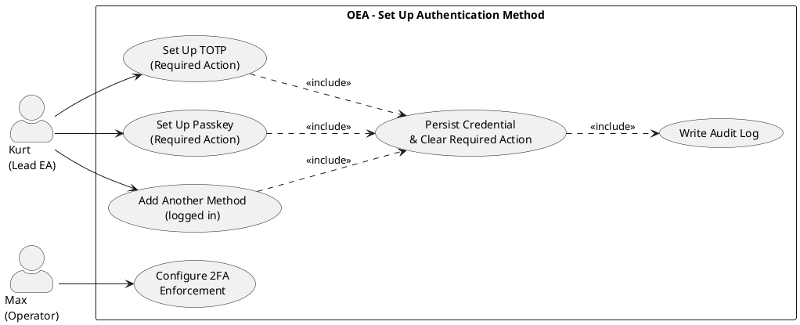

# UC-03: Set Up Authentication Method (Required Action at First Login)

## Diagram

## Goal in Context

Instances without an external identity provider use local authentication (username/password, optionally with a second factor). The administrator creates a person and sets an initial password. At first login, the system detects which "required actions" are still pending: if 2FA is enforced instance-wide (REQ-020) and no second factor has been set up yet, the person is redirected directly to the setup page – they get no access to the application until the required action is completed. If 2FA is not enforced, UC-03 is omitted entirely; the login (UC-01 A5) grants access directly.

## Persona and Story

**Primary Actor**: [Kurt – Lead Enterprise Architect](../../business-analysis/stakeholders/SH-03-kurt-lead-enterprise-architect.md)
**Other Stakeholders**: [Max – Operator in an SME](../../business-analysis/stakeholders/SH-06-max-operator-sme.md) – Max configures whether 2FA is enforced and which local methods are available

**Story**: As a person logging in for the first time with my initial password, I want to set up a second factor as part of the login so that I subsequently get full access according to my role.

## Trigger

- System-internal cause: After successful password verification, UC-01 detects that a required action is pending (2FA enforced, but no `LocalCredential` of type `totp` or `passkey` present yet)
- Timing: at the first login after the person was created by an administrator; or after an admin reset of the required actions
- Predecessor use case: UC-01 (Login, steps 1–2 of the basic flow A5 have already been executed)

## Preconditions

- [ ] A [Person](../../business-objects/person.md) with lifecycle status `invited` exists in the system
- [ ] The administrator has set an initial password for the person (REQ-024); the person knows this password
- [ ] The OEA instance has enabled 2FA enforcement (REQ-020) and has activated at least one 2FA method (TOTP or passkey)
- [ ] The person does not yet have an active [LocalCredential](../../business-objects/local-credential.md) of type `totp` or `passkey`

## Postconditions

### On Success

- A new [LocalCredential](../../business-objects/local-credential.md) (TOTP secret or passkey public key) is persisted and linked to the person
- The required-action flag "2FA setup" is cleared for the person
- The audit log contains an entry: person ID, timestamp, method set up
- The system now grants Kurt full access (session with permissions according to roles)
- The person's lifecycle status changes from `invited` to `active` (first successful login completion)

### On Failure

- No credential is persisted
- The required-action flag remains set
- Kurt receives no session; he can try again or close the browser

## Basic Flow

*Default case: TOTP setup as a required action, triggered by first login*

1. **Kurt**: enters username and initial password in the login form (UC-01 A5, steps 1–2)
2. **System**: validates the password; determines that the required action "2FA setup" is pending; redirects Kurt to the setup page – without a session and without access to the application
3. **Kurt**: selects TOTP as the method (or the system shows TOTP directly if it is the only available method)
4. **System**: generates a new TOTP secret, displays it as a QR code (`otpauth://` URI format) and in plain text for manual entry
5. **Kurt**: scans the QR code with an authenticator app and enters the currently displayed 6-digit code for verification
6. **System**: verifies the code against the secret (time tolerance ±1 window of 30 s); on success it persists the secret encrypted, clears the required-action flag, writes an audit log entry
7. **System**: creates the session with Kurt's permissions, redirects him to the role-based entry area; lifecycle transition `invited → active`

## Alternative Flows

**A1 – Passkey as required action**: At step 3, if Kurt selects passkey (or the instance has only activated passkey):
1. System starts the WebAuthn registration challenge
2. Kurt confirms with a compatible authenticator
3. System verifies the registration response, persists public key and credential ID
- Returns to step 6 (clear required-action flag, create session)

**A2 – 2FA not enforced**: If REQ-020 is inactive:
- UC-03 is not triggered; UC-01 A5 grants access directly after password verification
- Kurt optionally sets up a further method via his profile settings (A3)

**A3 – Additional method for an already logged-in person**: If Kurt is already authenticated and wants to set up an additional local method:
1. Kurt navigates to the security settings of his profile
2. System shows available methods that have not been set up yet
3. Method-specific flow as in the basic flow (TOTP) or A1 (passkey); no required-action context
4. System persists the new method; session remains active

## Exception Flows

**E1 – TOTP verification fails**:
- Condition: Kurt enters a wrong or expired code (step 5)
- Expected reaction: System shows an error message, no secret is persisted; required-action flag remains set
- Resumption: Kurt enters the next code; the setup page remains open

**E2 – Passkey registration fails**:
- Condition: Kurt cancels the authenticator confirmation or the authenticator reports an error
- Expected reaction: System shows a generic error message, no credential persisted; required-action flag remains set
- Resumption: Kurt can try again or switch to TOTP (if available)

**E3 – Kurt cancels the required action**:
- Condition: Kurt closes the browser or explicitly cancels the setup
- Expected reaction: no session, no credential; at the next login attempt UC-03 starts over
- Resumption: Kurt logs in again

## Data Flow

| Step | Data | Direction | Remark |
|---|---|---|---|
| 1–2 | Username, plain-text password | Kurt → System | Password only for verification, never persisted |
| 2 | Required-action status | System internal | Flag query after password verification |
| 4 (TOTP) | TOTP secret, QR code URI | System → Kurt | Show secret only once |
| 5 (TOTP) | Verification code (6 digits) | Kurt → System | |
| A1 (passkey) | WebAuthn challenge, RP ID, user handle | System → Kurt | |
| A1 (passkey) | Public key, credential ID, attestation | Kurt → System | Private key never leaves the authenticator |
| 6 | Credential persistence, flag clearing, audit log | System internal | Store credentials separately from the Person object |
| 7 | Session token | System → Kurt | |

## Involved Business Objects

| Business Object | Operation | Note |
|---|---|---|
| [person](../../business-objects/person.md) | read, update | Lifecycle transition `invited → active` on completion; read/clear required-action flag |
| [local-credential](../../business-objects/local-credential.md) | create | TOTP secret (encrypted) or passkey public key is created and linked to the person |

## Acceptance Criteria

- [ ] Basic flow (TOTP as required action at first login) can be fully completed
- [ ] A1 (passkey as required action) works; passkey login (UC-01 A3) is possible afterwards
- [ ] A2 (2FA not enforced): UC-03 is not triggered; login (UC-01 A5) grants access directly
- [ ] A3 (additional method in profile settings) works without required-action context
- [ ] Without a completed required action, Kurt receives no session (no partial access)
- [ ] E1 (TOTP error): error message, no credential, required-action flag remains set
- [ ] E2 (passkey error): error message, no credential, required-action flag remains set
- [ ] After completion, the audit log contains: person ID, timestamp, method set up (`totp` or `passkey`)
- [ ] The TOTP secret does not appear in server logs
- [ ] After the required action is completed, login with the new method (UC-01 A3/A4) is possible

## Out of Scope

- Enrollment via a separate invitation link (deliberately rejected; see REQ-021 `rejected`)
- Creating the person and setting the initial password by the administrator (separate UC; REQ-024 models the password hashing)
- Password reset for locally managed accounts (separate use case)
- Management (display, deletion) of already registered methods (separate use case)
- Recovery codes on complete loss of methods (separate use case / break-glass procedure)
- Enrollment for the system admin account (UC-02)
- OIDC account linking (person already has `externalReference`; no enrollment needed)

## Concept References

- [§21.8 Authentication/Authorization – Local Authentication](../../concept/70-platform/21-api-architecture.md)
- [§8.3 Person](../../concept/20-entities/08-organization-roles-persons.md)

## Implementation Notes

- Required-action mechanism: after successful password verification (UC-01 A5), the system checks whether open required actions exist; the session is created only after their completion (no early session grant)
- TOTP: RFC 6238, 30-second window, SHA-1; persist secret AES-256-GCM-encrypted
- Passkey: WebAuthn Level 2, `attestation: none` as default; prefer discoverable credentials
- EntityTypes: `Person` (required-action flag), `LocalCredential` (result)
- A3 (profile settings): CSRF protection via SameSite=Strict cookie; same enrollment logic as the basic flow, only a different auth gate

## Realizing Components

- Requirements: [REQ-022](../req/REQ-022-totp-enrollment.md), [REQ-023](../req/REQ-023-passkey-enrollment.md), [REQ-024](../req/REQ-024-initial-password-admin.md), [REQ-025](../req/REQ-025-audit-log-enrollment.md), [REQ-026](../req/REQ-026-additional-method-authenticated-person.md)
- User Stories: [US-021](../user-stories/US-021-totp-enrollment.md), [US-022](../user-stories/US-022-passkey-enrollment.md), [US-023](../user-stories/US-023-initial-password-admin.md), [US-024](../user-stories/US-024-audit-log-enrollment.md), [US-025](../user-stories/US-025-additional-method-logged-in-person.md)
- Rejected: [REQ-021](../req/REQ-021-enrollment-token-validation.md) (`rejected`), [US-020](../user-stories/US-020-enrollment-entry-invitation-link.md) (`rejected`)
- ADRs: [ADR-006](../../adrs/ADR-006-auth-stack-choice.md) (local auth as an option)
- Test Cases: none yet
- Implementation: none yet

## Open Questions

- [x] Which business object models the local credentials? → [local-credential](../../business-objects/local-credential.md)
- [x] Should a user be able to register multiple passkeys? → Yes (BR-02 in `local-credential.md`)
- [x] Enrollment via invitation link or at first login? → First-login required action (2026-06-25); invitation link approach rejected
- [ ] Does the minimal passkey setup in the walking skeleton support only discoverable credentials, or also non-resident ones?
- [ ] Required-action flag: as an additional attribute in the Person object (`requiredActions: [totp_setup]`) or as a separate table?

## Notes

v0.2.0: Fundamental architectural decision revised. The original enrollment token approach (v0.1.0) was rejected because it would have required a separate link delivery mechanism (email or similar). Just-in-time enrollment as a required action at first login is the industry standard (Keycloak, Authentik, AWS IAM) and needs no additional infrastructure. The OIDC path (UC-01 basic flow) is unaffected; UC-03 concerns local authentication exclusively.

## Change History

| Version | Date | Author | Change |
|---|---|---|---|
| 0.1.0 | 2026-06-25 | Requirements Engineer | Initial draft (enrollment via invitation link) |
| 0.2.0 | 2026-06-25 | Requirements Engineer | Architecture revision: enrollment token approach rejected; required action at first login as new basic flow |
