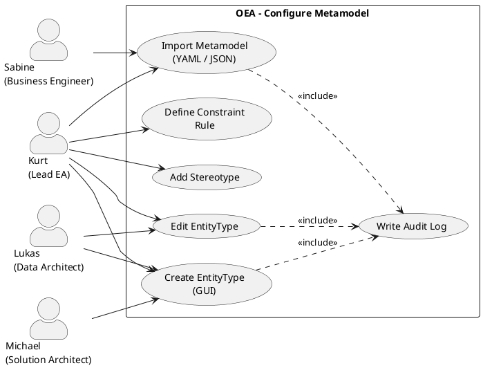

# UC-04: Configure Metamodel Collaboratively

## Diagram

## Goal in Context

Before architects can capture entities in the repository, the architecture team must define which types of entities and relations can be modeled in their organization at all. OEA delivers a TOGAF-based core metamodel (§6), which however has to be extended organization-specifically: industry specifics, proprietary platform types or internal governance requirements call for custom EntityTypes, stereotypes and constraint rules. This use case enables the architecture team to perform this configuration jointly, iteratively and without code deployment – either via the GUI or by file import.

## Persona and Story

**Primary Actor**: [Kurt – Lead Enterprise Architect](../../business-analysis/stakeholders/SH-03-kurt-lead-enterprise-architect.md)
**Other Stakeholders**: [Lukas – Senior Data Architect](../../business-analysis/stakeholders/SH-02-lukas-senior-data-architect.md), [Michael – Solution Architect](../../business-analysis/stakeholders/SH-04-michael-solution-architect.md), [Sabine – Business Engineer](../../business-analysis/stakeholders/SH-07-sabine-business-engineer.md)

**Story**: As a Lead Enterprise Architect, I want to configure our organization's metamodel together with my architecture team so that all architects can capture entities according to a uniform, organization-specific schema.

## Trigger

- Initial setup of an OEA instance: the TOGAF core metamodel must be extended organization-specifically
- New requirements (e.g., ISO 27001 introduces `SecurityZone` as a necessary type)
- Import of a prepared metamodel from an external tool or a template
- Iteration: an existing EntityType is extended by properties; a new stereotype is added

## Preconditions

- [ ] Kurt is logged in (UC-01) and has the role "Metamodel Editor" or a role with the corresponding permission
- [ ] An OEA instance exists with an initial (possibly empty) [MetamodelConfiguration](../../business-objects/metamodel-configuration.md)
- [ ] The TOGAF core metamodel (built-in EntityTypes, §6) is always present and visible

## Postconditions

### On Success

- The instance's [MetamodelConfiguration](../../business-objects/metamodel-configuration.md) is updated with the new/changed entry
- `lastModifiedBy` and `lastModifiedAt` are set to Kurt
- Audit log entry: person ID, timestamp, kind of change (create/update/delete EntityType/stereotype/constraint), affected element
- The new configuration takes effect immediately: the new types are available when creating new entities

### On Failure

- Configuration remains unchanged
- Error with a concrete message (e.g., "Name 'ApplicationComponent' already taken (built-in)")

## Basic Flow

*Default case: Kurt creates a new custom EntityType via the GUI.*

1. **Kurt**: navigates to the metamodel configuration (admin or architecture area)
2. **System**: shows all EntityTypes (built-in + custom) in a clear list; built-in marked as read-only
3. **Kurt**: clicks "New EntityType"
4. **System**: opens a form with fields: name (PascalCase), optional base type (dropdown of existing types), description
5. **Kurt**: fills in the form (e.g., name: `SecurityZone`, base type: none, description: "Logical network zone with trust level")
6. **Kurt**: adds properties (name, type, mandatory field yes/no; for enum: specify values); adds relations (target type, cardinality)
7. **Kurt**: saves
8. **System**: validates (name unique, base type valid, cardinality format correct); on success it persists the new EntityType, writes an audit log, shows a confirmation

## Alternative Flows

**A1 – Import from file**:
If Kurt has an existing metamodel definition as a file:

1. Kurt selects "Import"
2. System shows an import dialog with format selection (YAML, JSON)
3. Kurt uploads the file
4. System parses and validates the file: checks schema conformity, name conflicts with existing types, referential integrity (every `extends` value must be a valid type)
5. System shows a preview: newly added types (green), conflicts (red)
6. Kurt confirms or cancels
7. On confirmation: System imports all conflict-free types; audit log entry for each imported entry

**A2 – Add stereotype**:

1. Kurt selects an existing EntityType (built-in or custom)
2. Kurt selects "Add stereotype"
3. Form: stereotype name (PascalCase), additional properties
4. System saves the stereotype and links it to the base type

**A3 – Define constraint rule**:

1. Kurt selects an EntityType and opens "Constraint rules"
2. Kurt defines: rule name, expression (rule expression), severity (hint/warning/error), error message
3. System saves the rule; it is applied at the next validation

**A4 – Edit existing EntityType**:
Only custom EntityTypes (not built-in) can be edited:

1. Kurt selects the EntityType
2. Kurt changes description, properties or relations
3. System checks whether existing entities would become invalid due to the change (e.g., mandatory field added → warning, no blocking)
4. System saves and writes an audit log

**A5 – Another architect makes changes**:
Lukas (SH-02) also has the Metamodel Editor role:

- Identical flow to the basic flow or A1–A4
- All changes are attributed to Lukas in the audit log
- Simultaneous editing of the same EntityType: last-write-wins with a warning on collision (optimistic locking)

## Exception Flows

**E1 – Name already taken**:

- Condition: Kurt tries to create an EntityType with a name that already exists (built-in or custom)
- Expected reaction: Validation error "Name 'X' is already taken (built-in/custom)"; form remains open
- Resumption: Kurt chooses a different name

**E2 – Base type does not exist**:

- Condition: During import, an `extends` reference contains an unknown type
- Expected reaction: Import preview marks the entry as an error; import confirmation not possible without resolving this conflict
- Resumption: Kurt corrects the file or imports without the faulty entries (partial import)

**E3 – Custom EntityType is used by existing entities**:

- Condition: Kurt tries to delete a custom EntityType to which entities in the repository are still assigned
- Expected reaction: Error message with the number of affected entities; deletion blocked
- Resumption: Kurt first deletes the affected entities or archives them

**E4 – Missing permission**:

- Condition: A person without the Metamodel Editor role tries to make a change
- Expected reaction: 403 Forbidden; audit log entry for unauthorized access attempt
- Resumption: No access; the person contacts the admin

## Data Flow

| Step | Data | Direction | Remark |
|---|---|---|---|
| 2 | EntityType list (built-in + custom) | System → Kurt | Built-in marked as read-only |
| 5–6 | EntityType definition (name, properties, relations) | Kurt → System | |
| 8 | Validation result, persisted configuration | System internal | |
| A1.3 | YAML/JSON file | Kurt → System | Max. file size TBD |
| A1.5 | Import preview (diff) | System → Kurt | |

## Involved Business Objects

| Business Object | Operation | Note |
|---|---|---|
| [metamodel-configuration](../../business-objects/metamodel-configuration.md) | read, update | Core object: EntityTypeDefinitions, Stereotypes, ConstraintRules |
| [person](../../business-objects/person.md) | read | Authentication; `lastModifiedBy` references Person |
| [role](../../business-objects/role.md) | read | Permission check: Metamodel Editor role |

## Acceptance Criteria

- [ ] Basic flow: A new custom EntityType (with properties and relations) can be created via the GUI
- [ ] Built-in EntityTypes are visible but not deletable/modifiable (E1, BR-02)
- [ ] A1: YAML import with preview diff works; conflicts are detected and displayed
- [ ] A2: Stereotype can be added to an existing type
- [ ] A3: Constraint rule definable with severity; with severity=error it blocks saving of invalid entities
- [ ] A4: Custom EntityType is editable; warning on potentially breaking changes
- [ ] A5: Multiple architects with the Metamodel Editor role can make changes; the audit log attributes each change to the correct person
- [ ] E1: Name collision rejected with a concrete error message
- [ ] E3: Deleting an occupied EntityType is blocked; number of affected entities displayed
- [ ] After every change, the audit log contains: person ID, timestamp, kind of change, affected element

## Out of Scope

- Real-time collaborative editing (simultaneous typing by several persons in the same form); last-write-wins with collision warning is sufficient (A5)
- ArchiMate XMI import (separate decision; YAML/JSON is the primary import path)
- Versioning/rollback of the metamodel configuration (separate use case)
- Metamodel export (separate use case)
- Validation of existing entities when adding a new constraint rule (batch validation is a separate use case)
- Migration of existing entities on breaking changes (§15 Schema Evolution is a separate mechanism)

## Concept References

- [§6 Core Entity Types](../../concept/20-entities/06-core-entity-types.md)
- [§14 Extensibility – Custom EntityTypes, Stereotypes, Constraint Rules](../../concept/40-extensibility/14-extensibility.md)
- [§15 Schema Evolution](../../concept/40-extensibility/15-schema-evolution.md)

## Implementation Notes

- Built-in EntityTypes: managed in the backend as a code constant (not in the DB); the API returns them together with custom types (union)
- Optimistic locking: increment `MetamodelConfiguration.schemaVersion` on every change; conflict detected if the version differs on save
- Import validation: separate function (input: file content → output: diff list + error list); transactional import (all or nothing, or partial with explicit user choice)
- Rule expression for ConstraintRules: initially simple property null checks (MVP); more complex expressions (cross-entity) as an extension

## Realizing Components

- Requirements: [REQ-032](../req/REQ-032-entitytype-gui-configuration.md), [REQ-033](../req/REQ-033-metamodel-import.md), [REQ-034](../req/REQ-034-audit-log-metamodel.md)
- User Stories: [US-032](../user-stories/US-032-create-entitytype.md), [US-033](../user-stories/US-033-import-metamodel.md), [US-034](../user-stories/US-034-audit-log-metamodel.md)
- ADRs: –
- Test Cases: none yet
- Implementation: none yet

## Open Questions

- [ ] Which role authorizes metamodel editing? A separate "Metamodel Editor" role or a property of the "Lead Architect" role?
- [ ] Partial import: Should the user be able to choose which entries of a conflicting file are imported (checkbox per entry), or is it all-or-nothing?
- [ ] Constraint expression language: Which syntax for rule expressions? Own DSL, JSONPath, or CEL (Common Expression Language)?

## Notes

UC-04 is deliberately set to `target_release: v1.0` (not walking skeleton), since the metamodel configuration is needed early but can be bridged in the walking skeleton by static configuration. The walking skeleton works with the built-in TOGAF types without custom EntityTypes.

## Change History

| Version | Date | Author | Change |
|---|---|---|---|
| 0.1.0 | 2026-06-25 | Requirements Engineer | Initial draft |
