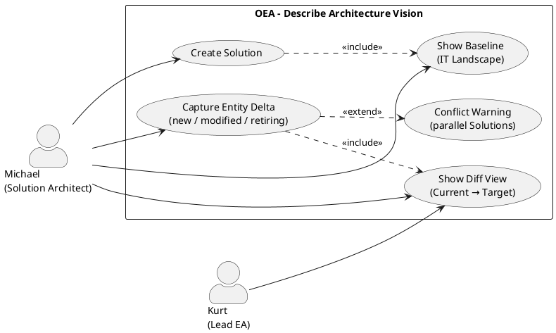

# UC-05: Describe the Architecture Vision of a Change Initiative

## Diagram

## Goal in Context

When a company wants to extend or change an existing solution – introduce a new module, replace an interface, migrate a platform – the solution architect must clarify early: What is the exact scope of this initiative? Which system parts are affected, which are not? Which target state is to be achieved?

OEA solves this problem by having the solution architect create a **Solution** for a change initiative and describe the **architecture vision** in it: the current state of the affected system landscape as well as the planned changes (new entities, modifications, decommissionings). The result is a machine-readable scope delimitation that serves as a basis for reviews, approvals and go-live decisions.

## Persona and Story

**Primary Actor**: [Michael – Solution Architect](../../business-analysis/stakeholders/SH-04-michael-solution-architect.md)
**Other Stakeholders**: [Kurt – Lead Enterprise Architect](../../business-analysis/stakeholders/SH-03-kurt-lead-enterprise-architect.md) (approval, not part of this UC)

**Story**: As a solution architect, I want to create an architecture for a planned change initiative in which I depict the current state of the affected systems and describe the planned changes – so that the scope is clearly delimited, all stakeholders have the same picture and a review is possible.

## Trigger

- A project or initiative is planned that extends, replaces or newly introduces existing systems
- Michael is commissioned to describe the architecture of a specific solution
- An existing solution draft is to be elaborated in content (scope still unclear)

## Preconditions

- [ ] Michael is logged in (UC-01) and has the role "Solution Architect" or a role with the corresponding permission
- [ ] In project mode: at least a basic understanding of the existing IT landscape is available (implemented solutions or manual baseline data)
- [ ] In plateau mode (alternative A1): a baseline plateau with status=`baseline` exists

## Postconditions

### On Success

- A [Solution](../../business-objects/solution.md) exists with status=`draft`
- The solution contains an architecture vision text (name + description: goal, scope, rationale)
- All EntityDeltas are captured (deltaType=`new`, `modified` or `retiring`)
- The diff view contrasts the current state (affected entities from the landscape) with the target state (after applying the deltas)
- `ownerId` of the solution is set to Michael; `createdAt` and `createdBy` are set

### On Failure

- No new object was persisted (or the existing one remains unchanged)
- Error message with a concrete hint (e.g., missing permission, validation error)

## Basic Flow

*Default case: Michael creates a new solution and describes the architecture vision in project mode (SME)*

1. **Michael**: navigates to the solution overview
2. **System**: shows all existing solutions with status and owner
3. **Michael**: clicks "Create new solution"
4. **System**: opens a creation form with fields:
   - Name (e.g., "ERP Extension Logistics Module")
   - Description / architecture vision (free text: goal of the initiative, what is changed and why)
5. **Michael**: fills in the form and saves
6. **System**: creates the solution in status `draft`; Michael is `ownerId`
7. **System**: shows the solution detail view; section "Architecture Vision & Scope"
8. **System**: shows the **current state** of the IT landscape as the baseline:
   - Project mode: all entities from `implemented` solutions, aggregated by entity ID
   - Searchable, filterable by entity type and name
9. **Michael**: identifies the affected entities and captures the **planned changes** as EntityDeltas:
   - a. **Entity is modified**: Michael selects an existing entity → "Capture change" → describes changed properties → `deltaType=modified`
   - b. **Entity is decommissioned**: Michael selects an existing entity → "Decommission" → `deltaType=retiring`
   - c. **New entity arises**: Michael clicks "New entity" → specifies type, name and properties → `deltaType=new`
10. **System**: updates the **diff view** in real time after each delta:
    - Left/top: affected entities in the current state (from the landscape)
    - Right/bottom: target state after applying the deltas (retiring grayed out, modified with change, new highlighted)
11. **Michael**: reviews the diff view; the scope of the initiative is clearly delimited
12. **Michael**: saves finally → architecture vision is completely captured; solution remains in status `draft`

## Alternative Flows

**A1 – Plateau mode (enterprise)**:
If the instance works in plateau mode:
1. Step 4: The form additionally contains the fields `fromPlateau` (dropdown: existing plateaus with status=`baseline`) and `toPlateau` (dropdown: plateaus with status=`target`; or "Create new target plateau")
2. Step 8: System shows the entities of the `fromPlateau` (including all inherited entities) as the current state
3. EntityDeltas describe the delta from the baseline plateau to the target plateau
4. Otherwise identical flow

**A2 – Continue editing an existing solution draft**:
If a solution draft has already been created for the initiative, but the scope has not yet been elaborated:
1. Michael opens the existing solution via the solution overview
2. Continue with step 7 of the basic flow

**A3 – Include entities from the current landscape directly in scope**:
If many entities are affected:
1. In step 8, Michael selects several entities via multi-select
2. For the whole selection, Michael chooses the delta type (e.g., pre-mark all as `modified`)
3. Michael then refines each delta individually
4. System validates and accepts all deltas

## Exception Flows

**E1 – EntityDelta conflict with parallel solution**:
- Condition: Another solution (status≠`implemented`, ≠`archived`) already contains an EntityDelta for the same entity
- Expected reaction: System shows a warning with a reference to the competing solution and its owner; capturing the delta is nevertheless possible
- Resumption: Resolution takes place in the review process; Michael can note the conflict hint in the delta

**E2 – Empty landscape (project mode, no implemented solutions yet)**:
- Condition: In project mode, no `implemented` solutions exist yet → the aggregated landscape is empty
- Expected reaction: System shows a notice "The landscape does not contain any realized entities yet. You can only create new entities (deltaType=new)."; fields for `modified` and `retiring` are disabled
- Resumption: Michael creates only new entities

**E3 – Entity not found in the current state**:
- Condition: Michael searches for an entity that is not present in the landscape (e.g., not yet captured in OEA)
- Expected reaction: Search result empty; system suggests creating the entity as `deltaType=new` or capturing it in the baseline data first
- Resumption: Michael creates it as a new entity or cancels and clarifies whether the entity first needs to be imported

**E4 – Missing permission**:
- Condition: Michael does not have the role "Solution Architect" or a comparable permission
- Expected reaction: 403 Forbidden with a concrete error message; no data access
- Resumption: Michael contacts the admin (UC-02)

## Data Flow

| Step | Data | Direction | Remark |
|---|---|---|---|
| 4–5 | Name, description (architecture vision text) | Michael → System | Free text; no structure enforced |
| 8 | Entity list of the current state | System → Michael | Aggregated from implemented solutions (project) or fromPlateau (plateau) |
| 9a–c | EntityDelta (entityId, deltaType, changes) | Michael → System | Value object; no BO of its own |
| 10 | Diff view (current state vs. target state) | System → Michael | Live calculation; not persisted |
| 12 | Solution (status=draft, with deltas) | System internal | Persisted |

## Involved Business Objects

| Business Object | Operation | Note |
|---|---|---|
| [solution](../../business-objects/solution.md) | create, update | Core object: name, description, EntityDeltas, status=draft |
| [architecture](../../business-objects/architecture.md) | read | Domain model overview; entity list for the baseline |
| [person](../../business-objects/person.md) | read | Authentication; `ownerId` and `createdBy` |
| [role](../../business-objects/role.md) | read | Permission check: Solution Architect role |

## Acceptance Criteria

- [ ] Solution can be created with name and architecture vision text (description)
- [ ] The current state of the landscape is shown as the baseline: project mode = sum of all `implemented` solutions; plateau mode = entities of the `fromPlateau`
- [ ] EntityDeltas of all three types (`new`, `modified`, `retiring`) can be captured
- [ ] Diff view shows affected entities: current state left/top, target state right/bottom; changes visually distinguishable
- [ ] E1: In case of an overlapping EntityDelta with another solution, a warning appears (non-blocking)
- [ ] E2: With an empty landscape, an explanatory notice appears; `modified` and `retiring` are disabled
- [ ] A1: In plateau mode, entities of the `fromPlateau` serve as the baseline; `toPlateauId` is selectable
- [ ] E4: Access without permission is rejected with 403; no data leak

## Out of Scope

- **Status transitions of the solution** (draft → proposed → approved → in-progress): this is a review and approval process; separate use case
- **Go-live process** (completing the solution as `implemented`, triggering the plateau transition): future UC (number TBD)
- **Creating and managing plateaus**: future UC (number TBD)
- **Metamodel extension to solution scope** (custom EntityTypes only for this solution): UC-04 / REQ-037
- **Deleting or archiving a solution**: separate UC or admin function
- **Conflict resolution for parallel solutions**: review process (after this UC)
- **XMI/Sparx import** (importing entities from existing models): separate integration component (§§ integration chapters)
- **Diagram output of the diff view**: visualization UC; the diff view here is functional, not finally designed

## Concept References

- [§6 Core Entity Types](../../concept/20-entities/06-core-entity-types.md) – EntityTypes used in deltas
- [§11 Temporal Model](../../concept/20-entities/11-temporal-model.md) – Current state vs. target state; plateau time windows
- [§12 Domain Views](../../concept/20-entities/12-domain-views.md) – Scope delimitation as a domain view concept
- [§16 Example Walkthrough](../../concept/50-walkthrough/16-example-walkthrough.md) – End-to-end example with solution and EntityDeltas

## Implementation Notes

- Diff calculation: stateless, calculated server-side from `EntityDelta[]` + landscape snapshot; not persisted
- EntityDelta conflict detection: on every delta save, check whether another non-archived solution contains a delta for the same `entityId`; warning only, no block
- Aggregated current state (project mode): `SELECT DISTINCT entity_id FROM entity_deltas WHERE solution.status = 'implemented'`; with multiple `modified` deltas on the same entity, the most recently implemented state applies
- Project mode and plateau mode should be served by the same UI flow; plateau fields are shown only if the instance is configured in plateau mode

## Realizing Components

- Requirements: [REQ-038](../req/REQ-038-create-solution.md), [REQ-039](../req/REQ-039-landscape-baseline.md), [REQ-040](../req/REQ-040-capture-entity-deltas.md), [REQ-041](../req/REQ-041-diff-view.md), [REQ-042](../req/REQ-042-conflict-warning-parallel-solutions.md)
- User Stories: [US-038](../user-stories/US-038-create-solution.md), [US-039](../user-stories/US-039-show-landscape-baseline.md), [US-040](../user-stories/US-040-delta-new-entity.md), [US-041](../user-stories/US-041-delta-modified.md), [US-042](../user-stories/US-042-delta-retiring.md), [US-043](../user-stories/US-043-diff-view.md), [US-044](../user-stories/US-044-conflict-warning.md)
- ADRs: –
- Test Cases: none yet
- Implementation: none yet

## Open Questions

- [ ] How is the "current state" calculated on first access if entities are not yet modeled in OEA but only exist in Sparx or another tool? (Dependency: import UC / XMI integration)
- [ ] Should the diff view be exportable (e.g., as PDF or Markdown for stakeholder presentations)? Or is this a separate export UC?
- [ ] Does each EntityDelta need an optional rationale (free text "Why this change?")? That would be valuable for reviews, but increases the capture effort.
- [ ] Should `deltaType=modified` automatically prefill the previous property values from the landscape (before state), or does Michael enter both states manually?

## Notes

UC-05 is deliberately limited to the capture workflow: create solution, describe architecture vision, capture EntityDeltas. The subsequent review/approval workflow (proposed → approved) and the go-live process (implemented + plateau transition) are separate use cases, since they involve their own actors (Lead EA, operator) and decision steps.

Project mode (SME) is the basic flow because it is the simpler entry point and addresses the larger target group. Plateau mode is alternative A1, but relies on the same technical mechanism (EntityDelta); only the starting point of the landscape differs.

## Change History

| Version | Date | Author | Change |
|---|---|---|---|
| 0.1.0 | 2026-06-26 | Requirements Engineer | Initial draft |
