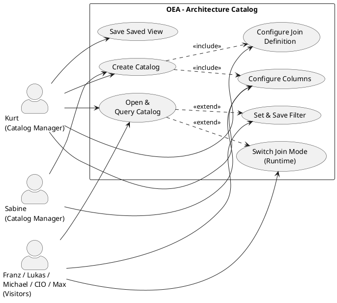

# UC-06: Create, Configure and Use an Architecture Catalog

## Diagram

## Goal in Context

In ongoing operation, the architecture repository contains hundreds of entities of different types with their attributes and connections. Without structured views, this data is hard to consume: for compliance audits, reporting to management, the preparation of architecture reviews or the daily maintenance of the landscape.

OEA solves this problem with **catalogs**: named, reusable table views on the repository that filter entities in a targeted way, configure attributes as columns and join related entities via connections – analogous to parameterized SQL queries, but without SQL knowledge.

This use case covers two complementary roles:

- **Catalog Manager** (SH-03, SH-07): creates catalogs, configures columns, joins, saved filters and saved views, places the catalog in the navigation tree
- **Catalog Visitor** (all): opens an existing catalog, filters and sorts, switches the join mode and saves their own filter combinations

## Persona and Story

**Primary Actor**: [Kurt – Lead Enterprise Architect](../../business-analysis/stakeholders/SH-03-kurt-lead-enterprise-architect.md)

**Other actors (usage as visitor)**:
- [Franz – Junior Domain Architect](../../business-analysis/stakeholders/SH-01-franz-junior-domain-architect.md) – reads catalogs to understand the landscape
- [Lukas – Senior Data Architect](../../business-analysis/stakeholders/SH-02-lukas-senior-data-architect.md) – uses data-centric catalogs for data architecture analyses
- [Michael – Solution Architect](../../business-analysis/stakeholders/SH-04-michael-solution-architect.md) – uses catalogs for baseline analysis before creating a solution
- [CIO](../../business-analysis/stakeholders/SH-05-cio-corporate-group.md) – consumes executive catalogs as a basis for decisions
- [Max – Operator](../../business-analysis/stakeholders/SH-06-max-operator-sme.md) – uses compliance catalogs for audit preparation
- [Sabine – Senior Business Engineer](../../business-analysis/stakeholders/SH-07-sabine-business-engineer.md) – creates domain-specific catalogs for business analysis

**Story Catalog Manager (Kurt)**:
As a Lead Enterprise Architect, I want to create reusable table views on the architecture repository so that all stakeholders have consistent, pre-filtered views of the entities relevant to them – without having to filter and configure anew each time.

**Story Catalog Visitor (all)**:
As a user of the architecture repository, I want to open an existing catalog, filter live and adjust the join mode – so that I can find precisely the information I need for my current task.

## Trigger

- Kurt wants to provide a standardized application inventory view for all EA users
- Sabine needs a domain-specific view of business processes and their interfaces
- Franz opens a catalog to get acquainted with the existing IT landscape
- Before creating a solution, Michael searches for affected systems (complementary to UC-05 / REQ-039)
- Max prepares a compliance audit and needs a filterable system overview

## Preconditions

- [ ] Actor is logged in (UC-01) and has a role with read permission on the repository
- [ ] The instance's MetamodelConfiguration contains at least one EntityType (UC-04)
- [ ] The repository contains at least one entity (for meaningful results; a catalog can also be created with an empty repository)
- [ ] **Additionally for Catalog Manager actions**: Actor has the role "Enterprise Architect" or a role with write permission for catalogs

## Postconditions

### On Success (create catalog)

- A [Catalog](../../business-objects/catalog.md) object exists with all configured columns, joins and SavedFilters
- The catalog is visible to all users of the instance, provided `scope=instance`
- Optional: the catalog has been added to a [TreeNode](../../business-objects/tree-node.md) in the navigation tree

### On Success (visit catalog)

- The actor sees the entities of the catalog with the configured columns and active filters
- Optionally saved filters / views are persisted and available the next time it is opened

### On Failure

- No catalog object was persisted; error message with a concrete hint

## Basic Flow

*Default case: Kurt creates a new catalog "Application Inventory" and configures it for all users*

1. **Kurt**: navigates to "Catalogs" in the main menu or in the navigation tree
2. **System**: shows an overview of all existing catalogs (scope=instance + own personal), ordered by name
3. **Kurt**: clicks "Create new catalog"
4. **System**: opens configuration form: name, description, primary entity type (dropdown from MetamodelConfiguration), scope (instance / personal), default join mode (rows / aggregate)
5. **Kurt**: selects `ApplicationComponent` as primary type; sets name = "Application Inventory", scope = `instance`, default join mode = `aggregate`
6. **System**: shows the **column configurator**: all attributes of the selected EntityType as available columns (incl. built-in attributes: name, status, description, createdAt, as well as all custom attributes from the metamodel)
7. **Kurt**: selects columns, arranges them via drag-and-drop, optionally sets deviating column labels (e.g., `name` → "Application Name")
8. **Kurt**: clicks "Add join"
9. **System**: opens join configurator: connection type (dropdown: all connection EntityTypes that have `ApplicationComponent` as source), target entity type, join direction, columns of the target entity, default join mode of this join
10. **Kurt**: selects connection type `DataFlow` → target entity `Interface`, columns: name + protocol, join mode: `aggregate`
11. **Kurt**: saves the catalog
12. **System**: persists the Catalog; shows the **live catalog view** with the entities from the repository
13. **Kurt**: creates a SavedFilter: clicks "Save filter" → name "Active systems only", expression: `status eq 'active'`
14. **Kurt**: creates a SavedView: clicks "Save view" → name "Compact view", selects only columns name + status, activates filter "Active systems only", isDefault = true
15. **Kurt**: places the catalog in the navigation tree: drags it into the folder "IT Landscape" or selects "Attach to tree" via the context menu
16. **System**: creates a [TreeNodeItem](../../business-objects/tree-node.md) entry in the selected folder; the catalog appears in the navigation tree

## Alternative Flows

**A1 – Open and use catalog as visitor (all actors)**:

*Franz opens the catalog "Application Inventory" to get acquainted with the existing IT landscape*

1. **Franz**: opens the catalog via the navigation tree or the catalog overview
2. **System**: shows the default view (isDefault SavedView, if defined): entities as table rows, columns as configured
3. **Franz**: sorts the table by a column (click on column header)
4. **Franz**: activates an existing SavedFilter "Active systems only" via quick selection
5. **System**: filters the results live; shows only entities matching the filter condition
6. **Franz**: additionally sets an ad-hoc filter (e.g., `layer = 'application'`) without saving it
7. **System**: also applies the ad-hoc filter; result list updates
8. **Franz**: switches the mode for the join "Interfaces" from `aggregate` to `rows`
9. **System**: converts the table to one row per interface; the main entity repeats for each interface

**A2 – Save ad-hoc filter (all actors)**:

1. Visitor has set an ad-hoc filter (as in A1, step 6)
2. Visitor clicks "Save filter"
3. **System**: asks for a name and whether the filter is `scope=personal` (only for me) or, if the visitor has Catalog Manager permission, `scope=instance` (for everyone)
4. Visitor confirms; the filter appears from now on in the quick selection

**A3 – Edit existing catalog (Catalog Manager)**:

1. Kurt opens the catalog; clicks "Configure"
2. **System**: opens the configuration editor (identical to the creation form, prefilled)
3. Kurt changes columns, adds another join or removes one
4. Kurt saves; **System** applies the changes immediately to all visitor views
5. All existing SavedViews are retained; column references that no longer exist are removed from SavedViews and the manager is informed

**A4 – Create personal catalog (all actors)**:

1. Actor creates a new catalog (as basic flow steps 3–11); selects `scope=personal`
2. **System**: creates the catalog; it is visible only to the actor themselves
3. Actor can later promote the personal catalog to `scope=instance` (if they have the permission)

**A5 – Configure columns of a join (detail)**:

1. When configuring a join (basic flow steps 9–10), Kurt selects which attributes of the target entity should appear as columns
2. In `aggregate` mode: the target attributes are shown comma-separated or as a sub-table in a cell
3. In `rows` mode: each target attribute becomes its own column; the primary entity repeats per result row

## Exception Flows

**E1 – Primary entity type no longer present in the metamodel**:
- Condition: The EntityType of an existing Catalog was removed from the MetamodelConfiguration (UC-04)
- Expected reaction: When opening the Catalog, a warning appears "Primary type ‹ApplicationComponent› no longer in the metamodel. The catalog cannot load data." With a hint to UC-04
- Resumption: Catalog Manager must manually migrate the catalog to a valid type or delete it

**E2 – No EntityType attribute for the chosen FilterExpression**:
- Condition: A SavedFilter references an attribute that was removed from the EntityType
- Expected reaction: SavedFilter is marked with a warning icon; the filter cannot be executed; manager is informed
- Resumption: Manager adjusts the SavedFilter

**E3 – Missing permission for Catalog Manager actions**:
- Condition: Visitor without write permission tries to create or edit a catalog
- Expected reaction: Button "Create new catalog" / "Configure" not visible or disabled; on direct API access: 403 Forbidden
- Resumption: Visitor contacts a Catalog Manager

**E4 – Empty repository (no result)**:
- Condition: The primary entity type has no entities in the repository
- Expected reaction: Table with 0 rows; informative notice "No entries found. Entities of type ‹ApplicationComponent› can be captured as a delta in a solution (UC-05)."
- Resumption: no block; catalog remains usable as soon as entities exist

## Data Flow

| Step | Data | Direction | Remark |
|---|---|---|---|
| 4–11 | Catalog configuration (name, primaryEntityType, columns, joinDefinitions, defaultJoinMode, scope) | Manager → System | Persisted as Catalog object |
| 12 | Entity list with attribute values and join results | System → Actor | Live query on repository; not persisted |
| 13 | SavedFilter (name, expressions) | Manager → System | Persisted in the Catalog object |
| 14 | SavedView (name, columnOrder, activeFilterIds, joinModeOverrides, isDefault) | Manager → System | Persisted in the Catalog object |
| 15–16 | TreeNodeItem (catalogId, parentNodeId, sortOrder) | Manager → System | Persisted in the TreeNode |
| A1 step 8 | Join mode override (rows/aggregate) | Visitor → System | Runtime override; optionally persistent as SavedView |

## Involved Business Objects

| Business Object | Operation | Note |
|---|---|---|
| [catalog](../../business-objects/catalog.md) | create, read, update | Core object; contains ColumnConfig, JoinDefinitions, SavedFilters, SavedViews |
| [tree-node](../../business-objects/tree-node.md) | update | Catalog is attached to the tree via TreeNodeItem |
| [metamodel-configuration](../../business-objects/metamodel-configuration.md) | read | Provides available EntityTypes, attributes, connection types for configuration |
| [person](../../business-objects/person.md) | read | Authentication; `createdBy`, `lastModifiedBy` of the Catalog |
| [role](../../business-objects/role.md) | read | Permission check: read vs. configure |

## Acceptance Criteria

### Create and configure catalog

- [ ] Catalog can be created with any EntityType as primary entity; all attributes of the type are available as columns
- [ ] Columns can be selected, ordered and given their own label
- [ ] At least one join via a connection EntityType (`isConnection=true`) is configurable; direction (outbound/inbound/both) is selectable
- [ ] Default join mode (`rows` / `aggregate`) is configurable at catalog level and per JoinDefinition

### Filters and views

- [ ] Ad-hoc filters can be set and saved as named SavedFilters
- [ ] SavedFilters support at least the operators: eq, neq, contains, in, isNull, isNotNull
- [ ] SavedFilters can be combined (AND / OR)
- [ ] SavedViews store column order + active filters + join mode overrides
- [ ] A SavedView can be marked as default (isDefault=true); only one per catalog
- [ ] Visitors without manager permission can create personal SavedFilters and SavedViews

### Visit catalog

- [ ] All actors can open catalogs with scope=instance
- [ ] Columns are sortable by clicking the header (ascending and descending)
- [ ] Join mode is switchable at runtime per join between `rows` and `aggregate`
- [ ] Switching the join mode updates the table without a page reload
- [ ] In `aggregate` mode, all linked objects appear in one cell; in `rows` mode, one row is created per combination

### Navigation tree

- [ ] A catalog can be assigned to a TreeNode (folder) in the navigation tree
- [ ] The same catalog can be linked in several TreeNodes (soft reference)
- [ ] Catalog can be opened directly via the navigation tree

### Security

- [ ] Creating, editing and deleting catalogs requires the role "Enterprise Architect" or a comparable write permission
- [ ] Catalogs with scope=personal are visible only to the creator; no data leak to other users
- [ ] E3: Direct API calls without permission are rejected with 403

## Out of Scope

- **Delete / archive catalog**: admin function; separate UC or admin panel
- **Export (PDF, CSV) of the catalog content**: separate export UC; the catalog itself is the persistable query
- **Permissions per catalog** (e.g., excluding certain users): permission concept still open; currently instance = everyone, personal = creator only
- **Aggregation functions in `aggregate` mode** (e.g., COUNT, SUM): currently only list aggregation; numeric aggregation is an extension candidate
- **Full-text search across several catalogs**: repository-wide search is a separate UC
- **Pivot view** (swap columns and rows): not in scope v1.0
- **Versioning of catalog configurations**: TBD
- **Plateaus and go-live transitions**: future UC (TBD)

## Concept References

- [§6 Core Entity Types](../../concept/20-entities/06-core-entity-types.md) – EntityTypes and their attributes queried in catalogs
- [§12 Domain Views](../../concept/30-dynamics/12-domain-views.md) – Catalogs as a tabular complement to graphical domain views

## Implementation Notes

- Catalog query: implemented server-side as a parameterized query object; the join logic follows the connection semantics of the repository (not SQL JOIN at DB level, but traversal of the entity graph)
- `aggregate` mode: all connected entities are collected server-side per main entity and delivered as an array; the frontend renders as a comma-separated list or embedded table
- `rows` mode: the backend expands the list; one main entity with N connected entities yields N rows in the response
- Runtime filters are passed as query parameters; they do not change the stored catalog configuration
- SavedViews and SavedFilters are embedded in the Catalog object (no repository of their own); for scope=personal catalogs this applies to all views/filters stored in them

## Realizing Components

- Requirements: [REQ-043](../req/REQ-043-create-catalog.md), [REQ-044](../req/REQ-044-configure-columns.md), [REQ-045](../req/REQ-045-configure-join-definition.md), [REQ-046](../req/REQ-046-catalog-query.md), [REQ-047](../req/REQ-047-set-and-save-filters.md), [REQ-048](../req/REQ-048-saved-view.md), [REQ-049](../req/REQ-049-join-mode-runtime.md), [REQ-050](../req/REQ-050-catalog-navigation-tree.md)
- User Stories: [US-046](../user-stories/US-046-create-catalog.md), [US-047](../user-stories/US-047-configure-columns.md), [US-048](../user-stories/US-048-add-join.md), [US-049](../user-stories/US-049-show-catalog-data.md), [US-050](../user-stories/US-050-switch-join-mode.md), [US-051](../user-stories/US-051-ad-hoc-filter.md), [US-052](../user-stories/US-052-saved-filter.md), [US-053](../user-stories/US-053-saved-view.md), [US-054](../user-stories/US-054-catalog-navigation-tree.md)
- ADRs: –
- Test Cases: none yet
- Implementation: none yet

## Open Questions

- [ ] Can joins be multi-level (e.g., ApplicationComponent → DataFlow → Interface → UsedBy → Role)? Multi-hop joins would make the configurator considerably more complex. V1.0: max. one join level (direct connections only).
- [ ] Should catalogs enforce a maximum result set (pagination mandatory), or are unlimited exports allowed? Relevant for large repositories.
- [ ] Can SavedViews also set join mode overrides for all joins at once (global override), or only per join?
- [ ] Does the CIO (SH-05) need simple chart/KPI widgets (e.g., "Number of applications = 47") in addition to the table? That would be a separate "dashboard" concept.

## Notes

UC-06 deliberately distinguishes between two usage roles: the **Catalog Manager** (SH-03, SH-07), who creates catalogs as reusable, shared queries for the team, and the **Catalog Visitor** (all actors), who consumes these queries and adapts them at runtime. This separation allows the complexity of the configuration to be borne by the EA expert, while all other stakeholders get a simple, preconfigured view.

The join logic (rows vs. aggregate) is the central differentiating feature compared to simple list views. It allows related entities to be displayed context-dependently either flat (rows: analytical, good for export and pivot) or compact (aggregate: good for overview and dashboards) – and on the same catalog, without new configuration.

## Change History

| Version | Date | Author | Change |
|---|---|---|---|
| 0.1.0 | 2026-06-26 | Requirements Engineer | Initial draft; basic flow Catalog Manager, A1–A5 visitor flows, all 7 stakeholders as actors |
