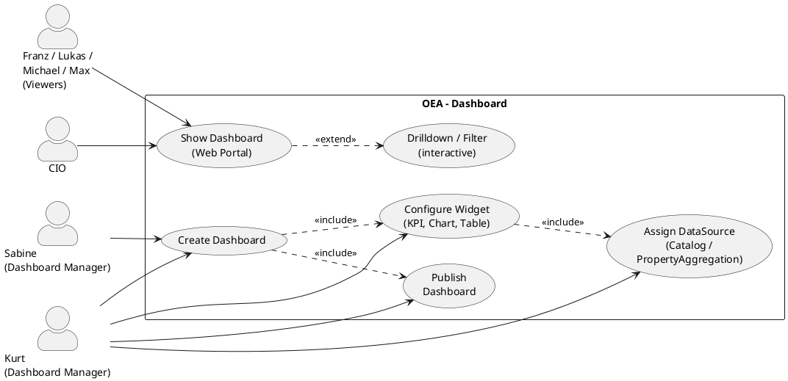

# UC-07: Create, Configure and Use a Dashboard in the Web Portal

## Diagram

## Goal in Context

Decision-makers at C-level (CIO, business unit heads) need condensed, current metrics from the architecture repository – without reading raw data in catalogs or having EA tool knowledge. At the same time, enterprise architects want to see investment cost forecasts, domain distributions and portfolio metrics at a glance, without manually assembling queries each time.

OEA solves this with **dashboards**: configurable views in the web portal that assemble KPI cards, charts and tables from repository data. The data basis is either [catalogs](../use-cases/UC-06-create-and-use-catalog.md) (tabular queries) or direct PropertyAggregations over EntityTypes with their [PropertyDefinitions](../../business-objects/metamodel-configuration.md).

This use case covers two complementary roles:

- **Dashboard Manager** (SH-03, SH-07): creates dashboards, configures widgets and DataSources, publishes as `scope=instance`
- **Dashboard Viewer** (all): opens an existing dashboard in the web portal; interactive elements (drilldown, date filter) if available

## Persona and Story

**Primary Actor**: [Kurt – Lead Enterprise Architect](../../business-analysis/stakeholders/SH-03-kurt-lead-enterprise-architect.md)

**Other actors**:

- [CIO](../../business-analysis/stakeholders/SH-05-cio-corporate-group.md) – primary consumer of C-level dashboards; needs investment cost overview and domain portfolio
- [Franz – Junior Domain Architect](../../business-analysis/stakeholders/SH-01-franz-junior-domain-architect.md) – reads dashboards for orientation
- [Lukas – Senior Data Architect](../../business-analysis/stakeholders/SH-02-lukas-senior-data-architect.md) – tracks data-related metrics
- [Michael – Solution Architect](../../business-analysis/stakeholders/SH-04-michael-solution-architect.md) – creates personal dashboards for solution preparation
- [Max – Operator](../../business-analysis/stakeholders/SH-06-max-operator-sme.md) – reads compliance metrics
- [Sabine – Senior Business Engineer](../../business-analysis/stakeholders/SH-07-sabine-business-engineer.md) – creates business-domain-specific dashboards

**Story Dashboard Manager (Kurt)**:
As a Lead Enterprise Architect, I want to create a C-level dashboard for the CIO with investment cost forecasts per plateau and domain distribution so that the CIO can view the current state of the IT portfolio in the web portal at any time – without having to operate OEA themselves.

**Story Dashboard Viewer (CIO)**:
As CIO, I want to open a clear dashboard with the most important architecture metrics in the web portal so that I can make budget decisions based on current data – in five minutes, without prior EA knowledge.

## Trigger

- Kurt wants to provide the CIO with a current investment cost evaluation across all plateaus
- Kurt wants to visualize the application domain distribution for the next architecture review
- Michael needs a personal overview of the systems affected by a solution
- The CIO wants to open the IT portfolio dashboard in the weekly management meeting
- Sabine wants to prepare business capability metrics for a business stakeholder

## Preconditions

- [ ] Actor is logged in (UC-01) and has read permission on the repository
- [ ] For PropertyAggregation-based widgets: The MetamodelConfiguration contains EntityTypes with [PropertyDefinitions](../../business-objects/metamodel-configuration.md) (defined via UC-04); the relevant entity instances have the property values filled
- [ ] For CatalogQuery-based widgets: At least one [catalog](../../business-objects/catalog.md) exists (UC-06)
- [ ] **Additionally for Dashboard Manager actions**: Actor has the role "Enterprise Architect" or a role with dashboard write permission

## Postconditions

### On Success (create dashboard)

- A [Dashboard](../../business-objects/dashboard.md) object exists with all configured widgets and DataSources
- With `scope=instance`: dashboard appears in the web portal for all users of the instance under the dashboard menu item
- With `scope=personal`: dashboard is visible only to the creator

### On Success (show dashboard)

- The actor sees the configured widgets with live-calculated data from the repository
- KPI cards, charts and tables reflect the current database state

### On Failure

- No dashboard object persisted; error message with a concrete hint to the faulty DataSource or configuration

## Basic Flow

*Default case: Kurt creates the investment cost dashboard for the CIO.*

1. **Kurt**: navigates in the web portal to "Dashboards" in the main menu
2. **System**: shows an overview of all existing dashboards (`scope=instance` + own `personal`), ordered by name
3. **Kurt**: clicks "Create new dashboard"
4. **System**: opens configuration form: name, description, scope (`instance` / `personal`)
5. **Kurt**: fills in: name = "IT Investment Planning 2026–2030", scope = `instance`; confirms
6. **System**: creates the empty dashboard and opens the **widget editor** with a 12-column grid
7. **Kurt**: clicks "Add widget" → selects type `KPI`
8. **System**: opens the widget configurator: title, DataSource type (CatalogQuery / PropertyAggregation), DataSource parameters
9. **Kurt**: configures KPI widget:
   - Title: "Total investment costs (forecast)"
   - DataSource: `PropertyAggregation` → EntityType: `plateau`, property: `investmentCostForecast`, aggregation: `sum`
   - Unit: "CHF million", comparisonMode: `none`
10. **Kurt**: places the KPI widget at the top left (columns 1–3, row 1); confirms
11. **Kurt**: again clicks "Add widget" → selects type `Chart`
12. **System**: opens chart configurator: ChartType, DataSource, x-axis, y-axis
13. **Kurt**: configures bar chart:
    - Title: "Investment costs per plateau"
    - ChartType: `bar`
    - DataSource: `PropertyAggregation` → EntityType: `plateau`, property: `investmentCostForecast`, aggregation: `sum`, GroupBy: `name`
    - X-axis: plateau name; y-axis: amount in CHF
14. **Kurt**: places the chart widget to the right of it (columns 4–12, rows 1–3)
15. **Kurt**: clicks "Add widget" → selects type `Chart` → configures pie chart:
    - Title: "Applications by architecture domain"
    - ChartType: `pie`
    - DataSource: `PropertyAggregation` → EntityType: `application-component`, property: `id`, aggregation: `count`, GroupBy: `architectureDomainId`
16. **Kurt**: places the pie chart widget (columns 1–6, rows 4–6)
17. **Kurt**: clicks "Save"
18. **System**: validates all DataSources (types, properties, catalog references exist); calculates the data live
19. **System**: shows the finished dashboard with the calculated values; shows notices for widgets with missing property values
20. **System**: publishes the dashboard for all users of the instance in the web portal

## Alternative Flows

**A1 – Show / view dashboard (all actors, web portal)**:

*The CIO opens the IT investment cost dashboard in the management meeting.*

1. **CIO**: opens the web portal in the browser (no login required if public instance; otherwise UC-01)
2. **System**: shows the dashboard overview
3. **CIO**: clicks "IT Investment Planning 2026–2030"
4. **System**: renders all widgets with current data; shows loading animation during calculation
5. **CIO**: looks at KPI and bar chart; hovers over a bar → tooltip shows the exact value
6. **System**: shows tooltip with detail value; no further interactions in the default viewer mode

**A2 – Create personal dashboard (all actors)**:

1. Actor creates a new dashboard (as basic flow steps 3–5); selects `scope=personal`
2. **System**: creates the dashboard; it is visible exclusively to the actor
3. Actor can later promote the personal dashboard to `scope=instance`, provided they have the permission

**A3 – Configure table widget with catalog as DataSource**:

*Kurt wants to embed the top 10 most expensive applications directly as a table in the dashboard.*

1. Kurt selects widget type `Table`
2. **System**: shows DataSource selection: only `CatalogQuery` available for table widgets
3. Kurt selects an existing catalog "Application Inventory" (UC-06) as DataSource; optionally selects a SavedView
4. **System**: shows a preview of the first rows
5. Kurt configures `pageSize=10` and places the widget
6. **System**: renders the table live with the catalog results, incl. pagination

**A4 – Edit existing dashboard (Dashboard Manager)**:

1. Kurt opens an existing dashboard; clicks "Edit"
2. **System**: opens the widget editor with the existing widgets
3. Kurt adjusts widgets (change DataSource, rename title, adjust layout), adds new widgets or removes existing ones
4. Kurt saves; **System** validates and updates immediately for all viewers

**A5 – Add text widget (Dashboard Manager)**:

1. Kurt selects widget type `Text`
2. **System**: opens Markdown editor
3. Kurt writes an explanatory text (e.g., methodological notes on the cost estimate) in Markdown
4. Kurt places and saves; the widget appears as formatted text without data binding

## Exception Flows

**E1 – PropertyDefinition not found on EntityType**:

- Condition: A widget references `propertyName=investmentCostForecast` on EntityType `plateau`, but this property does not exist in the current MetamodelConfiguration (e.g., after a metamodel change via UC-04)
- Expected reaction: The widget shows an error notice "Property ‹investmentCostForecast› not found on EntityType ‹plateau›. Please check the dashboard configuration." Other widgets continue to be rendered
- Resumption: Dashboard Manager opens the widget editor and selects a valid property

**E2 – Referenced catalog no longer exists**:

- Condition: A table widget references a catalog that has been deleted in the meantime
- Expected reaction: The widget shows "Catalog ‹Application Inventory› not found." Hint to UC-06
- Resumption: Dashboard Manager selects another catalog or recreates the catalog

**E3 – Missing permission for instance dashboard**:

- Condition: Actor without dashboard write permission tries to create a `scope=instance` dashboard
- Expected reaction: Scope selection shows only `personal`; direct API calls with `scope=instance` are rejected with 403
- Resumption: Actor creates a personal dashboard or contacts a Dashboard Manager

**E4 – No data for aggregation**:

- Condition: The EntityType `plateau` contains no entities, or none of the plateau instances has the property value `investmentCostForecast` filled
- Expected reaction: KPI widget shows "– (no data)"; chart widget shows an empty chart with notice "No data available. Maintain property ‹investmentCostForecast› on the existing entities."
- Resumption: no block; widget shows data as soon as properties are filled

## Data Flow

| Step | Data | Direction | Remark |
|---|---|---|---|
| 4–17 | Dashboard configuration (name, scope, widgets, dataSource definitions, gridPositions) | Manager → System | Persisted as Dashboard object |
| 18 | DataSource validation (EntityType + PropertyName, catalog reference) | System → System | Server-side; no persistence |
| 19 | Aggregated metric values, chart data points, table rows | System → Actor | Live calculation based on repository state; not persisted |
| A1 step 5 | Tooltip data (single value) | System → CIO | On demand on hover; not persisted |

## Involved Business Objects

| Business Object | Operation | Note |
|---|---|---|
| [dashboard](../../business-objects/dashboard.md) | create, read, update | Core object; contains all widget and DataSource definitions |
| [catalog](../../business-objects/catalog.md) | read | DataSource for table widgets (CatalogQueryDataSource) |
| [metamodel-configuration](../../business-objects/metamodel-configuration.md) | read | Provides available EntityTypes and PropertyDefinitions for configurator dropdowns |
| [person](../../business-objects/person.md) | read | Authentication; `createdBy` of the dashboard |
| [role](../../business-objects/role.md) | read | Permission check: read vs. create/edit |

## Acceptance Criteria

### Create and configure dashboard

- [ ] Dashboard can be created with any name and scope (`instance` / `personal`)
- [ ] All four widget types (KPI, Chart, Table, Text) can be added and configured
- [ ] KPI widget: DataSource `PropertyAggregation` selectable with all aggregation functions (sum, count, avg, min, max); unit and comparisonMode configurable
- [ ] Chart widget: all ChartTypes (bar, line, pie, donut, area, treemap) selectable; x- and y-axes configurable; legend and DataLabels toggleable
- [ ] Table widget: existing catalog selectable as DataSource; SavedView selectable; pageSize configurable
- [ ] Widget positioning in the 12-column grid via drag-and-drop
- [ ] System validates all DataSources on save; invalid references produce an error message

### Data rendering

- [ ] Widgets render live-calculated data from the current repository state
- [ ] PropertyAggregation: `sum`, `count`, `avg`, `min`, `max` over entities of a type with correct grouping
- [ ] PropertyAggregation with `groupBy=architectureDomainId` yields one series per domain
- [ ] Pie / donut chart with one y-axis rendered correctly
- [ ] Table widget renders the same rows as the referenced catalog (with SavedView filter)

### Permissions and visibility

- [ ] Dashboards with `scope=instance` are visible to all logged-in users in the web portal
- [ ] Dashboards with `scope=personal` are visible exclusively to the creator; no data leaks
- [ ] Creating and editing `scope=instance` dashboards requires dashboard write permission; direct API call without permission: 403

### Error handling

- [ ] E1: Widget with invalid PropertyDefinition shows an isolated error notice; remaining widgets stay functional
- [ ] E2: Widget with missing catalog shows an isolated error notice
- [ ] E4: Widget without data basis shows a "No data" message with a hint to missing property values

## Out of Scope

- **Delete / archive dashboard**: admin function; separate UC or admin panel
- **Drilldown / detail view from widget**: clicking a chart element opens a filtered catalog or entity detail (extension candidate v1.x)
- **PDF/PNG export of dashboards**: reporting export is a separate UC; the dashboard itself is live
- **Permissions per dashboard** (excluding certain users): currently instance=everyone / personal=creator; fine-grained permissions TBD
- **Real-time updates** (automatic refresh every N seconds): v1.0 = manual reload; real-time is an extension candidate
- **Embedded diagram** (architecture notation in the dashboard): the dashboard shows business metrics in standard charts; architecture diagrams remain in the canvas/viewpoint
- **Calculation of formulas across several properties** (e.g., costs/entity count): v1.0 only direct property aggregation; derived metrics are an extension candidate
- **Global filters with date range** (e.g., "only plateaus from 2027"): v1.0 only global PropertyAggregation filters; date-based restrictions TBD

## Concept References

- [§21.2.1 Visualization Strategy](../../concept/70-platform/21-api-architecture.md) – Web portal as publication and reporting platform

## Implementation Notes

- Dashboard data is calculated live on every call; no caching layer in v1.0 (performance NFR still to be defined)
- PropertyAggregation queries: server-side as an aggregation API on the entity store; no client-side calculation
- CatalogQueryDataSource takes over the query logic of the referenced catalog completely (incl. joins, SavedView filter); the dashboard delegates to the catalog API
- Rendering in the web portal: standard chart library (selection still open, presumably Chart.js or Apache ECharts); no canvas/Vue Flow needed (pure SVG/canvas charts)
- Grid layout: CSS Grid or react-grid-layout as a basis; drag-and-drop only in the edit mode of the client app; display only in the web portal

## Realizing Components

- Requirements: [REQ-051](../req/REQ-051-create-dashboard.md), [REQ-052](../req/REQ-052-configure-widget.md), [REQ-053](../req/REQ-053-property-aggregation-datasource.md), [REQ-054](../req/REQ-054-catalog-query-datasource.md), [REQ-055](../req/REQ-055-retrieve-dashboard-data.md), [REQ-056](../req/REQ-056-dashboard-access-visibility.md), [REQ-057](../req/REQ-057-widget-grid-layout.md)
- User Stories: [US-055](../user-stories/US-055-create-dashboard.md), [US-056](../user-stories/US-056-configure-kpi-widget.md), [US-057](../user-stories/US-057-configure-chart-widget.md), [US-058](../user-stories/US-058-configure-table-widget.md), [US-059](../user-stories/US-059-add-text-widget.md), [US-060](../user-stories/US-060-adjust-widget-layout.md), [US-061](../user-stories/US-061-show-dashboard-in-web-portal.md), [US-062](../user-stories/US-062-personal-dashboard.md)
- ADRs: –
- Test Cases: none yet
- Implementation: none yet

## Open Questions

- [ ] Should dashboards also be configurable in the client app (Electron), or exclusively in the web portal? The use case (C-level reporting) favors the web portal as the primary location; configuration could nevertheless be offered in the client app.
- [ ] Does the CIO need a login to the web portal, or are dashboards publicly readable (URL-based access without auth)? This depends on the data protection classification of the architecture data (ADR-001–005 open).
- [ ] Which chart library is used for the web portal? No ADR of its own needed (no strategic decision), but to be clarified before implementation.
- [ ] Does v1.0 also support negative numbers in PropertyAggregation (e.g., savings)?

## Notes

The difference to [UC-06 (Catalog)](./UC-06-create-and-use-catalog.md) is fundamental: A catalog is a **row view** with configurable columns – each entity is a row. A dashboard is a **condensation view** – data is aggregated, grouped and presented as metrics or charts. Both concepts are complementary: a dashboard can use a catalog as DataSource for an embedded table, but can also calculate PropertyAggregations directly on EntityTypes.

The connection to the [PropertyDefinitions](../../business-objects/metamodel-configuration.md) (v0.6.0) is the key prerequisite for meaningful dashboards: Only when properties such as `investmentCostForecast`, `operatingCostForecast` or `lifecycleStatus` are defined as typed, validated properties on the EntityType and filled in the entity instances can dashboards deliver meaningful aggregations. Dashboard and metamodel maintenance (UC-04) are closely linked.

## Change History

| Version | Date | Author | Change |
|---|---|---|---|
| 0.1.0 | 2026-06-26 | Requirements Engineer | Initial draft; basic flow investment cost dashboard, A1–A5, acceptance criteria, out of scope |
