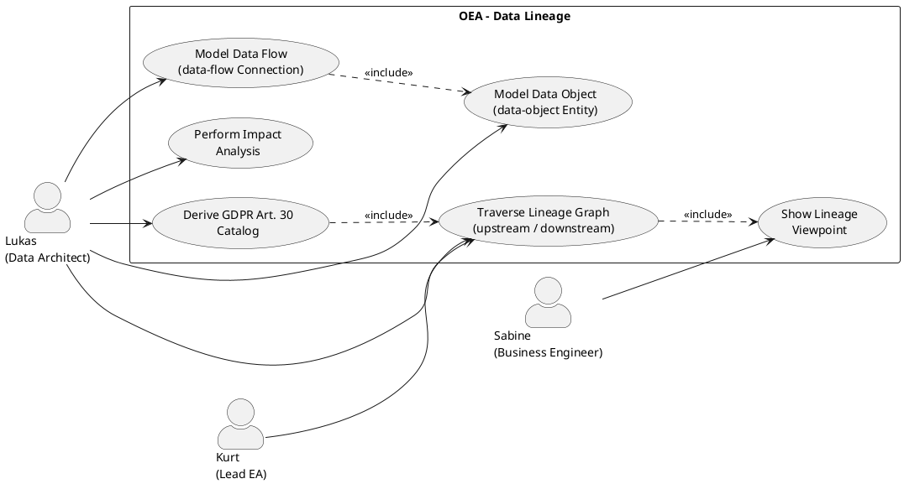

# UC-08: Model and Analyze a Data Flow Map (Data Lineage)

## Diagram



## Goal in Context

In every company, data flows between systems: customer master data from the ERP into the CRM, transaction data from point-of-sale systems into the data warehouse, employee master data from the HR system into payroll. These flows are rarely documented completely, become outdated quickly after schema changes and are hardly traceable for business units, data protection officers and auditors.

OEA solves this problem by managing data objects and data flows as first-class entities in the same architecture model as application components. Each data flow explicitly references which data objects it transports. The result is a **traversable lineage graph**: for any data object, OEA can calculate all source and target systems (upstream / downstream) – not only as a diagram, but as a queryable API response.

This UC is the basis for:
- **GDPR Art. 30**: generate the record of processing activities from the model (side flow A3)
- **Impact analysis**: which systems are affected if the schema of data object X changes?
- **Compliance reporting**: which data flows transport personal data without a documented legal basis?

## Persona and Story

**Primary Actor**: [Lukas – Senior Data Architect](../../business-analysis/stakeholders/SH-02-lukas-senior-data-architect.md)
**Other Stakeholders**:
- [Kurt – Lead Enterprise Architect](../../business-analysis/stakeholders/SH-03-kurt-lead-enterprise-architect.md) (approves metamodel extension)
- [Sabine – Business Engineer](../../business-analysis/stakeholders/SH-07-sabine-business-engineer.md) (uses business view of data flows)

**Story**: As a data architect, I want to model data objects and the data flows between systems in the same tool in which the application landscape is maintained – so that I can query at any time which path a certain data object takes through all systems, who transforms it and where personal data is processed.

## Trigger

- Lukas is to document the data flows for a new regulatory audit (e.g., GDPR, ISO 27001)
- A schema change in the ERP raises the question: which target systems are affected?
- Lukas takes over maintenance of the EA model from Avolution and wants to migrate lineage information
- A business unit workshop is to clarify which department is responsible for which data

## Preconditions

- [ ] Lukas is logged in (UC-01) and has permission to create and edit entities
- [ ] The following exist in the metamodel (or are created as part of this UC, basic flow steps 1–3):
  - EntityType `data-object` (`isConnection=false`) with PropertyDefinitions: `dataClassification`, `personalDataCategories`, `dataOwner`, `description`
  - EntityType `data-flow` (`isConnection=true`) with PropertyDefinitions: `protocol`, `frequency`, `transformationDescription`, `carriedDataObjectIds`
- [ ] At least two application components (ArchitectureEntities with EntityType `application-component`) already exist or are created in parallel

## Postconditions

### On Success

- At least one `data-object` entity with a stable integer ID exists and is filled with properties
- At least one `data-flow` entity connects two `application-component` entities and references the data object via integer ID in `carriedDataObjectIds`
- The lineage query `GET /api/v1/lineage?entityId={dataObjectId}&direction=both` returns the complete path (sources and consumers)
- A data lineage viewpoint shows the graph visually
- Optional: GDPR catalog shows all data flows with `personalDataCategories ≠ empty`

### On Failure

- No data object or data flow persisted
- Error message with a concrete hint (validation error, missing permission)

## Basic Flow

*Default case: Lukas models the customer master data lineage in an existing instance*

**Phase 1 – Extend metamodel (one-time)**

1. **Lukas**: opens the metamodel configuration (UC-04)
2. **System**: shows existing EntityType definitions
3. **Lukas**: creates EntityType `data-object` (`isConnection=false`):
   - PropertyDefinition `dataClassification` (enum: `public | internal | confidential | restricted`; validationMode=mandatory; category=Governance)
   - PropertyDefinition `personalDataCategories` (varchar(500); validationMode=optional; category=GDPR)
   - PropertyDefinition `dataOwner` (varchar(255); validationMode=warning; category=Governance)
4. **Lukas**: creates EntityType `data-flow` (`isConnection=true`):
   - PropertyDefinition `protocol` (enum: `REST | SOAP | JDBC | FTP | Kafka | SFTP | other`; validationMode=warning; category=Technology)
   - PropertyDefinition `frequency` (enum: `realtime | hourly | daily | weekly | on-demand`; validationMode=optional; category=Technology)
   - PropertyDefinition `transformationDescription` (varchar(1000); validationMode=optional; category=Technology)
   - PropertyDefinition `carriedDataObjectIds` (varchar(500); validationMode=optional; category=Lineage) — comma-separated integer IDs of the referenced DataObjects
5. **Lukas**: creates a lineage viewpoint (notation: `archimate3`; `allowedEntityTypes: [application-component, data-object]`; `allowedConnectionTypes: [data-flow]`) with matching NotationMappings and default sizes

**Phase 2 – Create data objects**

6. **Lukas**: creates ArchitectureEntity `Customer Master` (entityTypeId=`data-object`):
   - `dataClassification`: `confidential`
   - `personalDataCategories`: `Name, Address, Email, Customer Number`
   - `dataOwner`: `CRM team`
   - → System assigns integer ID, e.g., **42**
7. **Lukas**: creates ArchitectureEntity `Order Item` (entityTypeId=`data-object`):
   - `dataClassification`: `internal`
   - → System assigns integer ID, e.g., **43**

**Phase 3 – Model data flows**

8. **Lukas**: creates DataFlow connection: `SAP ERP → Data Warehouse` (entityTypeId=`data-flow`):
   - `protocol`: `JDBC`
   - `frequency`: `daily`
   - `carriedDataObjectIds`: `42,43`
   - → System assigns integer ID, e.g., **101**
9. **Lukas**: creates DataFlow connection: `Data Warehouse → BI Tool` (entityTypeId=`data-flow`):
   - `protocol`: `REST`
   - `frequency`: `on-demand`
   - `carriedDataObjectIds`: `42`
   - → System assigns integer ID, e.g., **102**

**Phase 4 – Query lineage**

10. **Lukas**: calls the lineage query: `GET /api/v1/lineage?entityId=42&direction=both`
11. **System**: traverses the graph along all DataFlows whose `carriedDataObjectIds` contain the ID `42`; returns:
    ```json
    {
      "dataObjectId": 42,
      "dataObjectName": "Customer Master",
      "upstream": [],
      "downstream": [
        { "via": 101, "system": { "id": 10, "name": "SAP ERP" } },
        { "via": 102, "system": { "id": 12, "name": "Data Warehouse" } },
        { "via": 102, "system": { "id": 14, "name": "BI Tool" } }
      ]
    }
    ```
12. **Lukas**: opens the lineage viewpoint; the diagram shows SAP ERP → Data Warehouse → BI Tool with `Customer Master` annotations on the edges
13. **System**: renders data flows with `personalDataCategories ≠ empty` in a different color (via `visualHint` in the viewpoint)

## Alternative Flows

### A1 – Upstream lineage (origin of a data object)

- **Step 10alt**: Lukas queries `direction=upstream` for a data object in the data warehouse
- **System**: traverses backwards along `targetEntityId` of the DataFlows; returns all source systems

### A2 – Impact analysis: schema change

- **Step 10alt**: Lukas queries `GET /api/v1/lineage?entityId=42&direction=downstream&mode=impact`
- **System**: returns all systems that consume `Customer Master` directly or transitively; these are potentially affected by a schema change

### A3 – GDPR record of processing activities (side flow)

- After step 9: Lukas opens a catalog (UC-06) with filter `entityTypeId=data-flow` AND `personalDataCategories ≠ empty`
- **System**: lists all data flows with personal data; Lukas exports as CSV/Excel for the data protection officer
- Optional (future): dashboard (UC-07) with `PropertyAggregation` on `data-flow`, grouped by `dataClassification`

### A4 – Import existing Avolution lineage

- **Step 1alt**: Lukas imports a metamodel configuration file (REQ-033) that already contains `data-object` and `data-flow` as EntityTypes
- **Step 6alt**: Lukas imports entities via CSV upload (future; no REQ yet); alternatively manual creation

## Exception Flows

### E1 – EntityType `data-flow` already exists (built-in conflict)

- **Step 4**: Lukas tries to create `data-flow`; the name collides with an existing custom type
- **System**: shows conflict warning with diff (REQ-033); Lukas chooses: rename or use the existing type

### E2 – `carriedDataObjectIds` references an invalid ID

- **Step 8**: Lukas specifies `carriedDataObjectIds: "42,999"`; ID 999 does not exist
- **System**: saves the DataFlow, but marks ID 999 as an unresolved reference; the lineage query ignores unresolved IDs and returns a warning
- Rationale: referential integrity for `carriedDataObjectIds` is soft-enforced (no FK at DB level), since the value is stored as a property string

### E3 – Lineage query yields a cyclic graph

- **Step 10**: Data flows form a cycle (A→B→C→A)
- **System**: detects the cycle during traversal (max. depth = 50 hops); aborts; returns the path traversed so far + warning `cycle_detected`

### E4 – No DataFlow references the DataObject

- **Step 10**: `carriedDataObjectIds` does not contain the ID anywhere
- **System**: returns empty upstream/downstream list; notice: "No data flow references this data object"

## Data Flow

```
Lukas (SH-02)
  │
  ├──[Step 3–5]──► MetamodelConfiguration: EntityTypeDefinition(data-object, data-flow), Viewpoint
  ├──[Step 6–7]──► ArchitectureEntity(data-object): id=42 (Customer Master), id=43 (Order Item)
  ├──[Step 8–9]──► ArchitectureEntity(data-flow): id=101, id=102 (with carriedDataObjectIds)
  └──[Step 10]──► Lineage API: traverses DataFlow graph → returns path
```

## Involved Business Objects

| BO | Role in this UC |
|---|---|
| [ArchitectureEntity](../../business-objects/entity.md) | DataObjects (data-object) + DataFlows (data-flow) as entity instances |
| [MetamodelConfiguration](../../business-objects/metamodel-configuration.md) | Defines EntityTypes data-object and data-flow with PropertyDefinitions |
| [Viewpoint](../../business-objects/viewpoint.md) | Lineage viewpoint with NotationMappings for data-object and data-flow |
| [Catalog](../../business-objects/catalog.md) | GDPR filter view on data-flow entities (A3) |

## Acceptance Criteria

**AC1** (data object with stable ID):
- Given: Lukas creates `Customer Master` (data-object)
- When: entity saved
- Then: System assigns integer ID ≥ 1; this ID is immutable; `entityTypeId=data-object` is set

**AC2** (DataFlow references DataObject via ID):
- Given: DataObject with ID 42 exists
- When: Lukas creates DataFlow with `carriedDataObjectIds="42"`
- Then: DataFlow is persisted with the correct property; lineage query for ID 42 returns this DataFlow

**AC3** (downstream lineage end-to-end):
- Given: chain SAP ERP →(101)→ DWH →(102)→ BI Tool; both DataFlows contain `carriedDataObjectIds="42"`
- When: `GET /api/v1/lineage?entityId=42&direction=downstream`
- Then: Response contains SAP ERP, DWH and BI Tool in the correct order; no system is missing

**AC4** (upstream lineage):
- Given: same chain as AC3
- When: lineage query from BI Tool backwards for ID 42
- Then: SAP ERP and DWH appear as sources

**AC5** (cycle detection):
- Given: data flows A→B, B→C, C→A (cycle) with DataObject 42
- When: lineage query
- Then: Response contains `cycle_detected=true`; no infinite loop

**AC6** (GDPR filter via catalog):
- Given: DataFlow with `personalDataCategories="Name,Address"` and DataFlow without personalDataCategories
- When: Lukas opens catalog with filter `entityTypeId=data-flow` AND `personalDataCategories ≠ empty`
- Then: Only the first DataFlow appears; the second does not

## Out of Scope

- **Column-level lineage** (field-to-field mapping between schemas): too granular for v1.0; extension point for future versions
- **Automatic schema synchronization** from production databases (no pull connector in v1.0)
- **Automatic lineage detection** from code or SQL queries
- **Avolution XMI/ArchiMate import** for lineage data: separate feature (A4 as manual fallback)
- **GDPR Art. 30 report as a generated document**: basis is laid here (AC6), report generation is a separate UC

## Concept References

| Concept Chapter | Relevance |
|---|---|
| §6 Core Entity Types | data-object and data-flow as extension to built-in types |
| §13 Business–Technology Linking | Lineage connects business terms (DataObject) with technical systems |
| §14 Extensibility | data-object / data-flow as custom EntityTypes |
| §15 Schema Evolution | Schema changes → impact analysis (A2) |
| §20 GRC/GDPR/ISMS | `personalDataCategories` + catalog as basis for Art. 30 |

## Implementation Notes

- **Lineage graph API** (`GET /api/v1/lineage`): traverses ArchitectureEntity graphs along DataFlow edges (BFS), with `carriedDataObjectIds` parsed as a property string; max. depth configurable; cycle detection via visited set
- **carriedDataObjectIds format**: comma-separated integer string in PropertyValue; parsed server-side on query; no FK constraint at DB level (soft reference)
- **[ADR-010](../../adrs/ADR-010-n-connection-data-lineage.md) (draft)**: The question property string vs. n-connection (`carries-data`) is open. The current basic flow uses a property string (option A); if n-connection is chosen (option B), `carriedDataObjectIds` is dropped and replaced by a standalone `carries-data` EntityType that models DataFlow→DataObject as a connection-of-connection.

## Realizing Components

- REQ: still to be derived (REQ-060 ff.)
- US: still to be derived
- Implementation: none yet

## Open Questions

- [ ] Should the lineage API also traverse transitively through `data-object`-to-`data-object` transformations (e.g., if a DataObject is derived from several others), or only system-to-system paths?
- [ ] How are Avolution data models (XMI/ArchiMate) mapped to `data-object`/`data-flow` EntityTypes? Import mapping must be defined (concept §13).
- [ ] Does `data-flow` need an additional property `transformationRule` for column-level lineage as preparation for v2.0?
- [ ] Is `carriedDataObjectIds` as a property string the right modeling choice, or should the relationship be modeled as an n-connection (`carries-data`, connection-of-connection)? → Captured in [ADR-010](../../adrs/ADR-010-n-connection-data-lineage.md) (draft); decision pending. The UC interim uses a property string (option A/C); if n-connection (option B) is chosen, an adjustment of the REQ is necessary.

## Notes

The difference to a static lineage diagram (as in Avolution) is fundamental: In OEA, lineage is **queryable**, not just visualizable. The combination of stable integer IDs (entity.md), typed connections (isConnection=true in metamodel-configuration.md) and the lineage query API (`/api/v1/lineage`) makes lineage a first-class feature.

The decision to store `carriedDataObjectIds` as a PropertyValue string instead of a standalone relation is a pragmatic trade-off for v1.0. It allows lineage semantics to be introduced without a schema extension; a later upgrade to a real join table is possible without discarding the BO model.

## Change History

| Version | Date | Author | Change |
|---|---|---|---|
| 0.1.0 | 2026-06-26 | Requirements Engineer | Initial draft; data lineage as traversable graph; lineage API; GDPR side flow; cycle detection |
