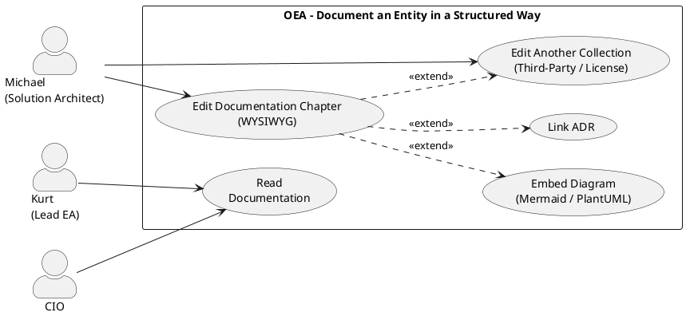

# UC-09: Document an Entity in a Structured Way

## Diagram



## Short Description

The solution architect documents an entity (e.g., a system, an application, a third party) directly in OEA via an operator-defined chapter collection — linked with the EA model, without a separate documentation tool. Typical use cases are Arc42 architecture documentation, third-party management or a license register.

## Primary Actor

**SH-04 – Michael, Solution Architect in a mid-sized company**

Secondary actors: SH-03 (Lead EA reads documentation along), SH-05 (CIO in the web portal)

## Goal

Every entity can be linked to one or more operator-defined documentation collections. The contents live in the EA repository, are visible via viewpoints and connected with ADRs, NFRs and the diagram canvas.

## Preconditions

- At least one `DocumentCollectionDefinition` is configured in the MetamodelConfiguration and assigned to the EntityType of the entity to be documented (UC-04)
- The entity to be documented exists as an ArchitectureEntity in the repository

## Basic Flow

*Default case: Michael documents a system according to Arc42*

1. Michael opens the ArchitectureEntity "CRM System" (application-component, id=1)
2. The system shows the tab "Documentation" with all assigned `DocumentCollectionDefinitions` as tabs
3. Michael selects the tab "Arc42 Architecture" and sees all 12 chapters as sections
4. Michael clicks on "3. Context and Scope" — a WYSIWYG editor opens
5. Michael writes the context text and inserts a Mermaid block (C4 context diagram)
6. The system renders the Mermaid block as an inline preview in the editor
7. Michael saves — the system creates a `documentation-entry` entity and links it via `documents` to id=1
8. Michael switches to "9. Architecture Decisions" and links existing ADRs via link in the editor
9. Michael switches to "5. Building Block View" and inserts a PlantUML component diagram
10. After completion: all filled chapters are marked with status "✓" in the overview

## Alternative Flows

**A1 – Another DocumentCollection (e.g., third-party management):**
- Step 2a: Michael switches to the tab "Third-Party Management" of the same entity
- There, Michael fills chapters "Vendor Assessment", "SLA Terms" and "Exit Strategy"
- For each chapter, a separate `documentation-entry` entity is created and linked via `documents`

**A2 – PlantUML server unavailable:**
- Step 6a: Rendering fails; system shows code fallback (raw text) and warning icon
- Michael can save the content; rendering is retried on the next load

**A3 – Several collections visible at the same time:**
- Step 2a: "Arc42 Architecture", "Third-Party Management" and "License Register" are configured for the EntityType
- Michael sees all three as tabs; fills one or more as needed

## Exception Flows

**E1 – Entity without collection assignment:**
- No documentation tab appears; no error; notice "No documentation collection configured for this type"

**E2 – Chapter content is overwritten:**
- At most one entry is allowed per (subject entity + `chapterRef` + `collectionRef`) (BR-05); saving again overwrites the existing one

## Acceptance Criteria

**AC1** (tab appears for assigned type):
- Given: EntityType `application-component` has collection `arc42-standard` assigned
- When: Michael opens the CRM System entity
- Then: Tab "Documentation" with tab "Arc42 Architecture" visible; all 12 chapters listed; unfilled chapters shown as empty

**AC2** (WYSIWYG save):
- When: Michael writes text + Mermaid block and clicks Save
- Then: `documentation-entry` entity created with `content`, linked via `documents(sourceId=new, targetId=1)`

**AC3** (Mermaid rendering):
- When: Content contains a ```mermaid block
- Then: Block is rendered as an SVG diagram; fallback to code if mermaid.js is not available

**AC4** (PlantUML rendering):
- When: Content contains a ```plantuml block
- Then: Block is rendered as SVG via the configured PlantUML server or WASM

**AC5** (web portal read-only):
- When: CIO opens the same entity in the web portal
- Then: Documentation tab visible; contents readable; Mermaid/PlantUML rendered; no edit button

**AC6** (progress display):
- When: 4 of 12 chapters filled
- Then: Overview shows "4 / 12 filled" and which chapters are still empty

**AC7** (several collections at the same time):
- When: Two collections configured for the same EntityType
- Then: Both tabs visible; contents fillable independently of each other

## Out of Scope

- Automatic filling from the EA model (conceivable in v2.0: generate context scope from diagram)
- PDF export of the documentation (v2.0)
- Collaborative real-time editing (v2.0)

## Relationship to Other Use Cases

- **UC-04**: Metamodel admin configures `DocumentCollectionDefinitions` and assigns them to EntityTypes (prerequisite)
- **UC-05**: Architecture vision and solutions define the modeled system; UC-09 documents its contents
- **UC-06**: Catalog can list `documentation-entry` entities (overview of all documented entities)

## Concept Reference

- §14 Extensibility: `DocumentCollectionDefinition` as an operator-defined metamodel concept
- §18 Reporting: structured documentation as output per entity
