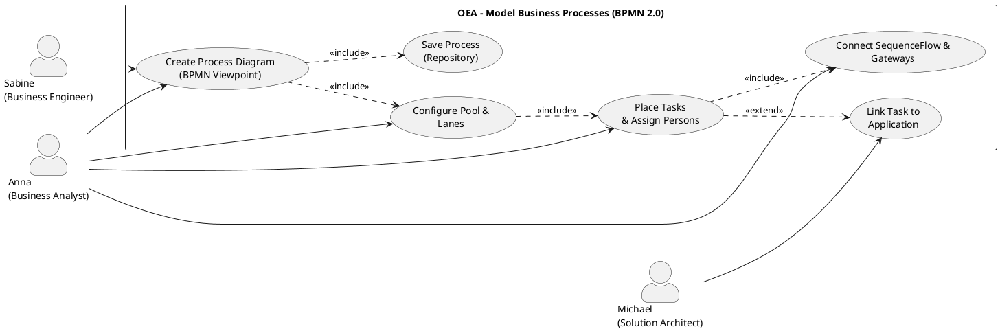

# UC-10: Model Business Processes According to BPMN 2.0

## Diagram

## Goal

The business analyst persona can model business processes directly in the OEA tool in BPMN 2.0. In doing so, she assigns roles and organizational units to lanes and concrete persons to tasks — without needing a separate process tool. Process models are part of the shared EA repository and can thus be linked with applications, capabilities and architecture domains.

## Actors

- **Primary**: SH-08 (Anna – Business Analyst)
- **Secondary**: SH-04 (Michael – Solution Architect; links tasks with applications), SH-07 (Sabine – Business Engineer; configures BPMN types in the metamodel)

## Preconditions

1. OEA instance is running; Anna is logged in with role "Modeler" or higher
2. BPMN process view viewpoint is configured in the metamodel (built-in or adapted by admin)
3. OrganizationalUnit and role entities exist in the repository (may also be empty)

## Postconditions

- Process diagram is persistently stored in the repository
- All process elements (pool, lane, task, event, gateway) are created as ArchitectureEntities with correct EntityTypeIds
- Assignment connections (lane → OrgUnit, lane → role, task → person) are anchored in the repository
- Process model is viewable read-only in the web portal (SH-03/04)

## Basic Flow

1. Anna opens an existing diagram or creates a new diagram and selects the viewpoint "Process Model (BPMN 2.0)"
2. The canvas palette shows BPMN-specific elements: pool, lane, task variants, events, gateways — according to the metamodel configuration
3. Anna drags a **pool** onto the canvas; the pool wizard opens: enter name, assign participant OrgUnit (`bpmn-pool-represents-org-unit`)
4. Anna inserts one or more **lanes** into the pool; for each lane she can:
   - Assign an **organizational unit** (`bpmn-lane-belongs-to-org-unit`)
   - Assign one or more **roles** (`bpmn-lane-performs-role`)
5. Anna places **tasks** (UserTask, ServiceTask, BusinessRuleTask etc.) within the lanes; elements are automatically linked to the lane via `bpmn-contained-in`
6. For UserTasks, Anna opens the detail panel and assigns a **person** from the repository (`bpmn-task-assigned-to`)
7. Anna connects elements with **SequenceFlow** connections; gateways (exclusive, parallel, inclusive) are inserted via the palette
8. Anna optionally selects "Link to application": a task-to-application connection links the process step with the supporting system in the EA repository
9. Anna saves the diagram; all entities and connections are persisted atomically

## Alternative Flows

**A1 — OrganizationalUnit does not exist**:
- Step 3/4: Assignment dropdown shows an empty list
- Anna selects "Create new OrgUnit": mini wizard (name, type) creates the `organizational-unit` entity directly in the assignment dialog
- Flow continues as in the basic flow

**A2 — Person does not exist in the repository**:
- Step 6: Person not found in autocomplete
- Anna can leave the field empty (assignment optional) and add it later

**A3 — Viewpoint with standard BPMN types only**:
- Steps 1–9 run without company-specific subtypes; all tasks appear as `bpmn-task` or standard subtype

## Acceptance Criteria

**AC1** (pool/lane structure):
- Given: Anna has opened the viewpoint "Process Model (BPMN 2.0)"
- When: She creates a pool and inserts lanes
- Then: Pool appears as a container on the canvas; lanes as swim lanes within the pool; tasks can be placed in lanes

**AC2** (OrgUnit assignment):
- When: Anna connects a lane with an OrgUnit
- Then: `bpmn-lane-belongs-to-org-unit` connection stored in the repository; lane shows OrgUnit name as label or badge

**AC3** (role assignment):
- When: Anna connects a lane with a role
- Then: `bpmn-lane-performs-role` connection stored; several roles per lane possible

**AC4** (person assignment):
- When: Anna assigns a person to a UserTask
- Then: `bpmn-task-assigned-to` connection stored; task shows person avatar or initials as indicator

**AC5** (process elements in catalog):
- Given: Process diagram is saved
- When: Anna opens a catalog for `bpmn-user-task`
- Then: All UserTask entities from all diagrams appear; join column shows assigned person and lane

**AC6** (metamodel configurability):
- Given: Admin has configured a subtype `approval-task extends bpmn-user-task`
- When: Anna opens the process diagram
- Then: `approval-task` appears in the palette; can be placed and assigned like any other task

**AC7** (web portal readability):
- When: User with role "Viewer" (web portal) opens the process diagram
- Then: BPMN canvas visible read-only; OrgUnit and person assignments as tooltips

## Out of Scope

- BPMN 2.0 XML export/import (separate, priority: medium — SH-08 concern)
- Simulation / process execution
- DMN integration (decision tables)
- Collaboration diagrams with message flows between different pool participants (v2.0)

## Concept Reference

- §9 Process Architecture: BPMN as adapter module, process as ArchitectureEntity
- §6 Core Entity Types: OrganizationalUnit as configurable EntityType

## Change History

| Version | Date | Author | Change |
|---|---|---|---|
| 0.1.0 | 2026-06-26 | requirements-engineer | Initial draft |
