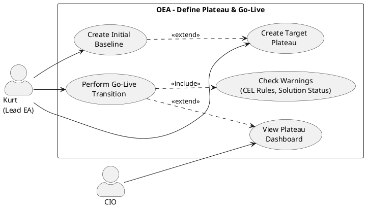

# UC-11: Define Architecture Plateau and Put It into Production

## Diagram

## Goal in Context

Organizations working in **plateau mode** steer the evolution of their enterprise architecture via clearly defined states: a baseline plateau describes the current reality, target plateaus describe planned target states. The Lead Enterprise Architect must create and maintain these states and — when a target state has actually been implemented — commit it as the new productive reality (go-live).

OEA supports this process by allowing Kurt to create the initial baseline, plan any number of target plateaus and finally perform a go-live transition. The transition is deliberately a manual act requiring confirmation: OEA does not enforce any prerequisites, but shows all configured warnings (CEL rules, solution status) so that Kurt can make an informed decision.

## Persona and Story

**Primary Actor**: [Kurt – Lead Enterprise Architect](../../business-analysis/stakeholders/SH-03-kurt-lead-enterprise-architect.md)

**Other Stakeholders**: [CIO](../../business-analysis/stakeholders/SH-05-cio-corporate-group.md) (observes progress; no active step in the flow)

**Story**: As a Lead Enterprise Architect, I want to capture my organization's planned target architecture as a plateau and — as soon as implementation is complete — commit it as the new productive baseline so that the current architecture state is documented clearly and traceably at all times.

## Trigger

1. OEA instance is configured in plateau mode and no baseline plateau exists yet → Kurt creates the initial baseline (A1)
2. Kurt wants to plan a new target state for the architecture → create target plateau (A2)
3. A target plateau has been implemented and is to become the new production architecture → go-live (basic flow)

## Preconditions

- [ ] Plateau mode is enabled for the OEA instance (instance configuration)
- [ ] Kurt is logged in (UC-01) and has the role "EA Manager" or a role with the corresponding permission
- [ ] For the basic flow (go-live): a baseline plateau (`status=baseline`) and at least one target plateau (`status=target`) exist

## Postconditions

### On Success (basic flow — go-live)

- The selected target plateau P1 has `status=baseline`; `validFrom` is set to the go-live time
- The previous baseline plateau P0 has `status=realized`; `validTo` is set to the go-live time; P0 is read-only (BR-03)
- Entities that had the lifecycle state `retiring` in P1 are `retired` after the transition
- The CIO can view the go-live entry in the plateau dashboard
- Other target plateaus remain unchanged (no system-side rebase automatisms; handling them lies with the operator and configured business rules)

### On Failure

- No plateau object was changed; complete rollback of the atomic transition
- Error message with a concrete hint (permission, DB error, confirmation canceled)

## Basic Flow

*Default case: Kurt performs a go-live transition for an existing target plateau.*

1. **Kurt**: navigates to the plateau overview (`/plateaus`)
2. **System**: shows all plateaus in a structured way:
   - Current baseline (status=`baseline`, highlighted)
   - Target plateaus (status=`target`, with planned validFrom)
   - Realized plateaus (status=`realized`, chronological, collapsible)
3. **Kurt**: selects a target plateau P1
4. **System**: shows the plateau detail view with:
   - Name, description, planned go-live date (`validFrom`)
   - Linked solutions: list with name, status (`draft`, `proposed`, `implemented`, …) and owner
   - Entity summary: N entities `active`, M `retiring`, K new compared to baseline
   - CEL rule violations (if business rules are configured): severity `hint`/`warning` (no enforcement; violations do not block go-live)
5. **Kurt**: reviews the summary and decides to perform go-live
6. **Kurt**: clicks "Perform go-live"
7. **System**: shows a confirmation dialog with:
   - Overview: "P1 becomes the new baseline; P0 is archived (realized, read-only)"
   - Number of non-implemented solutions (warning, no block)
   - Number of open CEL violations (warning, no block)
   - Explicit notice: "This action cannot be undone"
8. **Kurt**: confirms by entering the plateau name (two-step confirmation)
9. **System**: performs the atomic transition:
   - P1: `status` → `baseline`; `validFrom` = now (UTC)
   - P0: `status` → `realized`; `validTo` = now (UTC); read-only from now on (BR-03)
   - Entities with `lifecycle_state=retiring` in P1 → `lifecycle_state=retired`
10. **System**: shows success message; redirects to the updated plateau overview
11. **System**: plateau dashboard shows go-live entry with timestamp — viewable for SH-05 CIO

## Alternative Flows

### A1 – Create initial baseline plateau

*If no baseline exists yet in plateau mode (initial setup).*

1. **System**: shows a notice on the plateau overview: "No baseline plateau exists yet. Create the initial baseline to begin strategic EA planning."
2. **Kurt**: clicks "Create initial baseline"
3. **System**: opens creation form:
   - Name (e.g., "Baseline 2026-Q2", mandatory field)
   - Description (optional, max. 2000 characters)
   - `validFrom` (date; meaning: "state as of this effective date"; optional)
4. **Kurt**: fills in the form and saves
5. **System**: creates plateau with `status=baseline`; `createdAt`/`createdBy` set
6. **System**: shows notice: "Initial baseline created. Now capture the existing architecture directly in the baseline or create a target plateau for the target architecture (A2)."
7. Continue: Kurt captures entities in the baseline or proceeds with A2

### A2 – Create target plateau

*If a new target architecture is to be planned.*

1. **Kurt**: clicks "Create new target plateau" in the plateau overview
2. **System**: opens creation form:
   - Name (e.g., "Target Cloud Migration 2027", mandatory field)
   - Description / strategic rationale (optional)
   - `validFrom` (planned go-live date; optional)
   - `succeeds` (dropdown: current baseline preselected; changeable to any other plateau)
3. **Kurt**: fills in the form and saves
4. **System**: creates plateau with `status=target`; `succeeds` reference set
5. **System**: shows the plateau detail view; solution architects can now assign solutions to this target plateau (UC-05 A1)

### A3 – Transition plateau as intermediate state

*If a staged intermediate state between baseline and target makes sense.*

1. Identical flow to A2, but Kurt selects `status=transition` instead of `target`
2. Transition plateaus follow the same rules as target plateaus; they can also go live (basic flow)
3. Usage: optional modeling of migration phases (e.g., "Phase 1 — Salesforce introduction" before the final target)

## Exception Flows

### E1 – No baseline present at go-live attempt

- Condition: Kurt attempts go-live, but no `status=baseline` plateau exists
- Expected reaction: System shows error message "No baseline plateau exists. Create an initial baseline first."; link to A1
- Resumption: Kurt performs A1

### E2 – Go-live confirmation canceled

- Condition: Kurt cancels the confirmation dialog (steps 7–8) or enters the wrong plateau name
- Expected reaction: Dialog closes; no change to data; plateau remains in `status=target`
- Resumption: Kurt can start a new go-live attempt at any time

### E3 – Atomic transition fails (technical error)

- Condition: DB error, constraint violation or timeout during the transition in step 9
- Expected reaction: complete rollback; both plateaus (P0, P1) remain in their original status; error message with technical hint
- Resumption: Kurt can retry go-live; no data loss

### E4 – Missing permission

- Condition: The logged-in person does not have the role "EA Manager" or a comparable permission
- Expected reaction: 403 Forbidden; buttons "Go-live" and "Create" are not visible or disabled
- Resumption: Person contacts the admin (UC-02)

## Data Flow

| Step | Data | Direction | Remark |
|---|---|---|---|
| 2 | Plateau list (id, name, status, validFrom) | System → Kurt | All plateaus of the instance |
| 4 | Plateau detail (solutions, entity summary, CEL violations) | System → Kurt | Warnings only; no block |
| 7 | Confirmation dialog (summary, risk notice) | System → Kurt | Shows number of non-implemented solutions and violations |
| 8 | Plateau name (confirmation) | Kurt → System | Two-step confirmation; prevents accidental go-lives |
| 9 | Plateau status update (P1, P0), entity state update | System internal | Atomic transaction; complete rollback on error |
| 11 | Go-live entry (timestamp, plateau names) | System → Dashboard | Viewable for CIO |

## Involved Business Objects

| Business Object | Operation | Note |
|---|---|---|
| [plateau](../../business-objects/plateau.md) | create, update | Core object; status transition is the central operation |
| [entity](../../business-objects/entity.md) | update | `lifecycle_state` per plateau is updated at go-live |
| [solution](../../business-objects/solution.md) | read | Status overview in the confirmation dialog; no update by this UC |
| [architecture](../../business-objects/architecture.md) | read | Operating mode check (plateau mode required) |
| [person](../../business-objects/person.md) | read | Authentication; `createdBy` on creation |
| [role](../../business-objects/role.md) | read | Permission check: EA Manager role |

## Acceptance Criteria

- [ ] A1: Initial baseline plateau can be created without predecessor; `status=baseline` is set
- [ ] A2: Target plateau can be created with `succeeds` reference to an existing baseline; `status=target`
- [ ] A3: Transition plateau can be created with `status=transition`; can also go live
- [ ] Plateau overview shows baseline, targets and realized plateaus clearly separated
- [ ] Go-live summary shows: linked solutions with status, CEL violations (if configured), entity counts
- [ ] Go-live is **not** blocked if solutions are non-implemented — warning only
- [ ] Go-live is **not** blocked by CEL violations — warning only
- [ ] Two-step confirmation (entering plateau name) enforced before go-live
- [ ] After go-live: P1 has `status=baseline`; P0 has `status=realized` and is read-only
- [ ] Other target plateaus remain unchanged after go-live; no system-side rebase
- [ ] Atomic transition: complete rollback on technical error; no inconsistent state
- [ ] CIO can view the go-live entry with timestamp in the dashboard
- [ ] E4: Without the EA Manager role, go-live and create actions are inaccessible (403)

## Out of Scope

- **Solution status transitions** (`draft → proposed → implemented`): part of UC-05 and the solution review process
- **Capturing entities directly in the baseline**: basic entity management (separate UC, not yet created)
- **Deleting a plateau**: no planned feature; plateaus are immutable architecture history
- **Automatic rebase of other target plateaus**: deliberately not in the system — operator defines via business rules (ADR-017, ADR-018)
- **Project mode**: this UC applies exclusively to instances in plateau mode
