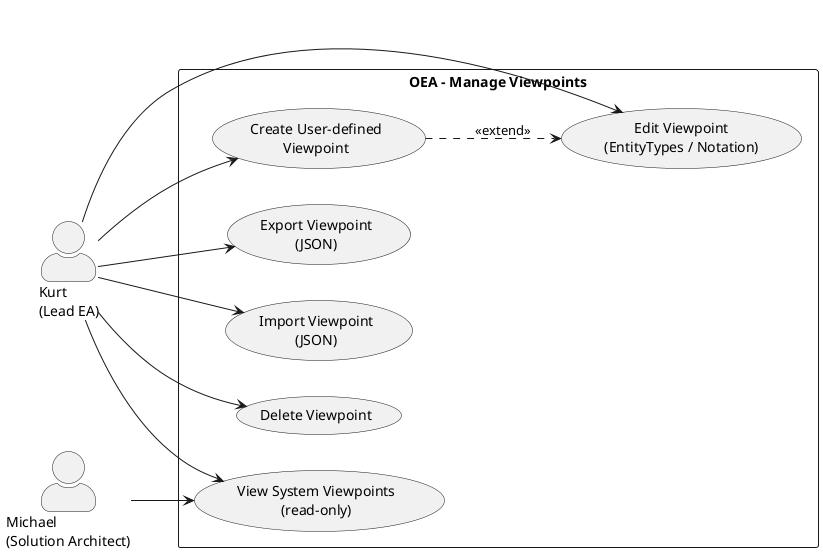

# UC-12: Create and Manage Viewpoints

## Diagram



## Goal in Context

OEA delivers a set of system-defined viewpoints (ArchiMate 3, UML, BPMN 2.0). However, every organization has specific perspectives that cannot be represented in standard viewpoints — for example a "Cloud Security View", a "Domain Overview" or a customer-specific BPMN layout. The Lead Enterprise Architect must be able to create and configure such user-defined viewpoints and export or import them if needed, without duplicating the metamodel.

A viewpoint defines: which entity and connection types may appear in diagrams of this type, which notation is used (ArchiMate 3, UML or BPMN 2.0) and how the elements are rendered by default (notation element, size).

## Persona and Story

**Primary Actor**: [Kurt – Lead Enterprise Architect](../../business-analysis/stakeholders/SH-03-kurt-lead-enterprise-architect.md)

**Other Stakeholders**: [Michael – Solution Architect](../../business-analysis/stakeholders/SH-04-michael-solution-architect.md) (uses viewpoints in UC-05; no active step in this UC)

**Story**: As a Lead Enterprise Architect, I want to define architecture views that show exactly the entity types and the notation that are relevant for our organization — so that diagrams are created consistently and do not have to be configured anew each time.

## Trigger

1. Kurt wants to introduce a new, organization-specific architecture view
2. An imported set of viewpoints is to be adopted for the instance (import flow)
3. An existing user-defined viewpoint must be adapted (new EntityTypes have been added to the metamodel)
4. A user-defined viewpoint is no longer needed and is to be deleted

## Preconditions

- [ ] Kurt is logged in (UC-01) and has the role "EA Manager" or a role with metamodel permission
- [ ] The instance's MetamodelConfiguration contains the EntityTypes and ConnectionTypes to be used in the new viewpoint (UC-04)
- [ ] For the import flow: a valid JSON file with viewpoint definitions is available

## Postconditions

### On Success (create)

- A new `ViewpointDefinition` entry with `viewpointType=user-defined` exists in the MetamodelConfiguration
- The viewpoint is immediately selectable for new diagrams
- `createdBy` and `createdAt` are set

### On Failure

- No new object was persisted; existing viewpoints unchanged
- Error message with a concrete hint (validation error, permission, import conflict)

## Basic Flow

*Default case: Kurt creates a new user-defined viewpoint.*

1. **Kurt**: navigates to the metamodel configuration → section "Viewpoints" (`/settings/metamodel/viewpoints`)
2. **System**: shows all viewpoints in two groups:
   - System-defined viewpoints (read-only; marked with an icon)
   - User-defined viewpoints (editable, deletable)
3. **Kurt**: clicks "Create new viewpoint"
4. **System**: opens creation form with:
   - Name (mandatory field; max. 255 characters; must be unique within the instance)
   - Description (optional; max. 1000 characters)
   - Notation (mandatory field; selection: `ArchiMate 3`, `UML`, `BPMN 2.0`)
5. **Kurt**: fills in the basic fields and clicks "Next"
6. **System**: shows the type selection page:
   - List of all EntityTypes from the MetamodelConfiguration (built-in + custom), grouped by ArchitectureLayer (if configured)
   - List of all connection types (`isConnection=true`)
   - Kurt selects via checkbox which ones should be allowed in this viewpoint
7. **Kurt**: selects EntityTypes and ConnectionTypes and clicks "Next"
8. **System**: shows the notation mapping page for each selected EntityType:
   - Per type: dropdown for `notationElement` (filtered by selected notation; shows only matching prefix elements)
   - Fields for `defaultWidth` and `defaultHeight` (prefilled with recommended values)
   - Optional: `visualHint` (color or icon override)
   - System-defined types already have default mappings prefilled; custom types receive a fallback mapping
9. **Kurt**: reviews and adjusts mappings
10. **Kurt**: clicks "Save viewpoint"
11. **System**: validates (BR-01 to BR-07); saves the viewpoint; shows success message
12. **System**: new viewpoint appears in the list of user-defined viewpoints

## Alternative Flows

### A1 – Edit existing user-defined viewpoint

1. **Kurt**: clicks a user-defined viewpoint in the viewpoint list → "Edit"
2. **System**: opens edit form with prefilled values (identical structure to the creation flow)
3. **Kurt**: adjusts EntityTypes, ConnectionTypes or notation mappings
   - Note: if an EntityType used in existing diagrams is removed from `allowedEntityTypes`, the system shows a warning with the number of affected diagrams (no block, information only)
4. **Kurt**: saves; system validates and persists
5. Existing diagrams that use this viewpoint are revalidated the next time they are opened (BR-05)

### A2 – Delete user-defined viewpoint

1. **Kurt**: clicks a user-defined viewpoint → "Delete"
2. **System**: checks whether the viewpoint is used by existing diagrams
   - If yes: warning "N diagrams use this viewpoint. These diagrams lose their viewpoint reference." (no automatic rollback of the diagrams)
   - If no: direct confirmation
3. **Kurt**: confirms the deletion
4. **System**: removes the viewpoint from the MetamodelConfiguration; affected diagrams no longer reference a valid viewpoint (UI shows a notice when opening these diagrams)

### A3 – Export viewpoints (REQ-058, US-078)

1. **Kurt**: clicks "Export viewpoints" in the viewpoint overview
2. **System**: opens selection dialog: all viewpoints, user-defined preselected; system-defined optionally selectable
3. **Kurt**: selects the viewpoints to export and clicks "Export"
4. **System**: generates JSON file in viewpoint format and starts download

Exported format (example):

```json
{
  "schemaVersion": "1.0",
  "exportedAt": "2026-06-27T10:00:00Z",
  "viewpoints": [
    {
      "id": "cloud-security-view",
      "name": "Cloud Security View",
      "notation": "archimate3",
      "viewpointType": "user-defined",
      "allowedEntityTypes": ["application-component", "security-zone"],
      "allowedConnectionTypes": ["data-flow"],
      "notationMappings": [...]
    }
  ]
}
```

### A4 – Import viewpoints (REQ-059, US-079)

1. **Kurt**: clicks "Import viewpoints" and selects a JSON file
2. **System**: validates the file (BR-08: all referenced EntityType IDs must exist in the instance)
   - Error for unknown IDs: list of missing types; no partial import
3. **System**: shows preview: new viewpoints (will be created), conflicting names (option: overwrite or rename)
4. **Kurt**: confirms the import
5. **System**: creates new viewpoints; on confirmation overwrites existing user-defined viewpoints of the same name; system-defined viewpoints are never overwritten

## Exception Flows

### E1 – Name not unique

- Condition: Chosen name already exists in the MetamodelConfiguration (BR-01)
- Expected reaction: Inline validation error on the name field; saving blocked
- Resumption: Kurt chooses a different name

### E2 – EntityType not present in MetamodelConfiguration

- Condition: Kurt tries to reference an EntityType that does not (or no longer) exist in the MetamodelConfiguration (can occur during import, BR-03/BR-08)
- Expected reaction: Validation error with list of missing IDs; no partial import
- Resumption: Kurt creates the EntityType via UC-04 or adjusts the import file

### E3 – Notation element prefix does not match the notation (BR-07)

- Condition: Kurt selects a `notationElement` with the wrong prefix (e.g., `bpmn:Task` in an ArchiMate viewpoint)
- Expected reaction: Dropdown shows only elements of the selected notation; free-text input is rejected with a validation error on save
- Resumption: Kurt selects a matching notation element

### E4 – Attempt to delete a system-defined viewpoint

- Condition: Kurt tries to delete a viewpoint with `viewpointType=system-defined` (BR-02)
- Expected reaction: Delete button not visible / disabled for system-defined viewpoints
- Resumption: not necessary; UI prevents the action

### E5 – Missing permission

- Condition: Logged-in person has no metamodel permission
- Expected reaction: 403 Forbidden; create/edit/delete not accessible
- Resumption: Person contacts the admin (UC-02)

## Data Flow

| Step | Data | Direction | Remark |
|---|---|---|---|
| 2 | Viewpoint list (id, name, notation, viewpointType) | System → Kurt | Two groups: system-defined, user-defined |
| 4–5 | Name, description, notation | Kurt → System | Basic fields |
| 6–7 | allowedEntityTypes[], allowedConnectionTypes[] | Kurt → System | Checkbox selection from MetamodelConfiguration |
| 8–9 | notationMappings[] (entityTypeId, notationElement, defaultWidth, defaultHeight) | Kurt → System | Per selected EntityType |
| 11 | ViewpointDefinition (complete) | System internal | Persisted in MetamodelConfiguration |
| A3 | JSON export (viewpoint definitions) | System → File | Download |
| A4 | JSON import + validation report | File → System | No partial import on validation error |

## Involved Business Objects

| Business Object | Operation | Note |
|---|---|---|
| [viewpoint](../../business-objects/viewpoint.md) | create, update, delete | Core object; only user-defined editable |
| [metamodel-configuration](../../business-objects/metamodel-configuration.md) | read, update | Viewpoints are part of the MetamodelConfiguration |
| [person](../../business-objects/person.md) | read | `createdBy`; permission check |
| [role](../../business-objects/role.md) | read | EA Manager role required |

## Acceptance Criteria

- [ ] User-defined viewpoint can be created with name, notation, allowedEntityTypes, allowedConnectionTypes
- [ ] Notation mappings configurable per EntityType (notationElement, defaultWidth, defaultHeight)
- [ ] Dropdown for notationElement shows only elements of the selected notation (BR-07)
- [ ] E1: Duplicate name is rejected with an inline error (BR-01)
- [ ] System-defined viewpoints are neither editable nor deletable (BR-02); buttons disabled
- [ ] A1: Existing user-defined viewpoint editable; warning when removing a used EntityType
- [ ] A2: Deletion with warning for used viewpoints; confirmation required
- [ ] A3: Export produces a valid JSON file with the selected viewpoints
- [ ] A4: Import validates all EntityType IDs against the MetamodelConfiguration (BR-08); no partial import on error; preview before adoption
- [ ] E5: Without metamodel permission, no access to create/edit/delete (403)

## Out of Scope

- **Creating/editing diagram instances**: diagrams are instances of a viewpoint; their management is a separate UC (not yet created)
- **Adapting system-defined viewpoints**: deliberately not provided (BR-02); operator creates user-defined viewpoints as replacement/supplement
- **Viewpoint inheritance**: a viewpoint cannot inherit from another; types are always selected explicitly
- **Extending notation elements**: the notation element catalog (ArchiMate 3, UML, BPMN 2.0) is fixed in v1.0; extension is a v2.0 topic
