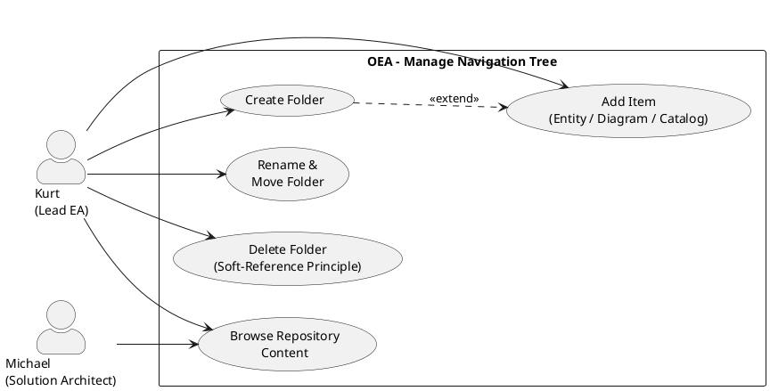

# UC-13: Manage Navigation Tree

## Diagram

## Goal in Context

A growing EA repository — with hundreds of entities, diagrams and catalogs — needs a business-meaningful structure that is independent of the internal data storage. The Lead Enterprise Architect organizes repository content in the navigation tree so that all users can find content quickly and browse it in a familiar logic.

Important: The navigation tree is pure navigation. It stores no content; it refers to existing entities, diagrams and catalogs. Deleting a folder never deletes the referenced content — only the navigation entry (soft-reference principle).

## Persona and Story

**Primary Actor**: [Kurt – Lead Enterprise Architect](../../business-analysis/stakeholders/SH-03-kurt-lead-enterprise-architect.md)

**Other Stakeholders**: [Michael – Solution Architect](../../business-analysis/stakeholders/SH-04-michael-solution-architect.md) (creates content that Kurt attaches to the tree; no active step in this UC)

**Story**: As a Lead Enterprise Architect, I want to organize the architecture repository in a folder structure so that all stakeholders can quickly find entities, diagrams and catalogs — without changing the semantic linking of the data.

## Trigger

1. A new business domain or initiative is to be structured in the repository → create new folder
2. Content (entity, diagram, catalog) has been newly created and is to be visible in the tree → add item
3. The existing folder structure no longer fits the organization → rename, move or reorganize folders
4. An obsolete folder is to be removed → delete folder

## Preconditions

- [ ] Kurt is logged in (UC-01) and has the role "EA Manager" or a role with repository organization permission
- [ ] The OEA instance is set up; the root node exists (created automatically during instance setup)
- [ ] For adding items: the entity, diagram or catalog already exists in the repository

## Postconditions

### On Success

- The navigation tree reflects the desired structure
- Referenced objects (entities, diagrams, catalogs) are unchanged in content
- `sortOrder` values are consistent (no gaps necessary; the system allows arbitrary orders)

### On Failure

- No change to the tree; affected nodes and items unchanged
- Error message with a concrete hint

## Basic Flow

*Default case: Kurt creates a new folder and attaches content.*

1. **Kurt**: opens the navigation tree in the client app or web portal
2. **System**: shows the tree starting from the root node; folders expandable/collapsible; items with type icon (entity, diagram, catalog)
3. **Kurt**: selects an existing node as parent node and clicks "New folder"
4. **System**: creates a new TreeNode directly in the tree as an editable inline entry
5. **Kurt**: enters a name and confirms (Enter or focus loss)
6. **System**: validates (BR-01: name unique among siblings); persists; shows new folder in the tree
7. **Kurt**: selects the new folder and clicks "Add content"
8. **System**: opens a search dialog across all repository content:
   - Search by name / entity type / catalog title
   - Filter by content type: entity, diagram, catalog
   - Multi-select possible
9. **Kurt**: selects one or more content items and confirms
10. **System**: creates `TreeNodeItem` entries; shows items in the folder
11. **Kurt**: adjusts the order via drag & drop (sortOrder)
12. **System**: persists the new `sortOrder` order

## Alternative Flows

### A1 – Rename folder

1. **Kurt**: double-clicks a folder name (or context menu → "Rename")
2. **System**: makes the name inline editable
3. **Kurt**: changes the name and confirms
4. **System**: validates (BR-01); persists; shows new name

### A2 – Move folder or item

1. **Kurt**: drags a folder or an item via drag & drop onto another parent node
2. **System**: checks:
   - BR-03: no cycle (a folder must not be moved into one of its own descendants)
   - BR-01: name of the moved folder must be unique in the target node
3. **System**: updates `parentId` and `sortOrder`; shows the updated tree

### A3 – Remove item from a folder

1. **Kurt**: selects an item in the folder → context menu → "Remove from this folder"
2. **System**: shows notice: "Only the navigation entry is removed. The entity / diagram / catalog is retained."
3. **Kurt**: confirms
4. **System**: removes the `TreeNodeItem`; the referenced object is unchanged; remaining references to the same object in other folders stay valid (BR-06)

### A4 – Delete folder

1. **Kurt**: selects a folder → context menu → "Delete folder"
2. **System**: checks BR-02 (root node not deletable); shows warning:
   - "This folder and all N subfolders and M entries will be deleted."
   - "The referenced entities, diagrams and catalogs are retained." (BR-05)
3. **Kurt**: confirms
4. **System**: deletes the folder recursively (all children and items); referenced objects untouched (BR-05)

### A5 – Attach the same object to several folders

1. **Kurt**: navigates to a second folder and clicks "Add content" (step 7)
2. **Kurt**: searches and selects the same object (e.g., the same catalog) that already lies in another folder
3. **System**: creates a second `TreeNodeItem` entry (different folder, same `referenceId`) — explicitly allowed by BR-06
4. **System**: now shows the object in both folders; no duplicate of the data

### A6 – Rename root node

1. **Kurt**: double-clicks the root node
2. **System**: makes the name editable (BR-02: only renaming allowed, no deletion)
3. **Kurt**: enters a new name (e.g., company name) and confirms
4. **System**: persists; shows new root name

## Exception Flows

### E1 – Name not unique among siblings (BR-01)

- Condition: A folder or renamed folder has the same name as a sibling node
- Expected reaction: Inline validation error; saving blocked until the name is changed
- Resumption: Kurt chooses a different name

### E2 – Cycle when moving (BR-03)

- Condition: Kurt tries to drag a folder into one of its own descendants
- Expected reaction: Drag & drop visually blocked (no valid drop target); on API attempt 422 with error message
- Resumption: Kurt selects a valid target

### E3 – Attempt to delete root node (BR-02)

- Condition: Kurt tries to delete the root node
- Expected reaction: Delete option not present in the context menu of the root node
- Resumption: not necessary; UI prevents the action

### E4 – Referenced object no longer exists (BR-04)

- Condition: A `TreeNodeItem` refers to an object that has been deleted in the meantime (e.g., catalog deleted)
- Expected reaction: Item is shown in the tree with "[Content no longer available]" and warning symbol; Kurt can clean it up via "Remove"
- Resumption: Kurt removes the orphaned item (A3) or restores the object

### E5 – Missing permission

- Condition: Logged-in person has no repository organization permission
- Expected reaction: Tree is readable (read-only); editing options (new folder, move, delete) not visible
- Resumption: Person contacts the admin (UC-02)

## Data Flow

| Step | Data | Direction | Remark |
|---|---|---|---|
| 2 | Tree structure (TreeNodes + items with type and name) | System → Kurt | Complete from root node; lazy-loaded for deep trees |
| 5 | Name of the new folder | Kurt → System | Inline input |
| 8–9 | Search + selection (referenceId, itemType, displayLabel) | Kurt → System | Multi-select possible |
| 11 | sortOrder changes (ItemId, new sortOrder) | Kurt → System | Drag & drop |
| A2 | parentId, sortOrder (moved node) | Kurt → System | Drag & drop; BR-01/BR-03 checked |

## Involved Business Objects

| Business Object | Operation | Note |
|---|---|---|
| [tree-node](../../business-objects/tree-node.md) | create, update, delete | Core object; root node not deletable (BR-02) |
| [catalog](../../business-objects/catalog.md) | read | Referenceable as item target; unchanged in content |
| [entity](../../business-objects/entity.md) | read | Referenceable as item target; unchanged in content |
| [person](../../business-objects/person.md) | read | `createdBy`; permission check |
| [role](../../business-objects/role.md) | read | Check repository organization permission |

## Acceptance Criteria

- [ ] Create a new folder under any parent node; inline editing of the name
- [ ] E1: Duplicate name among siblings is rejected with an inline error (BR-01)
- [ ] Add items via search dialog (entity, diagram, catalog); multi-select
- [ ] A5: The same object can be referenced in several folders at the same time (BR-06)
- [ ] A1: Rename folder via double-click / inline edit
- [ ] A2: Move folders and items via drag & drop; BR-03 (cycle) visually prevented
- [ ] A3: Remove item from folder with notice about soft reference; referenced object is retained
- [ ] A4: Delete folder with warning (N children, M items affected); referenced objects are retained (BR-05)
- [ ] E3: Root node has no delete option (BR-02); renaming possible via A6
- [ ] E4: Orphaned items (target deleted) are shown with a warning symbol and can be removed
- [ ] E5: Without permission, the tree is read-only; editing options not visible
- [ ] US-054: Structuring the navigation tree is fully covered by this UC

## Out of Scope

- **Creating content**: entities, diagrams and catalogs are created in their own UCs (UC-05, UC-06, future diagram UCs); UC-13 only organizes existing content
- **Permissions per folder**: access control via TreeNodes is not planned (v1.0); permissions are assigned role-based and instance-wide
- **Multiple trees per instance**: In v1.0 there is exactly one navigation tree per instance; multiple named trees are deferred
- **Tree export/import**: not a v1.0 feature; the tree is instance-specific navigation, not a portable artifact
