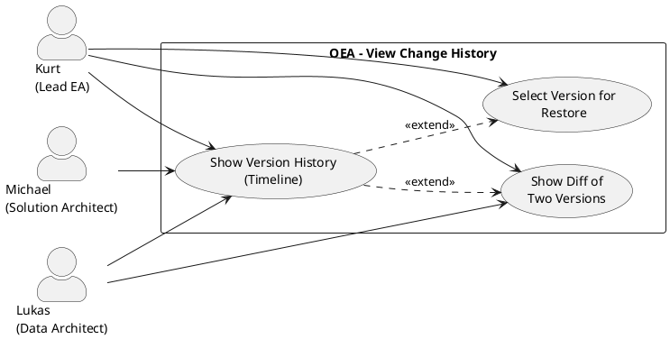

# UC-14: View the Change History of an Entity

## Diagram

## Goal in Context

An architecture repository is only trustworthy if it is traceable who changed what and when. The Lead Enterprise Architect and authorized users must be able to view the complete change history of an entity — as a timeline with diff view, without a separate audit tool.

OEA stores an immutable snapshot of the previous state in `entity_versions` before every update (ADR-016, BR-12/BR-13 in entity.md). UC-14 makes these snapshots accessible to users.

## Persona and Story

**Primary Actor**: [Kurt – Lead Enterprise Architect](../../business-analysis/stakeholders/SH-03-kurt-lead-enterprise-architect.md)

**Other Stakeholders**:
- [Lukas – Senior Data Architect](../../business-analysis/stakeholders/SH-02-lukas-senior-data-architect.md) (audit and compliance purposes)
- [Michael – Solution Architect](../../business-analysis/stakeholders/SH-04-michael-solution-architect.md) (reviews changes in his area of responsibility)

**Story**: As a Lead Enterprise Architect, I want to be able to trace who changed an entity when and what exactly was changed — so that I can justify changes, detect errors and, if needed, return to the previous version (UC-15).

## Trigger

1. An entity shows an unexpected state — Kurt wants to know when and by whom the change occurred
2. Compliance requirement: Lukas must prove that an entity had a defined state at a certain point in time
3. Preparation of a restore (UC-15): Kurt reviews the history before selecting an old state

## Preconditions

- [ ] Kurt is logged in (UC-01) and has read permission on the entity in question
- [ ] The entity exists in the repository and has at least one change version (i.e., it has been edited at least once since creation)

## Postconditions

### On Success

- Kurt sees the complete version history of the entity as a timeline
- No record was changed; the UC is purely read-only

### On Failure

- Error message with hint (missing permission, entity not found)

## Basic Flow

*Default case: Kurt opens the version history of an entity and looks at a change in detail*

1. **Kurt**: opens the detail view of an entity (e.g., "SAP ERP", id=42)
2. **System**: shows the entity details; a "History" tab is visible in the header (provided `entity_versions` entries exist)
3. **Kurt**: clicks "History"
4. **System**: shows a chronological timeline of all versions, newest first:
   - Version number (v1, v2, v3 …)
   - Timestamp (UTC)
   - Changed by (name of the person, linked to profile)
   - Change reason (if specified at update; otherwise empty)
   - Brief overview of changed fields (e.g., "name, description" or "properties.owner")
5. **Kurt**: clicks a version (e.g., v4)
6. **System**: shows a diff between v4 and v5 (its successor):
   - Changed fields with before/after values (highlighted in color: red = removed, green = added)
   - Unchanged fields are not shown (focus on changes)
7. **Kurt**: can optionally expand "Complete state v4" to see the entire entity state at that point in time

## Alternative Flows

**A1 – Set time range filter**

1. **Kurt**: clicks "Filter" in the timeline
2. **System**: shows date filter (from / to) and actor filter (select person)
3. **Kurt**: sets filter; system shows only versions in the selected period / by the selected person

**A2 – Compare two versions directly**

1. **Kurt**: selects two versions in the timeline via checkbox (e.g., v2 and v7)
2. **System**: shows diff between v2 and v7 — all changes over the entire period cumulated

**A3 – Switch from history directly to restore**

1. **Kurt**: sees the button "Restore this version" in the detail view of a version
2. **Kurt**: clicks the button → system redirects to UC-15 with prefilled version number

**A4 – Entity without change history**

1. **Kurt**: opens an entity that has never been edited since creation
2. **System**: shows in the history tab: "No changes since creation. Created on [date] by [person]."

## Exception Flows

**E1 – Missing read permission**
- Condition: Kurt has no read permission on the entity (e.g., solution-scoped entity outside his area)
- Expected reaction: 403; history tab not visible
- Resumption: Person contacts the admin (UC-02)

**E2 – Entity not found**
- Condition: Direct link to entity with deleted ID
- Expected reaction: 404 with clear message
- Resumption: Kurt navigates back to the catalog

## Data Flow

| Step | Data | Direction | Remark |
|---|---|---|---|
| 4 | Version list (version, changedAt, changedBy, changedFields[], changeReason) | System → Kurt | Sorted descending; paginated for > 50 entries |
| 6 | Diff (fieldName, oldValue, newValue) per changed field | System → Kurt | Changed fields only; properties object is broken down field by field |
| 7 | Complete entity state at the selected version | System → Kurt | Snapshot from `entity_versions` |

## Involved Business Objects

| Business Object | Operation | Note |
|---|---|---|
| [entity](../../business-objects/entity.md) | read | Current version + version snapshots from `entity_versions` |
| [person](../../business-objects/person.md) | read | `changedBy` in each version row |
| [role](../../business-objects/role.md) | read | Check read permission on the entity |

## Acceptance Criteria

- [ ] History tab appears on every entity with at least one stored version
- [ ] Timeline shows all versions with number, timestamp, actor and changed fields
- [ ] Diff view shows before/after per field; properties are broken down field by field, not as a JSON blob
- [ ] A1: Time range and actor filters reduce the displayed version list correctly
- [ ] A2: Any two versions can be compared directly with each other
- [ ] A3: From the version detail view, UC-15 (restore) can be started directly
- [ ] A4: Entities without change history show a meaningful notice
- [ ] E1: Without read permission, the history tab is not visible (403)
- [ ] Purely read-only UC: no data change possible

## Out of Scope

- **MetamodelConfiguration history**: Changes to the metamodel (EntityTypes, layers, rules) are recorded in a separate audit log; UC-14 covers only `ArchitectureEntity` versions
- **Mass history** (all changes of all entities): global audit log is a separate UC (not yet created; compliance requirement)
- **Export of the history** as PDF/CSV: deferred v2.0
