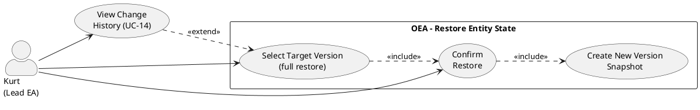

# UC-15: Restore Entity State

## Diagram

## Goal in Context

Faulty changes happen: a field was filled in incorrectly, a property was deleted by mistake, a wrong name was set. The Lead Enterprise Architect must be able to reset an entity to an earlier, known-good state — without data loss and without breaking auditability.

Important: A restore creates a **new** version entry. The state before the restore remains preserved in the history. There is no silent overwriting — every restore is itself a traceable change.

## Persona and Story

**Primary Actor**: [Kurt – Lead Enterprise Architect](../../business-analysis/stakeholders/SH-03-kurt-lead-enterprise-architect.md)

**Story**: As a Lead Enterprise Architect, I want to be able to reset an entity to an earlier state when a change was faulty — and ensure that the restore itself remains visible in the history.

## Trigger

1. An entity was edited incorrectly by mistake (wrong name, deleted property, wrong value)
2. In UC-14, Kurt has reviewed the version history and identified the desired target state

## Preconditions

- [ ] Kurt is logged in (UC-01) and has write permission on the entity
- [ ] The entity has at least one earlier version in `entity_versions`
- [ ] In UC-14, Kurt has identified the desired target version (typical entry point)

## Postconditions

### On Success

- The entity has the state of the selected version
- The current state before the restore is stored as a new `entity_versions` snapshot (immutable)
- The restore itself is visible as a version change: `changedBy`, `changedAt`, optional `changeReason`, marking as `restoredFromVersion: N`
- The entity's `version` number was increased by 1

### On Failure

- The entity is unchanged; no new snapshot
- Error message with a concrete hint

## Basic Flow

*Default case: Kurt resets an entity to an earlier version.*

1. **Kurt**: is in the version history of an entity (UC-14) and has identified version v4 as the target state
2. **Kurt**: clicks "Restore this version" in the detail view of v4
3. **System**: shows a confirmation dialog with:
   - Diff: what will change compared to the current state (which fields, before/after)
   - Notice: "The current state is saved in the history and can be retrieved at any time"
   - Notice: "Immutable fields (ID, type, connection endpoints) are not changed"
   - Optional free-text field: "Reason for restore" (e.g., "Erroneous change by employee XY reverted")
4. **Kurt**: optionally fills in the reason and confirms
5. **System**: performs the restore:
   - Snapshot of the current state is written to `entity_versions` (immutable)
   - Restorable fields are set to the state of v4 (BR-02)
   - `version` counter is increased by 1
   - New `entity_versions` entry with `restoredFromVersion=4`, `changedBy`, `changedAt`, `changeReason`
6. **System**: shows success message; entity detail view shows the restored state
7. **System**: the new version entry appears in the timeline with a clear marking "Restored from v4"

## Alternative Flows

### A1 – Restore directly from the entity detail view

1. **Kurt**: is on the detail view of an entity (not in the history)
2. **Kurt**: clicks "Reset to earlier version"
3. **System**: opens a compact version selection (timeline without diff detail)
4. **Kurt**: selects a version; continue from step 3 of the basic flow

## Exception Flows

### E1 – Validation error caused by restore

- Condition: The earlier state violates current metamodel rules (e.g., a property has meanwhile been marked `mandatory` and would have had no value in the old state)
- Expected reaction: System shows validation warnings in the confirmation dialog (no block — Kurt decides); after the restore, the affected properties appear with a validation warning (as with a normal save with `validationMode=warning`)
- Resumption: After the restore, Kurt corrects the affected fields

### E2 – Cancellation by Kurt

- Condition: Kurt closes the confirmation dialog without confirming
- Expected reaction: no change; entity unchanged

### E3 – Missing write permission

- Condition: Kurt has read permission, but no write permission on the entity
- Expected reaction: Button "Restore" not visible; on direct API call 403
- Resumption: Person contacts the admin (UC-02)

### E4 – Optimistic lock conflict

- Condition: Someone else changed the entity between Kurt's view and his confirmation
- Expected reaction: HTTP 409; dialog stays open with notice "The entity has meanwhile been changed by [person]. Please check the current version and start the restore again."
- Resumption: Kurt opens UC-14 again and checks the current state

## Data Flow

| Step | Data | Direction | Remark |
|---|---|---|---|
| 3 | Diff (current state vs. target version), warnings | System → Kurt | Only restorable fields are shown |
| 4 | Confirmation + optional `changeReason` | Kurt → System | |
| 5 | Snapshot (current state), update (target state), new `entity_versions` entry | System internal | Atomic transaction; rollback on error |

## Non-Restorable Fields (BR-02)

The following fields are immutable after creation and are **never** adjusted during a restore:

| Field | Reason |
|---|---|
| `id` | System field; primary key |
| `entityTypeId` | Immutable after creation (entity.md BR-03) |
| `sourceEntityId` | Connection endpoint immutable (entity.md BR-09) |
| `targetEntityId` | Connection endpoint immutable (entity.md BR-09) |
| `createdAt` | System field; creation timestamp |
| `createdBy` | System field; original creating person |

Restorable are: `name`, `description`, `isLogical`, `stereotypeIds`, `properties`.

## Involved Business Objects

| Business Object | Operation | Note |
|---|---|---|
| [entity](../../business-objects/entity.md) | read, update | Core object; snapshot + update in one atomic transaction |
| [person](../../business-objects/person.md) | read | `changedBy` in the new version entry |
| [role](../../business-objects/role.md) | read | Check write permission |

## Business Rules

| Rule ID | Statement | Trigger |
|---|---|---|
| BR-01 | A restore ALWAYS first stores a snapshot of the current state in `entity_versions` before the target state is written | onRestore |
| BR-02 | Immutable fields (`id`, `entityTypeId`, `sourceEntityId`, `targetEntityId`, `createdAt`, `createdBy`) are never changed during a restore | onRestore |
| BR-03 | The new `entity_versions` entry MUST contain `restoredFromVersion: N` so that the restore is clearly recognizable as such in the timeline | onRestore |
| BR-04 | The restore is an atomic transaction: snapshot + update + new version entry occur in one DB transaction; complete rollback on error | onRestore |
| BR-05 | Validation errors from the current metamodel do not block the restore; they generate warnings that are shown in the confirmation dialog and visible on the entity after the restore | onRestore |

## Acceptance Criteria

- [ ] Confirmation dialog shows diff (current vs. target version) with before/after values
- [ ] Optional free-text field "Reason for restore" in the dialog
- [ ] After restore: entity has the state of the selected version
- [ ] After restore: new `entity_versions` entry with `restoredFromVersion` visible in the UC-14 timeline
- [ ] After restore: entity's `version` counter increased by 1
- [ ] BR-01: current state before restore is preserved as a snapshot in the history
- [ ] BR-02: immutable fields (ID, type, connection endpoints) are not changed
- [ ] BR-04: on technical error complete rollback; no inconsistent state
- [ ] E1: Validation warnings are displayed; no block of the restore
- [ ] E3: Without write permission, the button is not visible
- [ ] E4: Optimistic lock conflict is caught with 409 and an understandable message

## Out of Scope

- **Restoring deleted entities**: Entities that were removed from the repository cannot be restored via UC-15 (separate UC, not yet created; soft delete would be a prerequisite)
- **Mass restore**: Simultaneously resetting several entities to a common point in time is not a v1.0 feature (the plateau model offers an alternative for state snapshots)
- **Restoring MetamodelConfiguration states**: separate UC, not yet created
