# UC-16: Partially Restore an Entity

## Diagram

```plantuml
@startuml UC-16-PartialRestore
left to right direction
skinparam actorStyle awesome

actor "Kurt\n(Lead EA)" as Kurt

usecase "View Change\nHistory (UC-14)" as UC_History

rectangle "OEA – Partially Restore an Entity" {
  usecase "Determine Target Version" as UC_Version
  usecase "Select Core Properties\n(Step 1)" as UC_Step1
  usecase "Select Custom Properties\n(Step 2)" as UC_Step2
  usecase "Select Connections\n(Step 3)" as UC_Step3
  usecase "Confirm Partial\nRestore" as UC_Confirm
  usecase "Create Partial Version\nSnapshot" as UC_Snapshot
}

Kurt --> UC_History
Kurt --> UC_Version
Kurt --> UC_Confirm

UC_History ..> UC_Version : <<extend>>
UC_Version ..> UC_Step1 : <<include>>
UC_Step1 ..> UC_Step2 : <<include>>
UC_Step2 ..> UC_Step3 : <<include>>
UC_Step3 ..> UC_Confirm : <<include>>
UC_Confirm ..> UC_Snapshot : <<include>>
@enduml
```

## Goal in Context

An entity should not always be reset completely to an earlier state (UC-15). Often only a part is faulty: a wrong name, a deleted custom property, or a changed connection description — while other changes are correct and intended. UC-16 enables a **selective restore** via a three-step wizard: at each step, Kurt selects exactly which fields and connections are to be reset.

As with UC-15, the partial restore is itself a traceable change: the current state is secured as a snapshot, and the new `entity_versions` entry contains both `restoredFromVersion` and `restoredFields` (list of the fields actually restored).

## Persona and Story

**Primary Actor**: [Kurt – Lead Enterprise Architect](../../business-analysis/stakeholders/SH-03-kurt-lead-enterprise-architect.md)

**Story**: As a Lead Enterprise Architect, I want to reset individual fields or properties of an entity to an earlier state in a targeted way — without overwriting correct changes to other fields.

## Trigger

1. In UC-14, Kurt has identified a historical version and wants to adopt only parts of it
2. Kurt notices an error in a particular field and knows the version in which it was still correct

## Preconditions

- [ ] Kurt is logged in (UC-01) and has write permission on the entity
- [ ] The entity has at least one earlier version in `entity_versions`
- [ ] Kurt has identified the target version in UC-14 (typical entry point)

## Postconditions

### On Success

- Only the selected fields have the value of the chosen target version; all other fields remain at the current state
- The current state before the partial restore is stored as an `entity_versions` snapshot
- The new version entry contains `restoredFromVersion` and `restoredFields` (explicit list of the restored fields)
- The entity's `version` counter was increased by 1

### On Failure

- No change; complete rollback
- Error message with a concrete hint

## Basic Flow

*Default case: Kurt opens the partial restore wizard from the version history*

### Entry

1. **Kurt**: is in the version history (UC-14) and clicks "Partially restore" on a version
2. **System**: opens the three-step wizard with the chosen version as source; shows the version info at the top (v4, 2026-03-01, changed by Michael)

---

### Step 1 — General Properties

3. **System**: shows a diff table of the general fields:

   | Field | Value in v4 (source) | Current value | Restore? |
   |---|---|---|---|
   | name | "SAP ERP Legacy" | "SAP S/4HANA" | ☐ |
   | description | "Legacy system until 2027" | "Production system from Q2 2026" | ☐ |
   | isLogical | false | false | — (identical, not selectable) |

   Identical fields are grayed out and not selectable. Only changed fields have a checkbox.

4. **Kurt**: selects via checkbox which general properties are to be restored (e.g., only `description`)
5. **Kurt**: clicks "Next → Custom Properties"

---

### Step 2 — Custom Properties

6. **System**: shows a diff table of all configured custom properties (from `propertyDefinitions` of the snapshot):

   | Property | Value in v4 (source) | Current value | Restore? |
   |---|---|---|---|
   | owner | "Lukas" | "Michael" | ☐ |
   | criticality | high | medium | ☐ |
   | lifecycle-status | "active" | "active" | — (identical) |
   | cost-center | "4711" | "4820" | ☐ |

   Properties that did not yet exist in v4 (added after a metamodel extension) are shown as "(not present in v4)" and are not selectable.

7. **Kurt**: selects via checkbox the properties to be reset to the v4 value
8. **Kurt**: clicks "Next → Connections"

---

### Step 3 — Connections

9. **System**: shows three groups of connections that reference this entity:

   **Connections with properties changed since v4** (selectively restorable):

   | Connection | Changed properties | Action |
   |---|---|---|
   | ERP→CRM Data Sync (id=88) | label: "old" → "new" | "Restore properties" → opens UC-16 for id=88 |
   | ERP runs-on Server-01 (id=91) | description changed | "Restore properties" → opens UC-16 for id=91 |

   **Connections added since v4** (informational):

   | Connection | Added on | Note |
   |---|---|---|
   | ERP→Cloud-DB DataFlow (id=105) | 2026-05-10 | Did not yet exist in v4 |

   **Connections removed since v4** (informational; not directly restorable):

   | Connection | Removed on | Note |
   |---|---|---|
   | ERP→Legacy-FTP (id=77) | 2026-04-01 | Removed connections can only be retrieved via soft-delete restore (not yet available) |

   Connection properties cannot be restored directly in this step — Kurt is redirected via "Restore properties" to a new UC-16 run for the respective connection entity.

10. **Kurt**: notes which connections he wants to handle separately; clicks "Next → Summary"

---

### Step 4 — Summary and Confirmation

11. **System**: shows a complete summary of all selected changes:
    - Source: version v4 (2026-03-01, Michael)
    - General properties: `description` is restored
    - Custom properties: `owner`, `criticality` are restored
    - Connections: no direct change in this run
    - Optional free-text field "Reason for restore"
    - Notice: "All non-selected fields remain unchanged"

12. **Kurt**: optionally enters a reason and clicks "Partially restore"
13. **System**: performs the atomic partial restore:
    - Snapshot of the current state → `entity_versions` (immutable)
    - Only the selected fields are set to target values
    - `version` counter +1
    - New `entity_versions` entry with `restoredFromVersion=4` and `restoredFields=["description","properties.owner","properties.criticality"]`
14. **System**: shows success message; entity detail view shows the updated state
15. **System**: in the timeline (UC-14) the new entry appears with "Partially restored from v4 (description, owner, criticality)"

## Alternative Flows

**A1 – Skip step**

- At each wizard step, Kurt can click "Skip" without making a selection
- Skipped steps contribute no fields to the restore
- The summary shows only the fields actually selected

**A2 – No differences in a step**

- If all fields of a step are identical between target version and current state, the system shows "No differences in this step" and advances automatically

**A3 – Switch to current version as source**

- Kurt can change the source version at any time in the wizard via a dropdown; the diff is recalculated immediately

**A4 – Nothing selected**

- If Kurt selects nothing in all steps and the summary is empty, "Partially restore" is disabled; no empty commit possible (BR-03)

## Exception Flows

**E1 – Validation error due to restoring a field value**
- Condition: A restored property value violates the current metamodel (e.g., enum value no longer exists)
- Expected reaction: Warning in the summary; no block — Kurt decides; after the restore the field appears with a validation warning
- Resumption: Kurt corrects the field after the restore

**E2 – Optimistic lock conflict**
- Condition: The entity was changed by someone else between wizard start and confirmation
- Expected reaction: 409 with notice; wizard stays open; Kurt can reload the diff (A3)
- Resumption: Kurt loads the current state and restarts the wizard

**E3 – Missing write permission**
- Condition: Kurt has read permission only
- Expected reaction: "Partially restore" option not visible; on API attempt 403
- Resumption: Contact admin (UC-02)

## Data Flow

| Step | Data | Direction | Remark |
|---|---|---|---|
| 3 | Diff of general properties (field, source value, target value) | System → Kurt | From EntityVersion.snapshot vs. current state |
| 6 | Diff of custom properties (property, source value, target value, type) | System → Kurt | Complete property list from snapshot.propertyDefinitions |
| 9 | Connection list (changed, added, removed) | System → Kurt | From entity_versions of the referencing connection entities |
| 11 | Summary (restoredFields[]) | System → Kurt | Preview before commit |
| 12 | Confirmation + changeReason | Kurt → System | |
| 13 | Snapshot + selective update + entity_versions entry | System internal | Atomic transaction; rollback on error |

## Involved Business Objects

| Business Object | Operation | Note |
|---|---|---|
| [entity](../../business-objects/entity.md) | read, update | Only selected fields are changed |
| [entity-version](../../business-objects/entity-version.md) | create, read | Snapshot before change; new entry with restoredFields |
| [person](../../business-objects/person.md) | read | `changedBy` in the new version entry |
| [role](../../business-objects/role.md) | read | Check write permission |

## Business Rules

| Rule ID | Statement | Trigger |
|---|---|---|
| BR-01 | Before the partial restore, a complete snapshot of the current state MUST be secured in `entity_versions` (identical to UC-15 BR-01) | onRestore |
| BR-02 | The transaction is atomic: snapshot + selective update + new `entity_versions` entry in one DB transaction; complete rollback on error | onRestore |
| BR-03 | A partial restore without selected fields (`restoredFields` empty) MUST be rejected — it produces no new version state (no empty commits) | onRestore |
| BR-04 | `restoredFields` in the new `entity_versions` entry contains the exact dot-notation list of the restored fields (e.g., `["description", "properties.owner"]`); non-selected fields do not appear in the list | onRestore |
| BR-05 | Immutable fields (`id`, `entityTypeId`, connection endpoints, `createdAt`, `createdBy`) can be neither selected nor restored — they do not appear in the wizard | UI + API |
| BR-06 | Connection properties are not restored directly in UC-16; the wizard shows them informatively and redirects to separate UC-16 instances for the respective connection entity | Step 3 |
| BR-07 | Properties that did not yet exist in the metamodel in the source version (added after a later metamodel extension) are not selectable; they are shown as "(not present in source version)" | Step 2 |

## Extension of the EntityVersion BO

UC-16 requires an additional attribute on `EntityVersion`:

| New Attribute | Type | Optional | Description |
|---|---|---|---|
| `restoredFields` | string[] | optional | Dot-notation list of the fields actually restored in a partial restore; null for full restore (UC-15) or regular updates |

## Acceptance Criteria

- [ ] Wizard opens with prefilled source version from UC-14
- [ ] Step 1: Diff of general properties; identical fields grayed out; only changed fields selectable
- [ ] Step 2: Diff of all configured custom properties (including empty ones); properties without source value marked as not selectable
- [ ] Step 3: Connections in three groups (changed/added/removed); changed connections with navigation to a separate UC-16 run
- [ ] A1: Each step individually skippable
- [ ] A2: Steps without differences are skipped automatically with a notice
- [ ] A4: Confirmation button disabled if no fields are selected (BR-03)
- [ ] Summary shows the complete `restoredFields` list before confirmation
- [ ] After restore: only selected fields changed; other fields unchanged
- [ ] New `entity_versions` entry contains `restoredFromVersion` and `restoredFields`
- [ ] In UC-14 timeline: entry shows "Partially restored from vN (field list)"
- [ ] BR-02: Atomic transaction; complete rollback on error
- [ ] E2: Optimistic lock conflict is caught with 409 and reload option

## Out of Scope

- **Direct connection restore**: Connection properties are not changed within this wizard — separate UC-16 instance per connection entity (BR-06)
- **Restoring deleted connections**: requires a soft-delete mechanism (not yet modeled)
- **Parallel comparison of several versions**: the wizard always compares exactly one source version with the current state; multiple sources are not a v1.0 feature
