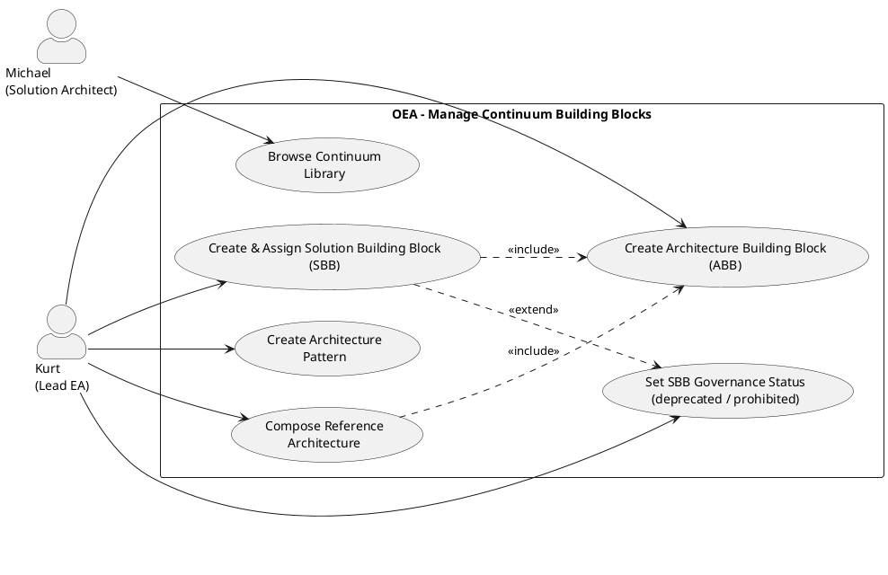

# UC-17: Manage Reusable Architecture Building Blocks

## Diagram

## Goal in Context

The TOGAF Enterprise Continuum separates reusable blueprints from concrete organizational instances. As Lead Enterprise Architect, Kurt must actively build and maintain these blueprints: Architecture Building Blocks (ABBs) specify what a component must deliver; Solution Building Blocks (SBBs) document which products fulfill these requirements; Architecture Patterns capture proven structural solutions; Reference Architectures combine building blocks into complete blueprints. This UC covers the entire lifecycle management of the continuum library.

## Persona and Story

**Primary Actor**: [Kurt – Lead Enterprise Architect](../../business-analysis/stakeholders/SH-03-kurt-lead-enterprise-architect.md)

**Other Stakeholders**: [Michael – Solution Architect](../../business-analysis/stakeholders/SH-04-michael-solution-architect.md) (consumes the building blocks when designing solutions)

**Story**: As a Lead Enterprise Architect, I want to document and maintain our organization-specific architecture building blocks and patterns so that solution architects can access a curated library and build new solutions on proven standards.

## Trigger

1. A new technology category is to be standardized → create ABB and evaluated SBBs
2. A proven pattern is to be documented for the whole organization → create architecture pattern
3. An industry-standard blueprint structure is to serve as a template for future plateaus → compose reference architecture
4. An SBB governance status changes (product EOL, security issue) → set SBB to `deprecated` or `prohibited`

## Preconditions

- [ ] Kurt is logged in (UC-01) and has the role "EA Manager" or a role with write permission on the continuum library
- [ ] For reference architectures: the referenced ABBs must already exist

## Postconditions

### On Success

- The new building block (ABB / SBB / pattern / reference architecture) is visible in the continuum library
- All referenced objects (e.g., `refines` ABB, `implements` ABBs) are linked correctly
- Scope protection is active: `imported` and `built-in` building blocks remain immutable

### On Failure

- No change; error message with a concrete hint

## Basic Flow

*Default case: Kurt creates a new organization-specific ABB and the associated SBB*

1. **Kurt**: opens the continuum library (navigation area "Enterprise Continuum")
2. **System**: shows the library divided into four areas: ABBs, SBBs, patterns, reference architectures; each with filters by `continuumLevel`, `maturityLevel`, `governanceStatus`
3. **Kurt**: clicks "New ABB" in the ABB area
4. **System**: opens the ABB form with fields: name, description, `continuumLevel`, `maturityLevel`, `governanceStatus`, specifications (Markdown), optional `refines` (dropdown of existing ABBs), optional `industry`
5. **Kurt**: fills in the form: name = "Enterprise IAM", `continuumLevel = organization`, `maturityLevel = established`, refines `common-systems` ABB "Identity Provider"
6. **System**: saves the ABB; shows the ABB in the refinement hierarchy under "Identity Provider"
7. **Kurt**: navigates to "New SBB"
8. **System**: opens the SBB form: name, vendor, version, description, `continuumLevel`, `maturityLevel`, `governanceStatus`, `evaluationNotes`, fields for `implements` ABBs (multi-select)
9. **Kurt**: fills in: name = "Keycloak", vendor = "Red Hat", version = "23.x", `governanceStatus = approved`, selects implemented ABBs: "Enterprise IAM" and "Identity Provider"
10. **System**: saves the SBB; shows it in the ABB detail view under "implementedBy"

## Alternative Flows

**A1 – Create architecture pattern**

1. **Kurt**: selects "New pattern" in the pattern area
2. **System**: opens the form with fields: name, problem (Markdown), solution (Markdown), applicability, consequences, `maturityLevel`, tags
3. **Kurt**: fills in the pattern (e.g., "Strangler Fig" for legacy replacement)
4. **Kurt**: links the pattern to existing patterns via "Related patterns" (multi-select)
5. **System**: saves; pattern is visible to all users in the library

**A2 – Compose reference architecture from ABBs and patterns**

1. **Kurt**: selects "New reference architecture"
2. **System**: opens the form; then multi-select for `composedOf` (ABBs) and `basedOnPatterns` (patterns)
3. **Kurt**: selects 5 ABBs and 2 patterns; sets `continuumLevel = organization`, `governanceStatus = approved`
4. **System**: saves; reference architecture appears as a blueprint for plateau creation (UC-11)

**A3 – Change SBB governance status (product EOL)**

1. **Kurt**: searches for the SBB "Oracle Database 11g" in the library
2. **Kurt**: opens the SBB and sets `governanceStatus = prohibited`, enters `evaluationNotes` (EOL October 2023, no more security updates)
3. **System**: saves; all entities with `instanceOfSBBId = Oracle-11g-UUID` receive a notice in the UI "Product used is prohibited; migration required"

**A4 – Edit ABB refinement hierarchy**

1. **Kurt**: edits an existing ABB
2. **Kurt**: changes the `refines` field (dropdown: only ABBs without cycle risk selectable)
3. **System**: checks cycle freedom (BR-03); on a cycle → HTTP 422 with notice

**A5 – Open `imported` building block (read-only)**

1. **Kurt**: opens an ABB imported from a continuum package (recognizable by the badge "Imported")
2. **System**: shows all fields read-only; edit and delete buttons not visible
3. **Kurt**: can read the building block and use it as a `refines` basis for own ABBs

## Exception Flows

**E1 – Cycle in ABB refinement**
- Condition: Kurt sets `refines` to an ABB that itself (directly or indirectly) refines this ABB
- Expected reaction: HTTP 422 "Refinement cycle detected: [ABB-A] → [ABB-B] → [ABB-A]"; no change
- Resumption: Kurt selects a different base ABB

**E2 – Deleting an ABB with dependent SBBs or entities**
- Condition: Kurt tries to delete an ABB that is referenced by SBBs or set as `conformsToABBId` by entities
- Expected reaction: Warning with the number of dependent SBBs and entities; no automatic blocking — Kurt decides
- Resumption: Kurt cleans up the references beforehand or deletes despite the warning

**E3 – SBB without ABB reference**
- Condition: Kurt saves an SBB without `implements` ABBs
- Expected reaction: Governance warning "An SBB without an ABB reference is only a product catalog entry"; no block
- Resumption: Kurt can add the ABB reference later

## Data Flow

| Step | Data | Direction |
|---|---|---|
| 4 | ABB form (name, continuumLevel, maturityLevel, governanceStatus, specifications, refines) | System → Kurt |
| 5–6 | Completed ABB form | Kurt → System |
| 8 | SBB form (name, vendor, version, governanceStatus, implements[]) | System → Kurt |
| 9–10 | Completed SBB form | Kurt → System |

## Involved Business Objects

| Business Object | Operation | Note |
|---|---|---|
| [architecture-building-block](../../business-objects/architecture-building-block.md) | create, read, update, delete | Core object; refinement hierarchy is checked |
| [solution-building-block](../../business-objects/solution-building-block.md) | create, read, update, delete | Governance status controls warning behavior on entity creation |
| [architecture-pattern](../../business-objects/architecture-pattern.md) | create, read, update, delete | Problem/solution format |
| [reference-architecture](../../business-objects/reference-architecture.md) | create, read, update, delete | Composition of ABBs + patterns |
| [person](../../business-objects/person.md) | read | `createdBy` reference |
| [role](../../business-objects/role.md) | read | Check write permission |

## Business Rules

| Rule ID | Statement | Trigger |
|---|---|---|
| BR-01 | `imported` and `built-in` building blocks of all types are read-only; no editing or deleting | onUpdate, onDelete |
| BR-02 | ABB refinement graph is acyclic (no direct or indirect cycle) | onABBCreate, onABBUpdate |
| BR-03 | SBB `governanceStatus=prohibited` generates a blocking warning on new entity creation (no hard block; decision lies with the architect) | onEntityCreate |
| BR-04 | Reference architecture `composedOf` list must not be empty (BR-03 from reference-architecture.md) | onCreate |

## Acceptance Criteria

- [ ] Create ABB: form with continuumLevel, maturityLevel, governanceStatus, refinement dropdown
- [ ] ABB refinement: cycle detection and 422 response
- [ ] Create SBB: multi-select for implemented ABBs; governance status selectable
- [ ] Set SBB governance status to `prohibited`: affected entities receive a notice
- [ ] Create pattern: problem/solution format; link related patterns
- [ ] Reference architecture: compose from ABBs and patterns; visible as a blueprint for plateau creation
- [ ] A5: `imported` building blocks recognizable as read-only with badge
- [ ] E2: Deleting with dependent references generates a warning, but does not block

## Out of Scope

- **Continuum package import**: UC-18
- **TRM configuration**: UC-19
- **Conformance analysis**: UC-20
- **Assignment of ABBs/SBBs to instance entities**: extension of the entity edit form (extension of UC-05/UC-06)
