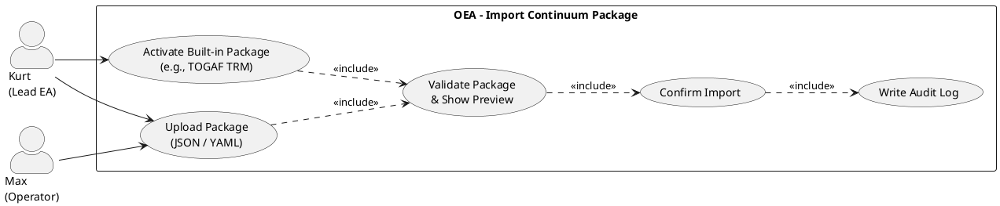

# UC-18: Import Continuum Package

## Diagram

## Goal in Context

OEA instances do not have to start from zero: the TOGAF Technical Reference Model, TM Forum Frameworx, industry-standard cloud design patterns (Azure, AWS) or internal corporate standards can be imported as prefabricated continuum packages. These imported building blocks are immutable (`scope=imported`) and form the stable foundation on which organization-specific extensions build.

ADR-002 decided: one repository, scope-based. Continuum packages are JSON/YAML files with ABBs, SBBs, patterns, reference architectures and TRM categories, which are loaded via the API.

## Persona and Story

**Primary Actor**: [Kurt – Lead Enterprise Architect](../../business-analysis/stakeholders/SH-03-kurt-lead-enterprise-architect.md)

**Other Stakeholders**: [Max – Operator](../../business-analysis/stakeholders/SH-06-max-operator-sme.md) (performs the import technically if applicable; Kurt decides on content)

**Story**: As a Lead Enterprise Architect, I want to load TOGAF and industry-specific architecture building blocks as a package into our OEA instance so that I can build our own standards on this validated foundation — without having to create each building block manually.

## Trigger

1. Initial setup of a new OEA instance: load TOGAF TRM as base package
2. A new industry-specific framework is introduced (e.g., TM Forum): import of the corresponding package
3. An OEA-internal standard package (built-in) is delivered with an OEA update and is to be activated

## Preconditions

- [ ] Kurt is logged in (UC-01) and has admin permission (equivalent to UC-02)
- [ ] The package is available as a JSON/YAML file or as a built-in package in OEA
- [ ] The package follows the OEA continuum package schema (validatable structure)

## Postconditions

### On Success

- All building blocks of the package are visible in the continuum library; `scope=imported`, `sourcePackage=<package name>`
- Imported building blocks are read-only (no editing, no deleting)
- Already existing building blocks with identical ID were not overwritten (conflict handling, see A1)
- Import log with number of newly imported, skipped and faulty entries

### On Failure

- No building block was imported (atomic import); error message with line reference and cause of error

## Basic Flow

*Default case: Kurt imports the TOGAF 10 TRM package*

1. **Kurt**: opens the continuum library, navigates to "Package import"
2. **System**: shows two options: "Built-in packages" (OEA standard, immediately activatable) and "Upload file" (own or external package)
3. **Kurt**: selects the entry "TOGAF 10 – Technical Reference Model" under "Built-in packages" and clicks "Preview"
4. **System**: shows a preview: number of ABBs (47), SBBs (0 — TRM contains only categories), patterns (12), reference architectures (3), TRM categories (38); below it a list of the main categories
5. **Kurt**: clicks "Import"
6. **System**: performs the import as an atomic transaction; all building blocks receive `scope=imported`, `sourcePackage="TOGAF 10 TRM"`
7. **System**: shows import log: "47 ABBs imported, 12 patterns imported, 38 TRM categories imported — 0 errors"
8. **Kurt**: checks the imported ABBs in the library; they appear with badge "Imported – TOGAF 10 TRM"

## Alternative Flows

**A1 – Conflicts on package update (newer version)**

1. **Kurt**: imports an updated version of a package that is already partially present
2. **System**: detects ID conflicts (building blocks with identical ID already present) and shows a conflict list: "12 entries already present — overwrite or skip?"
3. **Kurt**: selects: skip (default) or update (only for building blocks not changed organization-specifically)
4. **System**: imports only new building blocks; with "update", the conflicting entries are reset with `scope=imported`; organization-specific extensions are retained

**A2 – File upload (own package)**

1. **Kurt**: selects "Upload file" and uploads a `.json` or `.yaml` file
2. **System**: validates the package schema immediately after upload; on schema error: HTTP 422 with line reference
3. **Kurt**: sees preview and confirms the import
4. **System**: imports; `sourcePackage` = file name or name specified in the package

**A3 – Package deactivation (hide building blocks)**

1. **Kurt**: wants to hide an imported package (without deleting — references remain valid)
2. **System**: sets all building blocks of the package to "archived" (not visible in the library, but still referenceable via IDs)
3. **System**: shows warning: "N entities reference building blocks of this package; the references remain valid"

## Exception Flows

**E1 – Schema validation error**
- Condition: The uploaded package violates the OEA continuum package schema (missing mandatory field, wrong enum value)
- Expected reaction: HTTP 422 with error list (line, field, error description); no building block imported
- Resumption: Kurt corrects the file and uploads again

**E2 – Cycle in imported ABB refinement hierarchy**
- Condition: The package contains a cycle in the ABB `refines` graph
- Expected reaction: Import aborted; error message with cycle description
- Resumption: Contact package provider or correct the package manually

## Data Flow

| Step | Data | Direction |
|---|---|---|
| 3–4 | Package metadata, preview (counts, categories) | System → Kurt |
| 5 | Confirmation | Kurt → System |
| 6–7 | Import log (imported / skipped / faulty) | System → Kurt |

## Involved Business Objects

| Business Object | Operation | Note |
|---|---|---|
| [architecture-building-block](../../business-objects/architecture-building-block.md) | create (bulk) | scope=imported; read-only after import |
| [solution-building-block](../../business-objects/solution-building-block.md) | create (bulk) | scope=imported |
| [architecture-pattern](../../business-objects/architecture-pattern.md) | create (bulk) | scope=imported |
| [reference-architecture](../../business-objects/reference-architecture.md) | create (bulk) | scope=imported |
| [trm-category](../../business-objects/trm-category.md) | create (bulk) | scope=imported; hierarchy validation |
| [person](../../business-objects/person.md) | read | `importedBy` in the log |

## Business Rules

| Rule ID | Statement | Trigger |
|---|---|---|
| BR-01 | Import is atomic: either all valid building blocks are imported or none | onImport |
| BR-02 | Imported building blocks are read-only immediately after import (`scope=imported`); no subsequent change of the `scope` field possible | onImport |
| BR-03 | Cycle freedom in the ABB `refines` graph is checked before the import; a package with a cycle is rejected completely | onImport |
| BR-04 | Conflicts (ID already present) are not overwritten automatically; Kurt decides explicitly (A1) | onImport |

## Acceptance Criteria

- [ ] Built-in packages (OEA standard) are activatable without file upload
- [ ] Preview shows number and kind of building blocks to be imported before confirmation
- [ ] Atomic import: on schema error no building block imported; error list with line references
- [ ] Imported building blocks have `scope=imported` and are read-only (no editing/deleting in the UI)
- [ ] A1: Conflict handling shows list of conflicts; default = skip
- [ ] A2: File upload with schema validation before preview
- [ ] Import log after completion (imported / skipped / faulty)

## Out of Scope

- **Creating building blocks manually**: UC-17
- **Adjusting TRM-SBB assignments after import**: UC-19
- **Automatic update check for new package versions**: deferred v2.0
