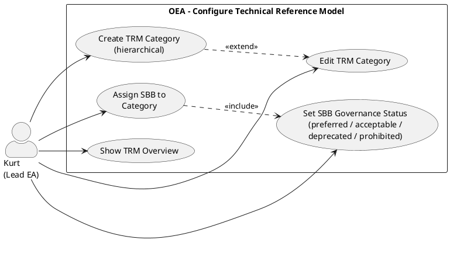

# UC-19: Configure Technical Reference Model

## Diagram

## Goal in Context

The Technical Reference Model (TRM) is an organization's technology taxonomy: a hierarchical classification of all technology service categories with clear standards on which products are preferred, accepted, being phased out or prohibited. A maintained TRM enables technology governance: architects see at a glance which products are permissible for a new entity, and deviations from the standard become visible automatically.

Kurt must build the TRM initially (possibly based on an imported TOGAF TRM package), add organization-specific categories and maintain the SBB governance assignments. This UC describes this configuration process.

## Persona and Story

**Primary Actor**: [Kurt – Lead Enterprise Architect](../../business-analysis/stakeholders/SH-03-kurt-lead-enterprise-architect.md)

**Story**: As a Lead Enterprise Architect, I want to maintain a clear technology taxonomy with binding standards (preferred / acceptable / deprecated / prohibited) per category so that solution architects always know what is organizationally permitted when selecting components — and deviations are automatically recognizable.

## Trigger

1. Initial setup: imported TOGAF TRM package is to be enriched with organization-specific SBB assignments
2. A new product has been evaluated → set SBB of a TRM category to `approved` or `acceptable`
3. A product is EOL → escalate SBB from `acceptable` to `deprecated` or `prohibited`
4. The organization opens up a new technology field → create new TRM category below an existing one

## Preconditions

- [ ] Kurt is logged in (UC-01) and has the role "EA Manager"
- [ ] The TRM contains at least one root category (possibly imported from UC-18 or created manually)

## Postconditions

### On Success

- TRM category is created / edited / SBB assignments updated
- `preferredStandard`, `acceptedAlternatives`, `deprecatedOptions` per category are set correctly
- `lastReviewedAt` is updated
- All entities whose `instanceOfSBBId` is affected by the change receive an updated governance notice in the UI

### On Failure

- No change; error message with a concrete hint

## Basic Flow

*Default case: Kurt enriches an imported TRM category with SBB standards*

1. **Kurt**: opens the TRM view in the navigation area "Enterprise Continuum → TRM"
2. **System**: shows the TRM as an expandable tree; imported nodes with badge "TOGAF 10"; own extensions without badge; each category shows: `preferredStandard` (or "—"), number of `acceptedAlternatives`, number of classified entities
3. **Kurt**: navigates to "Infrastructure Services → Data Management Services → Database Management"
4. **System**: shows the category detail view with current fields: no `preferredStandard` set, `acceptedAlternatives` empty, `deprecatedOptions` empty, `evaluationCriteria` empty, `lastReviewedAt` empty
5. **Kurt**: clicks "Edit"
6. **System**: opens the edit form with dropdowns for `preferredStandard` (single selection, only SBBs from the system), `acceptedAlternatives` (multi-select), `deprecatedOptions` (multi-select), free-text field `evaluationCriteria`
7. **Kurt**: selects `preferredStandard = SBB "PostgreSQL 17"`, adds `acceptedAlternatives = [SBB "MySQL 8.x"]`, `deprecatedOptions = [SBB "Oracle Database 11g"]`
8. **Kurt**: enters evaluation criteria: "Open source preferred; license costs < 10k/year; PostgreSQL compatibility required"
9. **Kurt**: clicks "Save" — `lastReviewedAt` is automatically set to today
10. **System**: saves; updates governance notices for all entities with `instanceOfSBBId = Oracle-11g-UUID` (deprecated) and all without SBB classification in this category (warning "no SBB set")

## Alternative Flows

**A1 – Create new TRM category below an existing one**

1. **Kurt**: opens an existing category (e.g., "Security Services") and clicks "Add subcategory"
2. **System**: opens the category form: name (mandatory), description, `evaluationCriteria`; `level` is automatically set = parent.level + 1
3. **Kurt**: enters name: "Zero Trust Network Access", clicks "Save"
4. **System**: inserts the new node into the hierarchy; `scope=organization`, no `sourcePackage`

**A2 – Reorganize TRM tree structure via drag & drop**

1. **Kurt**: drags an own (`scope=organization`) category via drag & drop under another node
2. **System**: checks: target must not be a descendant of the category being moved (BR-02); `level` is adjusted automatically
3. **System**: moves the node; `level` field of all affected descendants is updated

**A3 – Keep review date current**

1. **Kurt**: opens the TRM overview and activates the filter "Last reviewed > 12 months ago"
2. **System**: shows all TRM categories whose `lastReviewedAt` is more than 12 months ago or null
3. **Kurt**: opens each category, checks the SBB assignments and sets `lastReviewedAt` to today (also possible without content change)

## Exception Flows

**E1 – Cycle when moving a category**
- Condition: Kurt tries to move a category under one of its own descendants
- Expected reaction: Drop target visually marked as invalid; API attempt → HTTP 422
- Resumption: Kurt selects a different target

**E2 – Editing an `imported` category**
- Condition: Kurt opens a TRM category with `scope=imported`
- Expected reaction: Name and hierarchy read-only; only SBB assignments (`preferredStandard`, `acceptedAlternatives`, `deprecatedOptions`) and `evaluationCriteria` are editable (since these are organization-specific decisions)
- Resumption: Kurt can edit the SBB assignments despite `imported` scope

**E3 – Deleting a category with assigned entities**
- Condition: Kurt tries to delete a category to which entities are assigned (`classifiedEntities` not empty)
- Expected reaction: Warning "N entities are assigned to this category"; no automatic block
- Resumption: Kurt cleans up the assignments or deletes despite the warning

## Data Flow

| Step | Data | Direction |
|---|---|---|
| 2 | TRM tree (categories, SBB standard status, entity counts) | System → Kurt |
| 6 | Edit form (SBB dropdowns, evaluationCriteria) | System → Kurt |
| 7–9 | Completed form | Kurt → System |
| 10 | Updated governance notices for affected entities | System internal |

## Involved Business Objects

| Business Object | Operation | Note |
|---|---|---|
| [trm-category](../../business-objects/trm-category.md) | create, read, update, delete | Core object; SBB assignments and `lastReviewedAt` |
| [solution-building-block](../../business-objects/solution-building-block.md) | read | As selection options in the SBB dropdowns |
| [entity](../../business-objects/entity.md) | read | `trmClassificationIds` on entities; governance notices |
| [person](../../business-objects/person.md) | read | `createdBy` |
| [role](../../business-objects/role.md) | read | Check write permission |

## Business Rules

| Rule ID | Statement | Trigger |
|---|---|---|
| BR-01 | No cycle in the `parent` graph of the TRM categories | onTRMCreate, onTRMUpdate |
| BR-02 | `level = parent.level + 1` must be consistent | onTRMCreate, onTRMUpdate |
| BR-03 | An SBB must not be simultaneously `preferredStandard` AND in `acceptedAlternatives` AND in `deprecatedOptions` in the same category | onTRMUpdate |
| BR-04 | `imported` categories: hierarchy (name, parent) is read-only; SBB assignments and `evaluationCriteria` are editable | onTRMUpdate |
| BR-05 | `lastReviewedAt` is automatically set to `today` when the form is completed with Save | onTRMUpdate |

## Acceptance Criteria

- [ ] TRM tree as expandable hierarchy; imported nodes recognizable by badge
- [ ] Category detail view: `preferredStandard`, `acceptedAlternatives`, `deprecatedOptions`, `evaluationCriteria`, `lastReviewedAt`
- [ ] `imported` categories: name/hierarchy read-only; SBB assignments editable
- [ ] A1: Create subcategory; `level` set automatically
- [ ] A2: Drag & drop; cycle detection visually and via 422
- [ ] A3: Filter "Last reviewed > 12 months ago" available
- [ ] E1: Cycle when moving → drop target invalid; no save possible
- [ ] Change to SBB governance assignment updates notices on affected entities

## Out of Scope

- **Creating building blocks (ABBs, SBBs)**: UC-17
- **Package import**: UC-18
- **Technology conformance analysis**: UC-20
