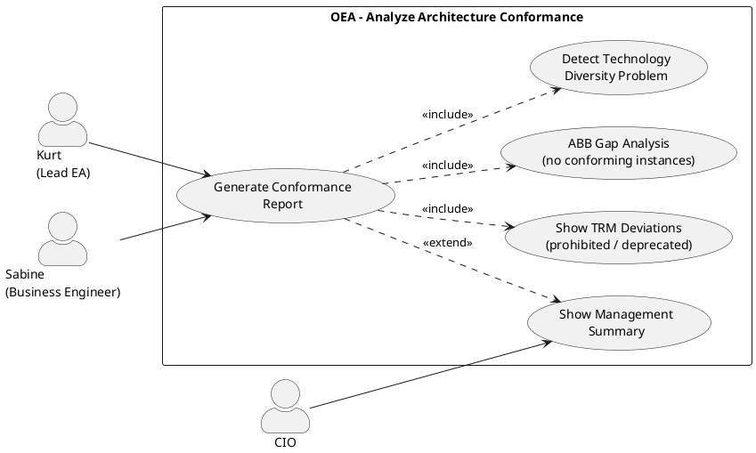

# UC-20: Analyze Architecture Conformance to the Continuum

## Diagram

## Goal in Context

A maintained Enterprise Continuum only has value if the actual architecture is regularly compared against it. Deviations must be visible: Which entities use prohibited products? Which ABBs have no conforming instances (gap)? Which TRM categories are populated with too many different products (technology diversity problem)?

UC-20 is a pure analysis UC — it changes no data, but makes conformance gaps and standards drift visible for Kurt and the CIO. The actual corrections take place in UC-05/06 (edit entity), UC-17 (adjust SBB governance) or UC-19 (update TRM).

## Persona and Story

**Primary Actor**: [Kurt – Lead Enterprise Architect](../../business-analysis/stakeholders/SH-03-kurt-lead-enterprise-architect.md)

**Other Stakeholders**:
- [CIO](../../business-analysis/stakeholders/SH-05-cio-corporate-group.md) (reads the conformance report as a management summary)
- [Sabine – Senior Business Engineer](../../business-analysis/stakeholders/SH-07-sabine-business-engineer.md) (uses the analysis for the standardization initiative)

**Story**: As a Lead Enterprise Architect, I want to see where our actual landscape deviates from the defined ABB standards, SBB governance rules and TRM specifications — so that I can derive targeted measures.

## Trigger

1. Regular architecture review date (quarterly)
2. A new product was set to `prohibited` → immediate check of how many entities are affected
3. Preparation of a technology standardization project

## Preconditions

- [ ] Kurt is logged in (UC-01) and has read permission on the repository
- [ ] The Enterprise Continuum (ABBs, SBBs, TRM) is configured (UC-17–19)
- [ ] At least some entities have `conformsToABBId`, `instanceOfSBBId` or `trmClassificationIds` set

## Postconditions

- No record was changed; the UC is purely read-only
- Kurt has a current overview of the conformance gaps and can derive measures

## Basic Flow

*Default case: Kurt opens the conformance dashboard and analyzes the current situation*

1. **Kurt**: opens the section "Continuum Conformance" in the EA dashboard
2. **System**: shows three analysis sections with summaries:

   **Section 1 – ABB Coverage**
   - Total ABBs: 52 (approved) / of which without conforming instance: 14 → gap rate 27%
   - Table: ABB name | continuumLevel | Conforming instances | SBBs present | Status
   
   **Section 2 – Standards Drift (SBB Governance)**
   - Entities with `instanceOfSBBId=prohibited`: 3
   - Entities with `instanceOfSBBId=deprecated`: 7
   - Entities without SBB reference, but TRM category set: 21
   - Table: Entity | Entity type | SBB used | Governance status | TRM category | Preferred standard

   **Section 3 – Technology Diversity (TRM)**
   - TRM categories with > 1 `approved` SBB: 4 → standardization potential
   - TRM categories without `preferredStandard`: 9
   - Table: TRM category | Number of SBBs used | Preferred standard | Entity count

3. **Kurt**: clicks "Entities with prohibited SBB" in section 2 (3 entries)
4. **System**: shows the 3 entities with details: name, entity type, SBB used ("Oracle Database 11g – prohibited"), TRM category, last changed by whom and when
5. **Kurt**: clicks an entity → jump to the entity detail view (UC-05)
6. **Kurt**: returns to the conformance dashboard and exports the report

## Alternative Flows

**A1 – ABB gap analysis in detail**

1. **Kurt**: expands an ABB in section 1 (e.g., "Message Broker")
2. **System**: shows:
   - Conforming instances: 0 (gap)
   - Implementing SBBs: [SBB "Apache Kafka 3.x" – approved], [SBB "RabbitMQ" – acceptable]
   - Notice: "No physical message broker classified in the landscape — possibly missing TRM assignment"
3. **Kurt**: clicks "Search entities" → shows all entities with entity type names that could semantically match (free-text search, no automatic match)

**A2 – Export report for CIO**

1. **Kurt**: clicks "Export report" → selects format (PDF, CSV)
2. **System**: generates a report with executive summary (gap rate, drift count, top 3 risks) and detail tables
3. **CIO**: receives the report via download or email link

**A3 – Derive technology diversity measure**

1. **Kurt**: opens a TRM category with 3 SBBs in use (e.g., "Container Orchestration": Kubernetes EKS, AKS, on-prem Kubernetes)
2. **System**: shows all entities with SBB references in this category; grouped by SBB
3. **Kurt**: recognizes: 2 entities use on-prem Kubernetes; planned migration to EKS → enters this insight as a basis for a new solution (UC-05)

**A4 – Filter by plateau or solution**

1. **Kurt**: activates the filter "Only entities in plateau P1 (Target 2027)"
2. **System**: shows conformance analysis filtered to entities of the selected plateau
3. **Kurt**: checks whether the planned target plateau is already standards-conformant

## Data Flow

| Step | Data | Direction | Remark |
|---|---|---|---|
| 2 | Conformance metrics and tables | System → Kurt | Read-only; no changes |
| 3–4 | Detail list of affected entities | System → Kurt | With jump link to the entity detail view |
| A2 | PDF/CSV report | System → Kurt | Executive summary + detail tables |

## Involved Business Objects

| Business Object | Operation | Note |
|---|---|---|
| [architecture-building-block](../../business-objects/architecture-building-block.md) | read | ABB gap analysis |
| [solution-building-block](../../business-objects/solution-building-block.md) | read | Governance status per SBB |
| [trm-category](../../business-objects/trm-category.md) | read | Technology diversity analysis |
| [entity](../../business-objects/entity.md) | read | `conformsToABBId`, `instanceOfSBBId`, `trmClassificationIds` |
| [person](../../business-objects/person.md) | read | `changedBy` in entity details |
| [role](../../business-objects/role.md) | read | Read permission |

## Business Rules

| Rule ID | Statement | Trigger |
|---|---|---|
| BR-01 | UC-20 is purely read-only — no write access to repository data | always |
| BR-02 | Conformance metrics are calculated on demand (no cached snapshot); exception: the export report may be cached (max. 1 hour) | onRead |

## Acceptance Criteria

- [ ] Three analysis sections: ABB coverage, standards drift, technology diversity
- [ ] ABB coverage: gap rate and table ABB × conforming instances × SBBs
- [ ] Standards drift: entities with prohibited/deprecated SBB clearly highlighted; jump link to the entity
- [ ] Technology diversity: TRM categories with entity counts and preferred standard
- [ ] A1: ABB gap drill-down shows implementing SBBs and notice about missing TRM classification
- [ ] A2: Export as PDF and CSV; with executive summary
- [ ] A4: Filter by plateau or solution
- [ ] Purely read-only UC: no data change possible

## Out of Scope

- **Corrections to entities** (changing SBB assignment, TRM classification): UC-05/UC-06
- **Changing SBB governance status**: UC-17
- **Adjusting TRM-SBB assignments**: UC-19
- **Automated conformance checks as a CI/CD gate**: deferred v2.0
