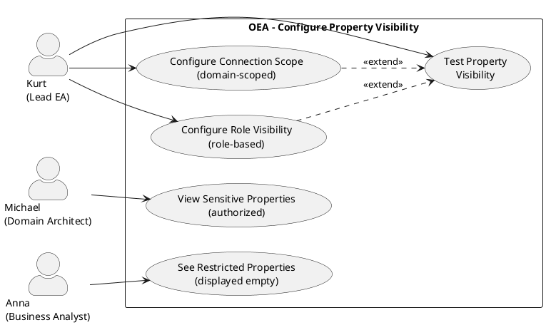

# UC-21: Configure Property Visibility

## Diagram

## Goal in Context

Not all properties of an entity may be visible to all users. Investment costs, contract terms or internal assessments are sensitive fields that should be accessible only to certain roles. In addition, a domain architect should see sensitive fields only for entities assigned to their domain — domain membership is ensured via connections in the graph. The visibility configuration takes place in the metamodel per `PropertyDefinition`, so that no code intervention is necessary.

## Persona and Story

**Primary Actor**: [Kurt – Lead Enterprise Architect](../../business-analysis/stakeholders/SH-03-kurt-lead-enterprise-architect.md)

**Other Stakeholders**:
- [Michael – Solution Architect](../../business-analysis/stakeholders/SH-04-michael-solution-architect.md) (Domain Architect, experiences the connection-based restriction)
- [Anna – Business Analyst](../../business-analysis/stakeholders/SH-08-anna-business-analyst.md) (sees restricted fields empty)

**Story**: As a Lead Enterprise Architect, I want to define per property in the metamodel who may see and edit the value — either role-based or depending on the entity's domain membership — so that sensitive data such as costs is not visible organization-wide.

## Trigger

1. A new property `investitionskostenPrognose` (EUR) is added to the metamodel → Kurt restricts visibility to the roles `EA-Manager` and `Budget-Owner`
2. The domain architect should see `sicherheitseinstufung` only for entities of their domain → Kurt configures `connection-scoped` with connection type `DomainAssignment`
3. A previously public field is to be restricted retroactively → Existing values are retained, but are displayed empty for unauthorized users

## Preconditions

- [ ] Kurt is logged in (UC-01) and has the role `EA-Manager` or a role with metamodel write permission
- [ ] The metamodel is not in `import-only` mode (REQ-035)
- [ ] For `connection-scoped`: the connection type used must be defined in the metamodel as `isConnection=true`

## Postconditions

**Success**:
- `PropertyDefinition.visibilityMode` is set; `allowedRoles` or `scopingConnectionType` correctly filled
- Unauthorized users see the field empty from now on and cannot edit it
- The change is recorded in the audit log (REQ-034)

**Failure**:
- Configuration invalid (e.g., empty `allowedRoles` with `role-restricted`) → error message; no saving

## Basic Flow

1. Kurt opens the metamodel editor (UC-04) and navigates to an EntityType (e.g., `ApplicationComponent`)
2. Kurt selects the property `investitionskostenPrognose` for editing
3. Kurt sets `visibilityMode = role-restricted` and selects the roles `EA-Manager`, `Budget-Owner` from the role list
4. Kurt saves — the system validates and persists the configuration
5. From now on, the entity API returns the value of this field only to users with the configured roles; all others receive `null` and the field is marked in the UI as empty and not editable

## Alternative Flow: connection-scoped

3a. Kurt sets `visibilityMode = connection-scoped` and selects the connection type `DomainAssignment` as `scopingConnectionType`
3b. At runtime the system checks: Does the requesting user have, via their domain membership (via `DomainAssignment` connection), a path in the graph to the requested entity?
3c. Yes → field visible; No → field empty and not editable

## Exception Flow

4a. Kurt sets `visibilityMode = role-restricted`, but leaves `allowedRoles` empty → system shows validation error: "At least one role must be selected"
4b. Admin users with the system role `system-admin` **always** receive read access to all properties, regardless of `visibilityMode` (REQ-128; configurable)

## Acceptance Criteria

- **AC1** (configuration): Kurt can set `visibilityMode` in the metamodel editor per PropertyDefinition; all three modes (`public`, `role-restricted`, `connection-scoped`) are selectable
- **AC2** (enforcement role-restricted): A user without a configured role sees the field empty and cannot edit it; no value in the API response
- **AC3** (enforcement connection-scoped): A domain architect sees the value only for entities reachable via the configured connection type; for all others the field remains empty
- **AC4** (admin override): A user with the `system-admin` role sees all properties regardless of `visibilityMode`; the override is configurable
- **AC5** (catalog consistency): In the catalog view (UC-06), restricted fields are also displayed empty for unauthorized users; sorting/filtering on restricted fields is disabled for these users

## Notes

- The value is filtered server-side — the frontend never receives the actual value for unauthorized users (`null` instead of the real value)
- `connection-scoped` requires a graph traversal at runtime; this has performance implications with deep graph structures (caching recommended)
- `visibilityMode` applies only to read and write access to the value, not to the existence of the field (the field itself is visible to everyone, but empty)
